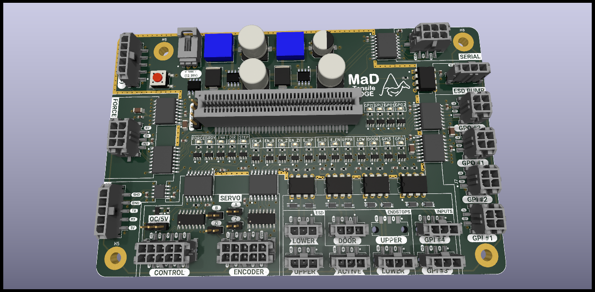

# MaD EdgeBoard

The **EdgeBoard** is the main controller PCB for the MaD tensile tester. It hosts
the **Parallax Propeller 2** microcontroller and carries all of the machine's I/O.

The current design is **revision v0.3** (2026-10). The revision is printed on the
silkscreen ("Rev v0.3", under the MaD logo) and in every title block. Boards made
from earlier files carry no revision text; the changelog below lists what differs.

## What's on the board

- **Propeller 2** module socket (the firmware in
  [`Firmware/MaDCore`](../../Firmware/MaDCore) runs here). The machine uses a
  **P2-EC32MB** module; see [P2 module pins](#p2-module-pins).
- **Servo drive interface** (J21): isolated STEP/DIR line drivers, enable, ready.
- **Encoder input** (J20): isolated quadrature receiver for the drive's encoder.
- **Endstops** and the **door interlock** / e-stop chain (J11-J18, current-loop
  inputs through optocouplers).
- **Host link: J1.** The control app talks to the P2 through a Parallax Prop Plug
  on J1 (P62/P63/RESn/GND, silkscreen `G|RES|RX|TX`, 2,000,000 baud). The carrier
  has no USB-to-serial chip of its own.
- **Raspberry Pi link** (J4, isolated through IC2), optional.
- Header for the [DS2 Addon](../DS2Addon/readme.md) force-gauge interface.

## Encoder input (J20) and its jumpers

U25 is a 5 V RS-422 receiver (AM26C32). Every channel has a header jumper that
ties its minus input to **ENC_REF**, a 2.5 V reference made from SC_5V by
R43/R44 (2.2 kΩ each) and decoupled by C31:

| Jumper | Ties | Channel | U25 pins | P2 pin |
|---|---|---|---|---|
| JP2 `A` | A- (J20.2) to ENC_REF | A | 2/1 | P9 |
| JP3 `B` | B- (J20.4) to ENC_REF | B | 6/7 | P10 |
| JP6 `Z` | Z- (J20.8) to ENC_REF | Z (index) | 14/15 | P12 |
| JP5 `ZI` | ZI- (J20.10) to ENC_REF | ZI | 10/9 | P11 |

R40/R41/R42 (2.2 kΩ) pull A+, B+ and Z+ up to SC_5V. ZI+ has no pull-up.

**Settings by encoder type** (the silkscreen between the jumpers reads
`OC: A B Z`, the three to fit for an open-collector encoder):

- **RS-422 line-driver encoder** (A/A-, B/B-, Z/Z-): leave **all four jumpers
  open**. Wire A±, B±, Z± (and ZI± if it has a second index) to J20, and its 0 V to
  J20.5. A shunt here would short the driver's minus output to ENC_REF, which ties
  all four minus legs together.
- **Single-ended NPN open-collector encoder** (A, B, Z; for example the Omron
  E6B2-CWZ6C and its clones, such as the Taiss on this machine): fit shunts on
  **JP2, JP3 and JP6**. Wire A to J20.1, B to J20.3, Z to J20.7, and the encoder 0 V
  to J20.5. Leave JP5 open.
  - The encoder must be a true open collector, with **no internal pull-up**. A
    "voltage output" NPN encoder pulls its outputs up to its own supply.
  - A, B and Z read **inverted** on P9/P10/P12. The output sinks while active, so
    the Z index pulse is **active-low** on P12 (inferred: the receiver output is
    low whenever the + input is below ENC_REF). Inverting both A and B keeps the
    count direction.
- **Single-ended push-pull 0/5 V (TTL) encoder:** as for open collector. The
  pull-ups are harmless. Fit JP5 too if a second index is wired to ZI+.
- **Not supported: any encoder whose outputs swing above 5 V.** That includes
  push-pull HTL outputs and voltage-output NPN outputs on a 12-24 V supply. The
  silkscreen under J25 reads `ENC OUT 5V MAX`.
  - U25's A/B inputs are rated -11 V to +14 V absolute maximum, with a ±7 V
    common-mode range (read: TI SLLS104M §5.1 and §5.3, p.4). A 24 V output
    exceeds that.
  - It also pushes current back into the drive's 5 V through the 2.2 kΩ
    pull-ups: (24 - 5) V / 2.2 kΩ = 8.6 mA per line (inferred).

**Encoder supply (J25, `VIN +V 0V`).** J20 has no supply pin; all ten pins are
used. The encoder side of the board has only SC_5V, which comes from the drive
through J21.1. J25 is a pass-through for an external supply:

- J25.1 `VIN`: the external supply, **at the voltage the encoder is rated for**.
  For example, the Taiss is reported to need at least 7 V, and a 5 V RS-422
  encoder needs 5 V.
  - VIN may be up to 30 V, F1's rating (read: LUTE 1206L datasheet, Revision 2020,
    p.2).
- J25.2 `+V`: to the encoder's V+, through F1 (PTC, 0.20 A hold).
- J25.3 `0V`: the supply 0 V, tied to the encoder ground (EN_GND).
- **Use a supply that is isolated from the carrier's V_IN.** J25.3 is EN_GND, the
  drive side of IC14/IC16. A supply shared with V_IN returns to the carrier's GND,
  which joins the two grounds and bypasses the isolators (inferred from the
  netlist: V_IN returns to GND).

The pin order keeps VIN and 0 V apart, so one stray shunt cannot short the supply.

**Load on the drive's 5 V (SC_5V, J21.1).** The carrier draws up to about 45 mA
from it (inferred: sum of datasheet maxima at 5.5 V). On top of that, U24 sources
whatever the drive's STEP/DIR inputs draw. Check the total against the drive's
5 V output rating; the repo does not record the drive model.

| Load | Max current | Source |
|---|---|---|
| U25 AM26C32 | 15 mA | SLLS104M §5.6, p.5 |
| IC16 side 1 | 8 mA | ISO6740 DC, SLLSFJ6G §7.10, p.13 |
| IC14 side 2 (ISO7741F) | 5.2 mA | SLLSEP4K §5.10, p.14 |
| U24 AM26LS31 (SO, no load) | 3 mA | SLLS114N, p.6 |
| R25 (SRDY pull-up, 1 kΩ) | 5.5 mA | while SRDY is low |
| R40-R42 (2.2 kΩ pull-ups), new in v0.3 | 7.5 mA | open-collector outputs all low |
| R43 + R44 (ENC_REF divider), new in v0.3 | 1.25 mA | |

## Loop inputs (J11-J18)

Each input is a current loop: the loop + pin feeds an NSI50010 10 mA regulator
(IC6-IC13) and an optocoupler LED.

**Supported loop supply: 5 V to 12 V (±5 %), up to 50 °C ambient.**

- **15 V and 24 V loops are not supported** on this board.
- A 5 V loop works: at 4.75 V it leaves at least 3.05 V across the regulator,
  against the 1.8 V it needs.
- The limit is a calculation, not yet a measurement. Bench-check it once (see
  [change 8](#8-loop-regulators-ic6-ic13-cathode-copper-and-a-supported-range)).

## P2 module pins

The P2-EC32MB brings P0-P39 and P58-P63 to its edge fingers. It does **not** bring
out P40-P57: fingers 55, 56, 59-67 and 69-77 are no-connects, and P40-P55 drive the
module's PSRAM.

Source: Parallax P2-EC32MB Rev B schematic, as transcribed in
`SIL/embsim/boards/netlists/p2_ec32mb.net`.

- **J24 (P40-P47, VIO_40_47) is dead** with an EC32MB. It only works with a plain
  P2-EC module.
- **J22 (P32-P39) works.** On v0.3, J22.3 (P32) also carries IC2's TX input; see
  change 6.
- P32 also reaches the module's J101, a 2-pad solder link to the TCXO option pin
  (read: `p2_ec32mb.net`). Leave J101 open.
- P38/P39 also drive the module's LED buffer.

## Ordering notes

- **J3 via-in-pad:** the P29/P30/P31 vias sit inside J3 pads 11/10/9 (0.3 mm
  drill). Order them **filled and capped** (IPC-4761 Type VII). The board's
  User.Drawings layer circles them and carries the same note below the outline.
  KiCad 9 has no per-via fill setting, so the order form must say it. All other
  vias are tented.
- **Shunts SH1-SH4** are BOM-only rows with no footprint and no CPL entry. Fit
  them by hand after assembly: JP1 always; JP2, JP3 and JP6 only for an
  open-collector encoder.
- **IC14 must be the F part.** On receipt, check that the top marking reads
  `ISO7741F` (read: SLLSEP4K package option addendum, p.38). LCSC's parametric
  text for C485810 says "Fail-safe output High Level", which contradicts TI.
- **Board thickness:** the stackup in `MaD_Edge.kicad_pcb` adds up to 4.69 mm
  (three 1.51 mm dielectrics). It predates v0.3. Order the real thickness, and
  check the STEP export against it.
- **J25 fit:** J25 sits between the J20 and J21 Micro-Fit headers, 0.045 mm from
  both courtyards (measured). Check that a 3-pin housing fits on J25 with both
  Micro-Fit receptacles mated before ordering.

## Revision v0.3 changelog

Each change cites the finding it fixes and the datasheet behind it. The findings
come from the SIL hardware review and from the review of this revision. Tags:
(measured) means checked on these files with KiCad 9.0.6; (read) gives a datasheet
section and page; (inferred) is a judgement.

### 1. IC14: default-low isolator and a pull-down on P6 (servo enable)

**Finding SRV-F6.** The drive enable must not float on while the P2 is in reset,
booting or being flashed. Neither the carrier nor the module pulls P6, and the
fitted IC14 (non-F) outputs high from an open or unpowered input.

- **IC14 is now an ISO7741FDWR** (LCSC C485810, confirmed as the F part).
  - Same pinout as before (read: TI SLLSEP4K Table 4-1, p.5).
  - The F suffix gives a **low** output when the input is open or side 1 is
    unpowered (read: SLLSEP4K Table 7-2, p.29).
- **R39, 10 kΩ from P6 to GND,** holds the enable request low until firmware drives
  P6.
  - On the PCB it sits by IC14 and joins the P6 trace at U29 through two vias.
  - Electrically it is the same net as IC14 pin 5 (inferred).
- With the F part, STEP and DIR (P8/P7) also rest low while the P2 is not driving
  them. Check the drive accepts this (inferred: a step input normally counts edges,
  not levels).
- **Bring-up checks** (not yet done):
  - Check the top marking (see [Ordering notes](#ordering-notes)).
  - With the drive powered, scope J21.7 (enable) while switching the carrier on.
    The outputs are undetermined while VCC1 is between 1.7 V and 2.25 V (read:
    SLLSEP4K Table 7-2 note 1, p.29), and R39 cannot cover that window. Record
    whether the enable glitches.

### 2. Q1: the fitted SOT-23 MMBT3904 pinout, and its base drive

**Finding SRV-F8-Q1.** Q1 was drawn as a TO-92 2N3904 (1 E, 2 B, 3 C), but the
fitted part is a SOT-23 MMBT3904 (1 B, 2 E, 3 C) (read: JSCJ MMBT3904 datasheet,
LCSC C20526, p.1). JP1's open-collector position therefore could never enable the
drive.

- The symbol is now `Transistor_BJT:MMBT3904` and the footprint `SOT-23`.
- The pads are re-netted: base to R24, emitter to EN_GND (new via), collector to
  JP1 pin 3.
- **R24 is now 4.7 kΩ** (was 43 kΩ; UNI-ROYAL 0603WAF4701T5E, LCSC C23162).
  - With 43 kΩ, IC14's OUTC gave Q1 about 77 µA of base current, which limits the
    open-collector enable to about 8 mA at hFE min 100 (read: SLLSEP4K §5.9 p.13,
    VOH ≥ 4.1 V; C20526 p.1, hFE).
  - 4.7 kΩ gives 0.7-1.0 mA. That keeps Q1 saturated at about 10 mA and in its
    active region up to about 70 mA (inferred: a forced gain of 10-14 at 10 mA,
    near the IC/IB = 10 at which the datasheet specifies VCE(sat); hFE min 100).
  - OUTC then sources at most 1 mA into the base, inside the -4 mA VOH test point
    (read: SLLSEP4K §5.9, p.13) and the ±15 mA absolute maximum (§5.1, p.6). In
    the `5V` position of JP1 that 1 mA adds to the drive's enable current.
  - The value is a judgement: the repo does not record the drive's enable-input
    current. Check it against the drive manual.

### 3. U25: a 5 V receiver and its own decoupling

**Finding ENC-F3.** The AM26LV32IDR is rated 3.0-3.6 V, but U25 runs from 5 V
(read: TI SLLS202H §6.3).

- **U25 is now an AM26C32IDR** (LCSC C36693).
  - Same pinout (read: TI SLLS104M Table 4-1, p.3).
  - VCC 4.5-5.5 V (read: §5.3, p.4).
  - VOH at least 3.8 V at -6 mA (read: §5.6, p.5), above IC16's 0.7 × VCC1 = 3.5 V
    input threshold at 5.0 V. At 5.5 V the threshold is 3.85 V, so meeting it then
    relies on IC16's input drawing only microamps (inferred).
  - The schematic keeps the AM26LV32xD symbol, since KiCad has no AM26C32 symbol
    and the pinout is identical.
  - Not an AM26LS32: its 2.7 V high is too low for IC16.
- **C30, 0.1 µF from U25.16 to EN_GND,** placed beside the pin.
  - It is 0402 (Samsung CL05B104KO5NNNC, LCSC C1525), the only size that fits
    between JP2 and U25 (measured: courtyard search).

### 4. U25 enables tied; the Z channel gets a receiver; JP4 removed

**Finding ENC-F5.** U25's G and ~G enables were wired to J20's Z+ and Z-, so they
needed a shunt on JP4 that the BOM did not list. The enable pins have no internal
pull (read: SLLS202H Fig 8-2).

- **G (pin 4) now goes to SC_5V and ~G (pin 12) to EN_GND,** so U25 is always
  enabled (read: SLLS104M Table 7-1, p.9).
- **Z+/Z- (J20.7/.8) now go to 4A/4B (pins 14/15).** Output 4Y goes through IC16
  channel D to P12.
- **JP4 is deleted.**

### 5. Encoder front end: a reference, not ground; pull-ups; supply pass-through

**Findings ENC-F4a and ENC-F4b.** With a minus input grounded, a 0-5 V
single-ended signal never reaches the -0.2 V differential low threshold. The Taiss
NPN open-collector encoder also had no pull-up and no supply.

- **JP2/JP3/JP5 now tie A-/B-/ZI- to ENC_REF instead of EN_GND.** Their values are
  now A_REF, B_REF and ZI_REF.
- **JP6 (Z_REF) is new.** It is the Z- reference jumper, placed where JP4 was.
- **ENC_REF = SC_5V/2,** from R43/R44 (2.2 kΩ) and C31 (0.1 µF).
  - A single-ended 0-5 V input then swings about ±2.5 V around the reference.
  - The receiver needs only ±0.2 V (read: SLLS104M §5.6, p.5).
  - Input resistance is at least 12 kΩ per input (read: ibid.). With all four
    reference jumpers fitted, the worst-case loading moves ENC_REF to about
    1.8-3.2 V. That still leaves more than 1 V of margin (inferred, worst-case
    divider arithmetic).
- **R40/R41/R42 (2.2 kΩ to SC_5V) pull A+, B+ and Z+ up.**
  - The E6B2-CWZ6C open-collector output sinks up to 35 mA with 0.4 V residual
    (read: Omron E6B2-C datasheet, Ratings/Characteristics).
  - A 2.2 kΩ pull-up draws 2.3 mA.
  - An RS-422 driver handles the extra 2.3 mA (inferred).
- **J25 + F1** form the encoder supply pass-through.
  - The decision, its limits and its reasons are in
    [Encoder input](#encoder-input-j20-and-its-jumpers): outputs no higher than
    5 V, VIN at the encoder's own rating, and a supply isolated from V_IN.
  - F1 is a LUTE 1206L020/30NR (LCSC C7542932, measured: LCSC product detail):
    0.20 A hold, 0.46 A trip, 30 V, R1max 2.7 Ω (read: LUTE 1206L datasheet,
    Revision 2020, p.2).
  - Its hold current is 0.12 A at 70 °C (read: ibid., p.6), above the 80 mA
    maximum of an E6B2-CWZ6C (read: Omron E6B2-C datasheet).
  - J25 is a 1×3 2.54 mm header, the same part as JP1.
- **The BOM now names the shunts.** SH1-SH4 are BOM-only rows (no footprint): one
  2.54 mm shunt each for JP1 (always fitted) and for JP2/JP3/JP6 (open-collector
  encoder only). The part is HCTL HC-JP254-1-65-CL-B-G0, LCSC C5380290.
- **New load on SC_5V:** up to 8.75 mA from R40-R44. The full budget is in
  [Encoder input](#encoder-input-j20-and-its-jumpers).

### 6. Pi link (IC2/J4): module pins that exist, and a 3.3 V Pi side

**Findings HOST-F2 and HOST-F5.**

**The pin problem:**

- IC2 sat on P52-P55, which the P2-EC32MB does not bring out (see
  [P2 module pins](#p2-module-pins)).
- Of the pins the EC32MB does bring out, only **P29, P30 and P31 are unused on the
  carrier** (measured: the v0.2 netlist and `p2_ec32mb.net`).
- Every other brought-out pin already goes to a circuit or to J22.
- IC2 has four channels, so the fourth uses **P32**, which J22.3 shares.

**The new mapping:**

| IC2 pin | Channel | Was | Now | J4 pin |
|---|---|---|---|---|
| 3 INA | P2 TX to Pi | P55 | **P32** (J3 finger 8, J22.3) | J4.2 RPI_TX |
| 4 INB | GPO to Pi | P54 | **P31** (finger 9) | J4.4 RPI_GPO |
| 5 OUTC | Pi TX to P2 RX | P53 | **P30** (finger 10) | J4.3 RPI_RX |
| 6 OUTD | GPI from Pi | P52 | **P29** (finger 11) | J4.5 RPI_GPI |

- **Why P32 carries an isolator input:** sharing a pin with an input is harmless.
  An ISO674x input draws at most 10 µA (read: SLLSFJ6G, p.12), so J22.3 still works
  as P32 (inferred).
- **Why not P33,** which reaches only J22 and would avoid the J101 note: moving
  INA there means another firmware and SIL re-pin for one solder link that is open
  unless someone bridges it (read: `p2_ec32mb.net`, J101 "2-pad solder link").
  This is a judgement; it can still move.
- **Via-in-pad:** J3 fingers 9-11 have no copper access other than a via in the
  pad. J22 sits 0.3 mm above them and a bus runs 0.4 mm below.
  - The three 0.5/0.3 mm vias sit inside those pads (measured).
  - They must be filled and capped; see [Ordering notes](#ordering-notes).

**The Pi side:**

- **The Pi side now runs from the Pi's 3.3 V.** RPI_5V is renamed RPI_3V3,
  including the In2 plane under J4, and the J4.1 silkscreen reads `3V3`.
  - ISO674x VCC2 range: 2.25-5.5 V (read: SLLSFJ6G §6.3, p.8).
  - Input threshold: 0.7 × VCC (read: p.12). At 3.3 V the Pi's 3.3 V TX meets it.
  - The outputs swing to 3.3 V, so a Pi GPIO never sees 5 V.
  - The `RPI_3V3` netclass pattern follows the rename (it stays in Power).
- **IC2 is the non-F ISO6742DWR (default high).** A default-low output would hold
  a UART line low, which reads as a break (read: SLLSFJ6G Table 9-2, p.31).
  - Its LCSC number was C2862403, which is the **ISO7742FDWR** (F, default low)
    (measured: LCSC product detail). Assembly would have fitted the F part. It is
    now **C5216407, the ISO6742DWR** (measured: LCSC product detail).
  - IC1 shared that LCSC number, so it changes too and drops its ISO7742FDWR
    alternate. Boards built from earlier files most likely carry the F part on
    IC1 (inferred from the BOM). Its outputs to J5/J6 (IGPO1/2) idle **high** with
    the non-F part while P26/P27 are undriven. The firmware does not use P24-P27
    (measured: no `HW_pins.h` entry).

### 7. J4 footprint restored

**Finding HOST-J4.** J4's footprint had lost its 43045-0618 mounting pads.

- J4 is back on `Molex_Micro-Fit_3.0_43045-0618_2x03-1MP_P3.00mm_Vertical`.
- Its two mounting tabs are numbered MP (not pin 7), as in 2023, and carry no net.
- The left tab is 0.525 mm from the nearest other copper, an RPI_GPO via
  (measured); DRC reports no clearance item.
- The DRC parity note "No pad found for pin 7 (SHIELD)" is the same as on v0.2.

### 8. Loop regulators IC6-IC13: cathode copper and a supported range

**Finding REST-F7d.** On 24 V loops the NSI50010s run over their power rating on
almost no copper.

**The rating** (read: onsemi NSI50010Y/D Rev 3, p.3):

- 208 mW at 25 °C on 100 mm² of 1 oz copper, derate 1.66 mW/°C (RθJA 600 °C/W).
- 347 mW on 300 mm², derate 2.8 mW/°C; 436 mW on 500 mm², derate 3.5 mW/°C.
- RψJL (junction to cathode lead) 196 °C/W on the 100 mm² board.
- Current: Ireg 7-13 mA (read: p.2).

**What v0.3 adds** for each part (measured: zone fill):

- **On F.Cu, a pour around the cathode pad**, so the lead sits in copper rather
  than on a trace: 12-23 mm².
- **The same cathode pour on B.Cu, In1 and In2**: 134-227 mm² on each layer.
  In1 and In2 were empty there.
- **Six 0.6/0.3 mm vias** join the layers (five on IC11, where a sixth would fall
  outside its pour).
- Copper per cathode net totals 422-696 mm² over the four layers. v0.2 had only the
  pads and a short trace, about 5 mm² per part.
- The pours use thermal reliefs on the U5-U8 through-hole pins and stay solid on
  the SMD pads and vias.
- Measured fill to fill, the inner pours are 5.8 mm from the GND/+3.3V planes,
  2.25 mm from EN_GND/SC_5V and 3.9 mm from GND_IO/5V_IO.

**Why not a series resistor:** a resistor cannot also keep 5 V loops working.

- At 5 V the regulator has 5 - 1.7 V (VO2631 LED VF max; read: Vishay 84732
  Rev 2.3, p.3) = 3.3 V.
- It needs 1.8 V for 80 % of its current (read: NSI50010Y/D p.2). That leaves at
  most about 1.5 V for a resistor, about 115 Ω at 13 mA.
- At 24 V that resistor removes only about 20 mW.
- The opto needs at least 5 mA (I_TH max; read: Vishay 84732 Rev 2.3, p.3).
- 24 V loops would need a per-loop 1.5-2 kΩ resistor with a solder-jumper bypass
  for 5 V loops. That is a layout change not made here.

**Supported range.** The worst-case loop power is (V_loop × 1.05 - 1.1 V) × 13 mA.

- 1.1 V is the LED's minimum VF at 10 mA (read: Vishay 84732 Rev 2.0, p.3). Rev 2.3
  gives no minimum, so this is a judgement.
- The copper is credited only as the datasheet's 100 mm² case. It is spread over
  four layers behind vias, so a better case is not proven (inferred).
- The supported limit keeps 10 °C below the computed maximum, to cover the via
  path (inferred).

| Loop supply (+5 %) | Worst-case power | Max ambient on the 100 mm² rating | Verdict |
|---|---|---|---|
| 12 V (12.6 V) | 150 mW | 60 °C | Supported up to 50 °C |
| 15 V (15.75 V) | 190 mW | 35 °C | Not supported |
| 24 V (25.2 V) | 313 mW | over 208 mW at 25 °C | Not supported |

**Bench check (not yet done).** Run a 12.6 V loop on IC6-IC13 for 30 minutes.
Measure each cathode lead with an IR thermometer at emissivity 0.9 on a treated
surface (read: NSI50010Y/D p.3 note).

- Pass: each lead rises no more than 70 °C above ambient (inferred:
  150 °C - 50 °C - 196 °C/W × 0.15 W).
- Record the result here.

### 9. Revision marking and silkscreen

- Title blocks on all three sheets and on the PCB read v0.3.
- The silkscreen reads "Rev v0.3" under the logo.
- The SERVO label moved up 2.2 mm to clear R43/R44/C31.
- New silkscreen:
  - `VIN +V 0V` at J25, and `ENC OUT 5V MAX` under it.
  - `OC: A B Z` between the encoder jumpers.
  - `3V3` at J4.1.
- Q1's reference is shown again (0.8 mm, between Q1 and R24).
- None of the v0.3 silkscreen overlaps a footprint outline or a pad (measured:
  DRC with the silk rules switched on in a scratch copy).

### 10. BOM fields

- The 0.1 µF 0603 row (22 parts) ordered LCSC C14663, the YAGEO
  CC0603KRX7R9BB104, 50 V X7R 0603 (measured: LCSC product detail).
  - Its MPN field named a Samsung 0402 part (CL05A104KA5NNNC) and its description
    said 6 V. Both now match the ordered part.
  - The DigiKey number that went with the Samsung MPN is cleared; it could not be
    checked.
- F1, SH1-SH4 and IC14 field changes are covered in changes 5 and 1.

### Not changed in v0.3 (still open)

- IC16's Value, MPN and LCSC fields still name three different parts (IC16-BOM).
- The J14/J16 Value fields are still swapped relative to the nets (REST-F7c).
- DS2 GPIO0-2 are not tied (REST-F9i).
- U24 3A/4A are open (good practice only).
- 24 V loop inputs (see change 8).

### Firmware and SIL follow-up

Done in the same PR (commit 94ed68d):

- `Firmware/MaDCore/src/HAL/Include/HW_pins.h`: `HW_PIN_RPI_TX` 55 → **32** and
  `HW_PIN_RPI_RX` 53 → **30**, with the SIL's host pins to match.

Still to do:

- `HW_pins.h`:
  - New: GPO on P31, GPI on P29.
  - The index channel on this board is P12 (Z, channel 4) and P11 (ZI, channel 3).
    The firmware names them the other way round.
- `SIL/mad-catalog/netlists/mad_edge.net` needs a re-export from these files,
  together with embsim's `mad_edge` fixture. This changes:
  - JP4 removed, JP6 added.
  - Q1 pin order, and R24 = 4.7 kΩ.
  - U25 enables and channel 4.
  - The ENC_REF network.
  - IC2 on P29-P32.
  - The SC_5V loads.
- SIL tests that assume a JP4 shunt, or Q1 in TO-92 order, need updating.

## Working with the design

This is a [KiCad](https://www.kicad.org/) 9 project. Open the `.kicad_pro` in this
folder to view or edit the schematic and layout. Use KiCad 9: KiCad 10 rewrites
the files and renames pins.

Manufacturing outputs (Gerbers, BOM, interactive BOM, 3D models) are generated by
the hardware CI job (KiBot) and published on `hardware-v*` release tags. See the
[CI/CD docs](https://rileymccarthy.github.io/MaD/dev/ci-cd-and-releases/).

## Documentation

For how the board fits into the wider system, see the
[Hardware overview](https://rileymccarthy.github.io/MaD/how-it-works/hardware/) on
the documentation site.
