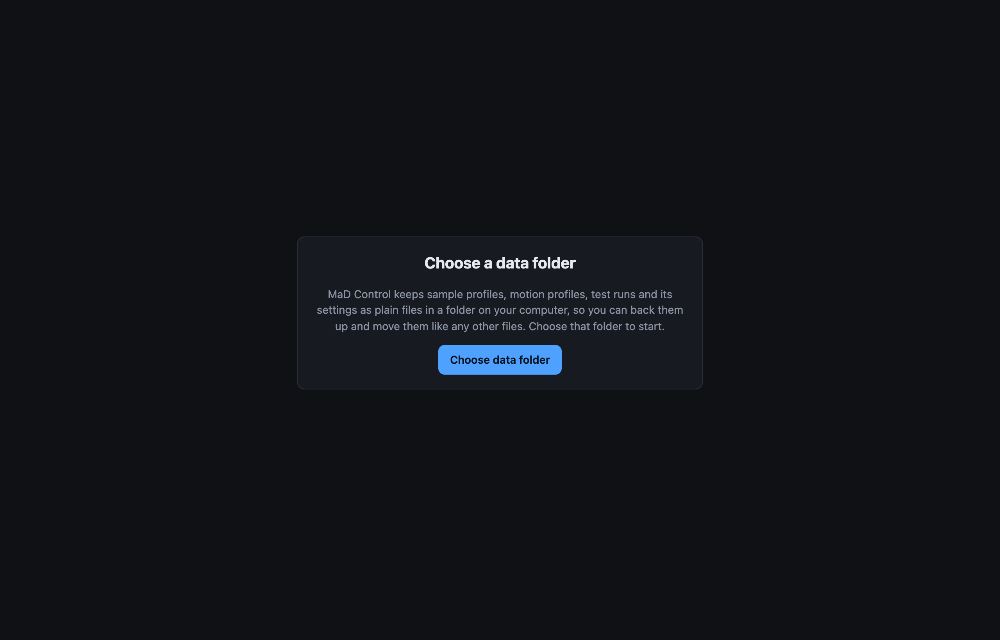
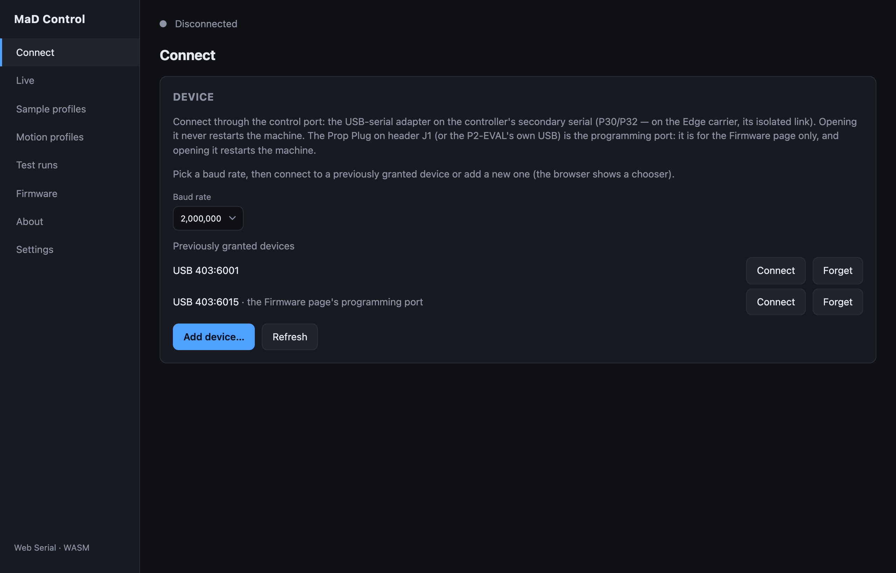
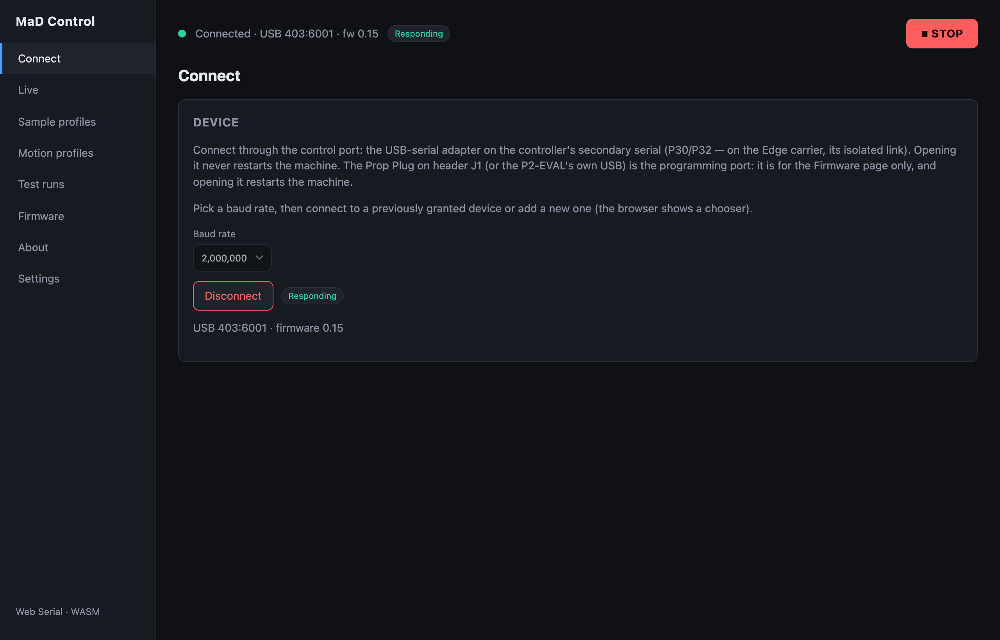

# Power up and connect

## 1. Power the machine on

1. Turn on the **mains inlet** switch.
2. Press the momentary **ON** button.
3. Release the **emergency stop**.

Why it is staged is in the
[theory of operation](../how-it-works/the-machine.md#power-up-sequence).

## 2. Open the app and choose a data folder

In **Chrome or Edge**, open
**<https://rileymccarthy.github.io/MaD/app/>**.

The first time, the app asks where to keep your data. Click **Choose data
folder** and pick (or create) a folder. Profiles, test runs and settings are
saved there as plain files. You only do this once.

## 3. Connect on the control port

Open **Connect**. Leave the baud rate at **2,000,000** and click **Connect
device** (it reads **Add device…** once the browser remembers a port). The
browser shows its serial port chooser: pick the **control port** adapter.

Ports you have used before are listed under **Previously granted devices**:
click **Connect** beside the control port. The port the Firmware page programs
through is labelled *the Firmware page's programming port* so you don't pick it
by mistake.

When the link is up the status bar turns green, and **Responding** appears once
the firmware is answering:

| Status bar | Meaning |
|---|---|
| **Connected** + **Responding** | The port is open and the firmware is answering. You're done. |
| **Connected** + **Not responding** | The port is open but nothing is answering. On a new board this is expected: it has no firmware yet, so [flash it](flashing-firmware.md). Otherwise see [Connection problems](../troubleshooting/connection.md#connected-but-not-responding). |
| A banner under the status bar | The firmware and the app don't match. See [Flash the firmware](flashing-firmware.md). |

## The two ports

The controller has two serial ports with separate jobs.

| | Control port | Programming port |
|---|---|---|
| **Where** | Secondary serial, P30/P32: **J4** on the Edge carrier | **J1** (Prop Plug), or the P2-EVAL's own USB |
| **Used by** | The **Connect** screen | The **Firmware** screen only |
| **Opening it** | Never restarts the machine | **Restarts the machine**: the adapter's DTR line drives reset |
| **Carries** | The MaD protocol | The boot loader, and the firmware's debug log |

Because opening the control port never resets the controller, connecting,
refreshing the page and reconnecting are all safe while a test is running.

The firmware does not answer the app on J1. If you connect there, the machine
restarts and the app shows **Not responding**.

## Disconnecting and reconnecting

- **Disconnect** closes the port. The machine carries on with whatever it was
  doing.
- If the link drops (cable pulled, machine power-cycled), the status bar shows
  **Disconnected** with a **Reconnect** button, and the app reconnects by
  itself when the adapter comes back.

    

- If the control adapter and the Prop Plug have the same USB id, the app won't
  guess between them (one of them restarts the machine): pick the control port
  on the Connect screen.

Next: [Flash the firmware](flashing-firmware.md).
