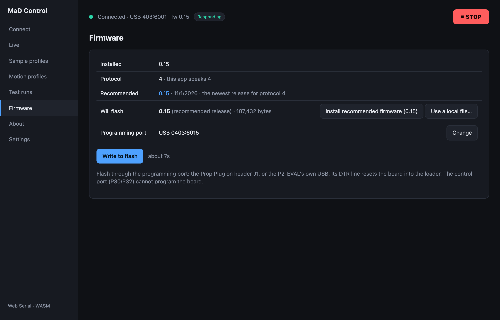
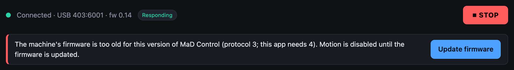
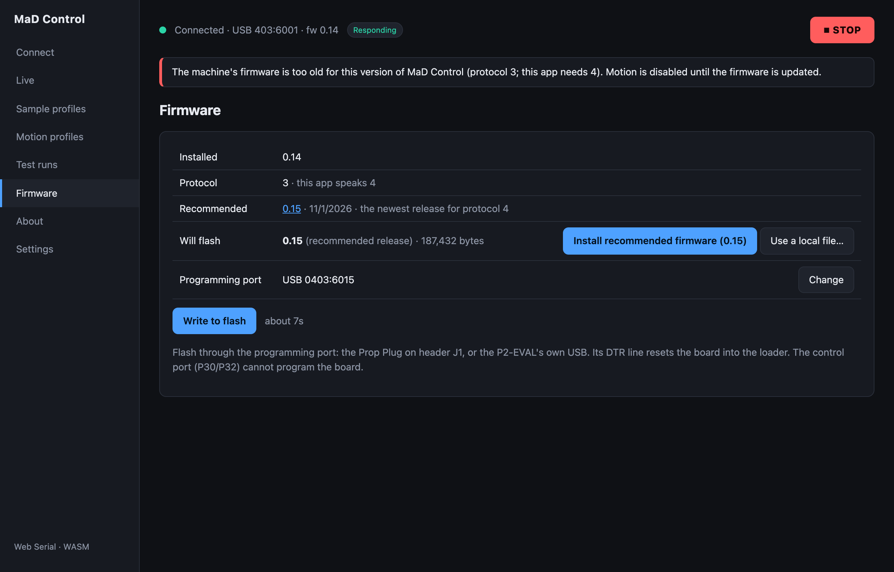
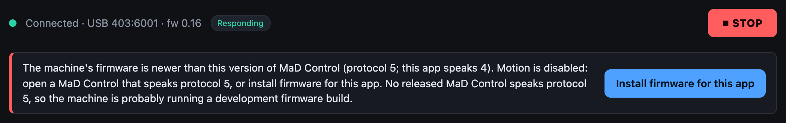

# Flash the firmware

The app programs the controller straight from the browser. You need to do this
on a new board, and whenever the app says the firmware doesn't match.

## Do you need to?

Open **Firmware**. With a machine connected it shows what is installed next to
what the app recommends:

| Row | What it tells you |
|---|---|
| **Installed** | The firmware version the machine reports |
| **Protocol** | The protocol version the firmware speaks, next to the one this app speaks. They must be equal. |
| **Recommended** | The newest firmware release that speaks this app's protocol |
| **Will flash** | What the next flash would write: the recommended release, or a local file you picked |
| **Programming port** | The serial port the flash goes through |

Flash if any of these is true:

- The status bar says **Connected** but never **Responding** (a board with no
  firmware).
- A banner under the status bar asks for an update. While it is red, the app
  will not move the machine:

    

- **Installed** is older than **Recommended**.

If **Installed** equals **Recommended** and there is no banner, skip to
[Configure and calibrate](machine-setup.md).

## Flash it

1. Plug the **Prop Plug into J1** (or the P2-EVAL's USB). This is the
   programming port; the control port cannot program the board. Leave the
   control port connected.
2. On **Firmware**, check **Programming port** names the Prop Plug. If it
   says *No serial device yet* or *Several serial devices*, click **Choose
   port** / **Change** and pick it. The choice is remembered.
3. Click **Install recommended firmware**. The browser asks you to confirm the
   file (`MaD-Firmware-<version>.bin`) and the port. Check both, then confirm.

    

4. Wait. The status line under the button goes through:

    | Status | What is happening |
    |---|---|
    | *Downloading MaD-Firmware-….bin…* | The app fetches the release |
    | *Resetting the board…* | The control session is stopped and the Prop Plug resets the controller into its boot loader |
    | *Uploading… n%* | The image is sent to the controller |
    | *Writing flash… about n s. Do not disconnect or reset the board.* | The controller writes it to its SPI flash |
    | *Wrote n bytes to flash. The board has rebooted into the new firmware.* | Done |

5. The app reconnects on the **control port** and checks the firmware again.
   The banner clears, and **Installed** shows the new version.

The whole thing takes well under a minute. The estimate is shown next to
**Write to flash** before you start.

!!! warning "Don't unplug during *Writing flash*"
    The write happens on the controller after the upload finishes. Cutting
    power or resetting during it leaves a partial image. If that happens, flash
    again: the boot loader is in ROM and is always reachable through J1.

## Flashing a local build

To flash something other than the recommended release, click **Use a local
file…**, pick the image, then **Write to flash**. **Will flash** shows the file
name with *(local file)* so you can see what is about to be written.

## When the app is the one out of date

If the banner says the firmware is **newer** than this version of MaD Control,
the banner names the way out. When a released app speaks the firmware's
protocol, click **Open MaD Control X.Y.Z**. When none does (a development
firmware build), click **Install firmware for this app** and flash the
recommended release:

[Firmware problems](../troubleshooting/firmware.md#the-machines-firmware-is-newer-than-this-version-of-mad-control)
covers each case.

## If it fails

See [Firmware problems](../troubleshooting/firmware.md#flashing-fails).

Next: [Configure and calibrate](machine-setup.md).
