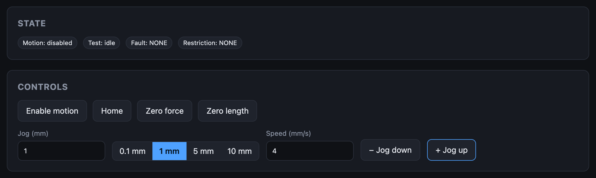

# Getting Started

Setting up a MaD machine takes five steps. Do them in order the first time;
after that, day-to-day use is just steps 2 and 5.

| | Step | What you do | How long |
|---|---|---|---|
| 1 | [What you need](requirements.md) | A Chromium browser, two USB serial adapters, a folder for your data | — |
| 2 | [Power up and connect](connect.md) | Open the app, choose the data folder, connect on the control port | 2 min |
| 3 | [Flash the firmware](flashing-firmware.md) | Install the recommended firmware through the programming port | 2 min |
| 4 | [Configure and calibrate](machine-setup.md) | Enter the machine's mechanics, check the motor, calibrate the load cell | 20 min, once per machine |
| 5 | [Run your first test](operators.md) | Jog, zero, build profiles, run, review | 10 min |

[:rocket: Open MaD Control](https://rileymccarthy.github.io/MaD/app/){ .md-button .md-button--primary }

## What a working setup looks like

When everything is right, the status bar is green, says **Responding**, and
there is no banner under it:

and the **Live** screen shows `Fault: NONE` and `Restriction: NONE`, with
**Enable motion** available:

If yours looks different, [Troubleshooting](../troubleshooting/index.md) is
organised by what you see on screen.

## Just exploring?

You can open the app and click through every screen without a machine. Live
data, calibration and tests need a machine connected.

## Building from source

To build the firmware, run the app from source or run the simulation rig, see
the [Developer guide](../dev/index.md).
