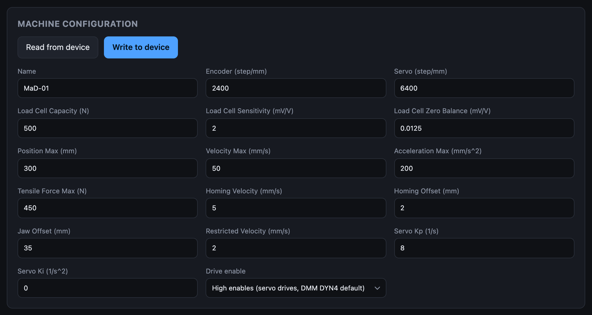
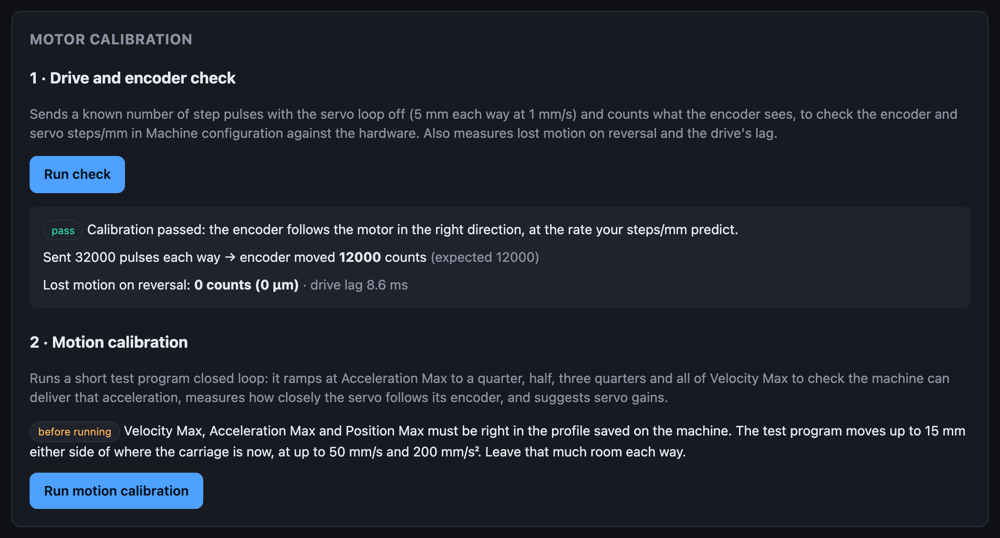
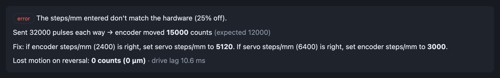
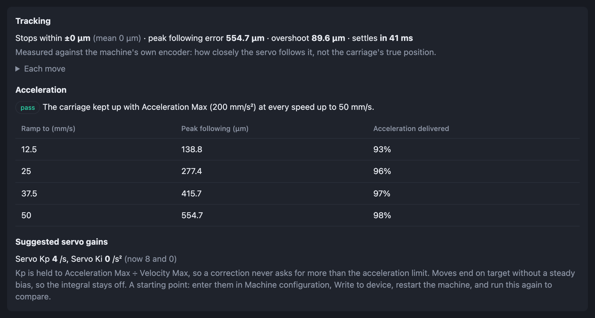
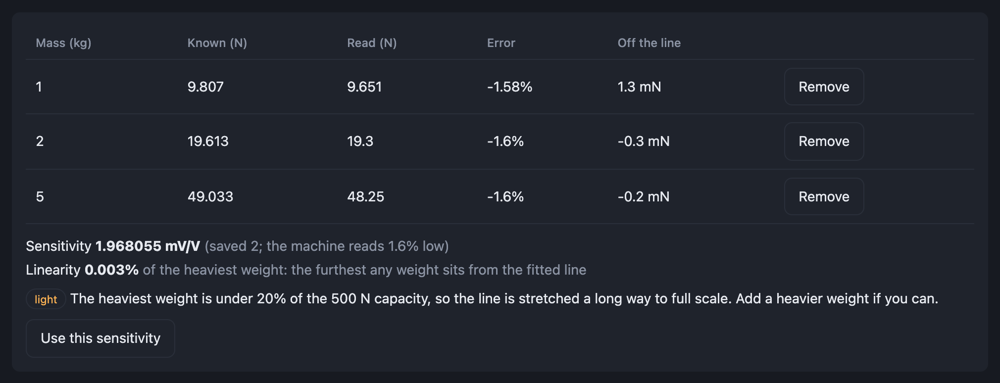

# Configure and calibrate

A machine needs this once, and again whenever its mechanics, drive or load cell
change. Everything here is on the **Settings** screen, with the machine
connected.

The order matters: the motor calibration moves the carriage using the limits
you enter in step 1, and the load cell calibration uses the capacity and
sensitivity you enter there.

!!! info "Settings take effect after a restart"
    The machine reads its configuration when it starts. After **Write to
    device**, **power-cycle the machine** before relying on the new values.
    Reconnecting the app does not restart it.

## 1. Enter the machine configuration

Under **Machine configuration**, the values load from the machine. Fill them in
from your hardware's datasheets, then click **Write to device** and power-cycle.

The ones that must be right before anything moves:

| Field | Where the value comes from |
|---|---|
| **Encoder (step/mm)** | Encoder counts per revolution ÷ millimetres of travel per revolution |
| **Servo (step/mm)** | Drive pulses per revolution ÷ millimetres of travel per revolution |
| **Position Max (mm)** | The carriage's usable travel |
| **Velocity Max (mm/s)**, **Acceleration Max (mm/s²)** | Start conservative; the motion calibration tells you if the machine can deliver them |
| **Tensile Force Max (N)** | The lowest rated part in the load path (usually the load cell) |
| **Load Cell Capacity (N)**, **Load Cell Sensitivity (mV/V)** | The load cell's datasheet |
| **Drive enable** | **High enables** for servo drives such as the DMM DYN4; **Low enables** for most stepper drivers |

[Machine configuration](../user-guide/machine-configuration.md) describes every
field.

!!! warning "If the carriage never moves"
    A wrong **Drive enable** leaves the drive switched off: motion enables,
    jogs are accepted, and nothing moves. Flip it, write, power-cycle.

## 2. Check the drive and encoder

Open **Live**, click **Enable motion**, and jog the carriage to the middle of
its travel. Then go back to **Settings → Motor calibration** and click **Run
check**.

It drives the carriage 5 mm out and back at 1 mm/s with the servo loop off and
counts what the encoder sees.

- **pass**: the two steps/mm values match the hardware and the encoder counts
  the right way. Go to step 3.
- **error**: read the **Fix** line. It gives the value to change, for either
  assumption:

    

    Change the value you trust less, **Write to device**, power-cycle, and run
    the check again.

Every finding is explained in
[Motor calibration](../user-guide/motor-calibration.md#what-the-findings-mean).

## 3. Run the motion calibration

**Run motion calibration** unlocks once the check has passed on the values
saved on the machine. The panel says how far it will travel either side of the
carriage's position: leave that much room.

It runs a short program closed loop and reports three things:

- **Acceleration**: *pass* means the carriage kept up with **Acceleration
  Max** at every speed. *too high* means lower **Acceleration Max** (or
  **Velocity Max**), write, power-cycle and run it again.
- **Tracking**: how closely the servo follows its encoder.
- **Suggested servo gains**: starting values for **Servo Kp** and **Servo
  Ki**. Enter them in Machine configuration, write, power-cycle, and run the
  calibration again to compare.

Neither routine writes anything to the machine. You change the fields yourself.

## 4. Calibrate the load cell

Under **Load cell calibration**. Neither step moves the carriage.

### Zero

Take any sample out of the grips so the load cell hangs free, and click **Read
zero**. After 3 seconds it shows the zero balance and the noise:

Click **Use this zero** (it fills in **Load Cell Zero Balance** above), then
**Write to device** and power-cycle. If the badge says *still settling*, wait
and read again.

### Sensitivity

With the load cell hanging vertically:

1. Click **1. Read unloaded**.
2. Hang a known weight, enter its **Mass (kg)** including the hanger, and click
   **2. Read with weight**.
3. Repeat with more weights, up to at least 20% of the load cell's capacity if
   you can.

Click **Use this sensitivity**, then **Write to device** and power-cycle.

The flags (*light*, *swinging*, *polarity*) are explained in
[Load cell calibration](../user-guide/load-cell-calibration.md#flags).

## 5. Confirm

After the last power-cycle, reconnect and check on **Live** that:

- with nothing in the grips, **Machine Force** reads close to zero;
- a known weight reads its weight;
- a 10 mm jog moves the carriage 10 mm.

Next: [Run your first test](operators.md).
