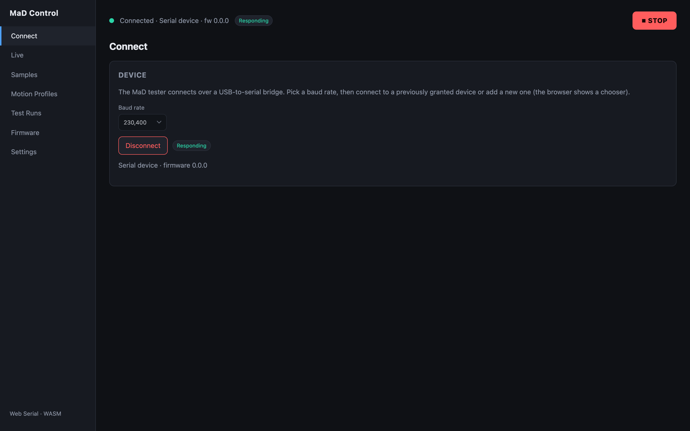
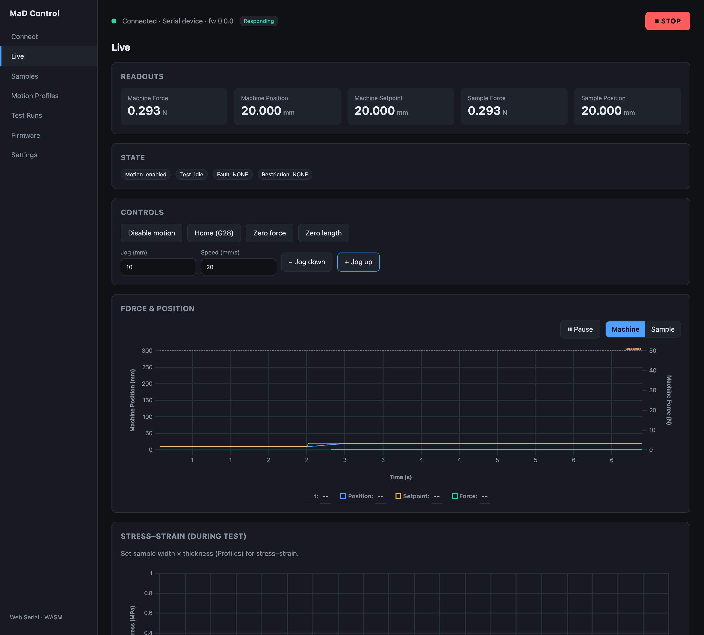
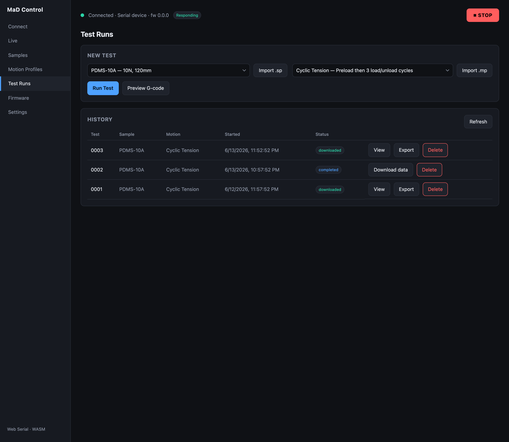

# For operators — your first test

This is a guided walkthrough for someone with a MaD machine who wants to connect
and run a test for the first time. It uses the browser control app — there is
nothing to install.

!!! tip "Just exploring?"
    You can open the app and click through every screen without a machine
    connected. To see live data and run tests you'll need a MaD machine (or the
    [SIL emulator](../dev/sil-testing.md), which is how the screenshots below were
    produced).

## 1. Open the app

In **Chrome or Edge**, go to:

**<https://rileymccarthy.github.io/MaD/app/>**

If you see an "unsupported browser" message, you are not in a Chromium browser —
see [requirements](requirements.md).

## 2. Power on and connect

1. Power the machine on (see the
   [power-up sequence](../how-it-works/the-machine.md#power-up-sequence)) and
   connect it to your computer over USB.
2. In the app, open **Connect** in the sidebar.
3. Leave the **baud rate** at the default (**2,000,000**) and click **Connect
   device**. Your browser shows a serial-port chooser — pick the machine's port.

When connected, the status bar turns green and shows **Connected** with a
**Responding** badge once the firmware starts streaming data:

[:octicons-arrow-right-24: More on connecting](../user-guide/connecting.md)

## 3. Check the firmware

Open **Firmware** in the sidebar. **Installed** is what the machine is running;
**Latest release** is the newest published firmware.

- If they match, you're done — go to step 4.
- If it's older, or the status bar says **Connected** but never **Responding**
  (a new board that has never been programmed), update it now, before your first
  test.

To update:

1. Check **Will flash** shows the latest release. The app picks the production
   build (`MaD-Firmware-<version>-release.bin`) of the newest
   [GitHub release](https://github.com/RileyMcCarthy/MaD/releases) by itself;
   there is nothing to download. That build talks to the app on J1, the same
   port it is programmed through.
2. Check the **Port** is the machine you mean to program, then click
   **Write to flash** and confirm.

The status line runs through *Resetting the board…*, *Uploading… n%*, then
*Finishing…*. The board reboots into the new firmware and **Installed** updates.

Programming uses the **Debug/Programming header (J1)** and an adapter that
drives RESn from DTR, such as a Parallax Prop Plug. On production hardware
that's the same connection you already use for control — if the machine is
talking to the app, it can be programmed. The isolated Raspberry Pi link has no
reset line and **cannot** program the board.

If the machine was flashed with a `-madEdge.bin` image, it shows **Connected**
but never **Responding**: that build talks on P53/P55, which the machine's
P2-EC32MB module doesn't bring out. Flash the latest release over J1 as above.

[:octicons-arrow-right-24: Full firmware guide](../user-guide/firmware-and-diagnostics.md)

## 4. Watch live data

Open **Live**. You'll see real-time readouts (machine and sample force/position),
the machine **state** (faults, restrictions, motion, test), manual **controls**,
and a live **force & position** chart:

To move the gantry by hand, click **Enable motion**, set a jog distance and
speed, and use **+ Jog up** / **− Jog down**. You can also **Home**, **Zero
force**, and **Zero length** here.

[:octicons-arrow-right-24: Live monitoring](../user-guide/live-monitoring.md) ·
[Manual control](../user-guide/manual-control.md)

## 5. Set up a test

A test combines two things:

1. A **sample profile** — your material's dimensions and safety limits
   (max force, max displacement, width, thickness). Create it on the **Sample profiles**
   screen. [:octicons-arrow-right-24: Sample profiles](../user-guide/sample-profiles.md)
2. A **motion profile** — what the machine should *do*: a sequence of moves
   (linear pulls, dwells, cyclic waveforms) grouped into repeatable sets. Build it
   on the **Motion profiles** screen.
   [:octicons-arrow-right-24: Motion profiles](../user-guide/motion-profiles.md)

!!! note "The data folder"
    The first time you open the app it asks for a data folder: click
    **Choose data folder** and pick a folder on your computer. Profiles, results
    and settings are saved there. You only do this once.
    [:octicons-arrow-right-24: Settings & data](../user-guide/settings-and-data.md)

## 6. Run it

Open **Test runs**. In the **New test** card, pick your saved sample and motion
profiles, optionally **Preview G-code**, then click **Run test**. The run appears
in the **History** table and updates to *completed* on its own when the machine
finishes:

!!! warning "The machine is the safety authority"
    MaD runs tests **autonomously from its SD card** and is protected by its own
    **hardware e-stop and sensors**. Closing the browser tab or losing the USB
    link does **not** stop a running test — the app simply reconnects to keep
    monitoring it. The red **STOP** button in the app is a convenience that
    disables motion; it is *not* a substitute for the hardware e-stop.

## 7. Review the results

Back in **Test runs**, click **Download data** on a finished run to pull the CSV
off the machine, then **View** to see the analysis — force vs time, position
(actual / setpoint / expected), and a stress–strain curve:

[:octicons-arrow-right-24: Test history & analysis](../user-guide/test-history-and-analysis.md)

## Keeping the firmware up to date

The machine runs its own firmware, updated separately from the app. Updating it
is the same **Write to flash** operation as [step 3](#3-check-the-firmware).

There's no automatic notification for firmware, so check the version on the
**Firmware** screen against the latest release now and then. A good habit is to
check whenever you update the app, since the two travel together.

[:octicons-arrow-right-24: Full firmware & diagnostics guide](../user-guide/firmware-and-diagnostics.md)

---

That's the full loop: **connect → check firmware → profile → run → analyse**.
The [User Guide](../user-guide/index.md) covers every screen in detail.
