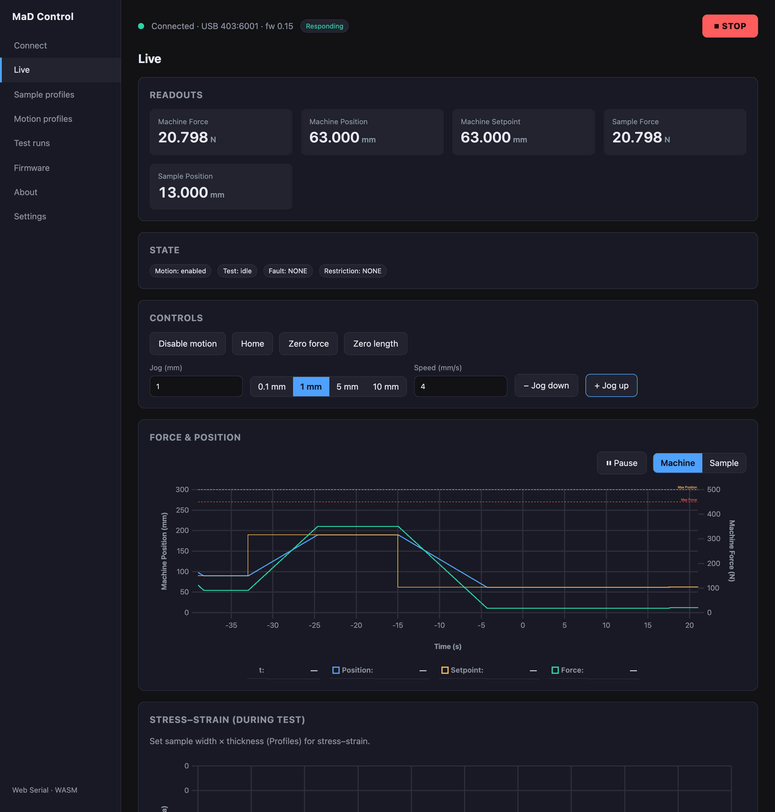
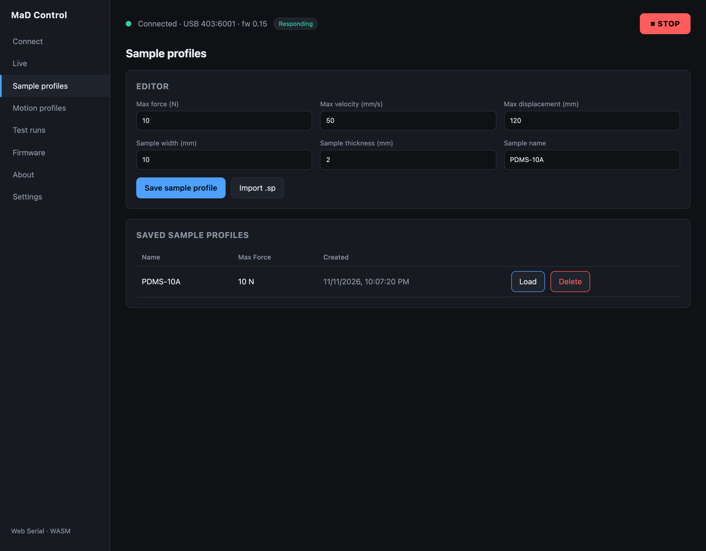
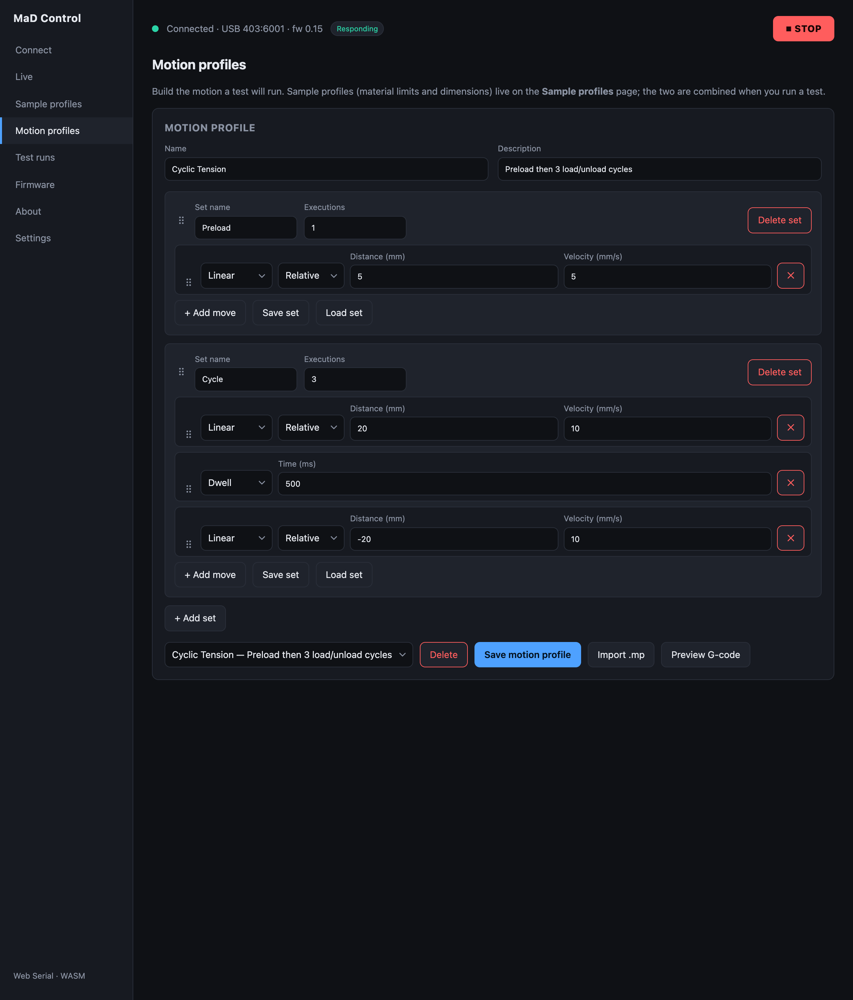
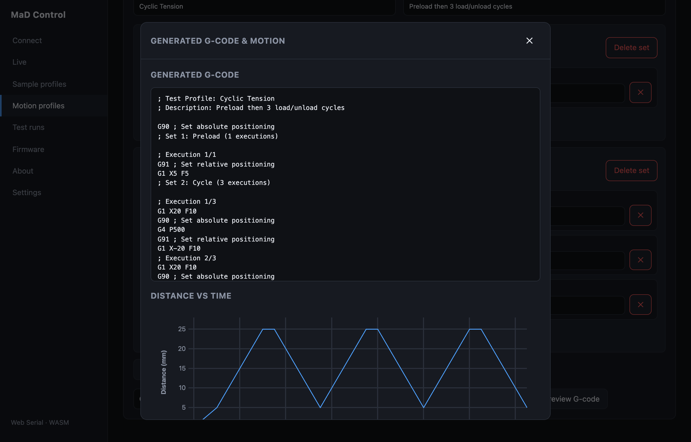
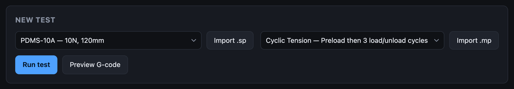
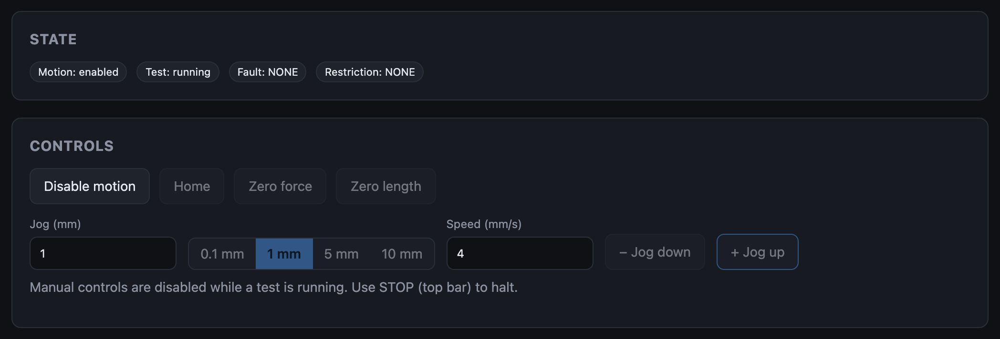
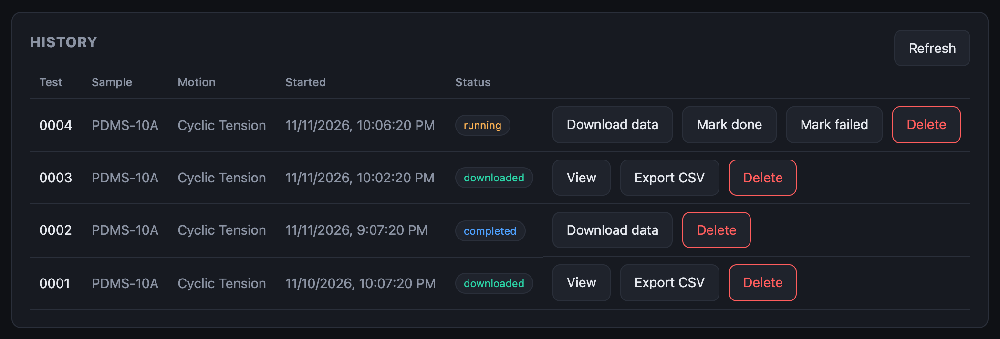
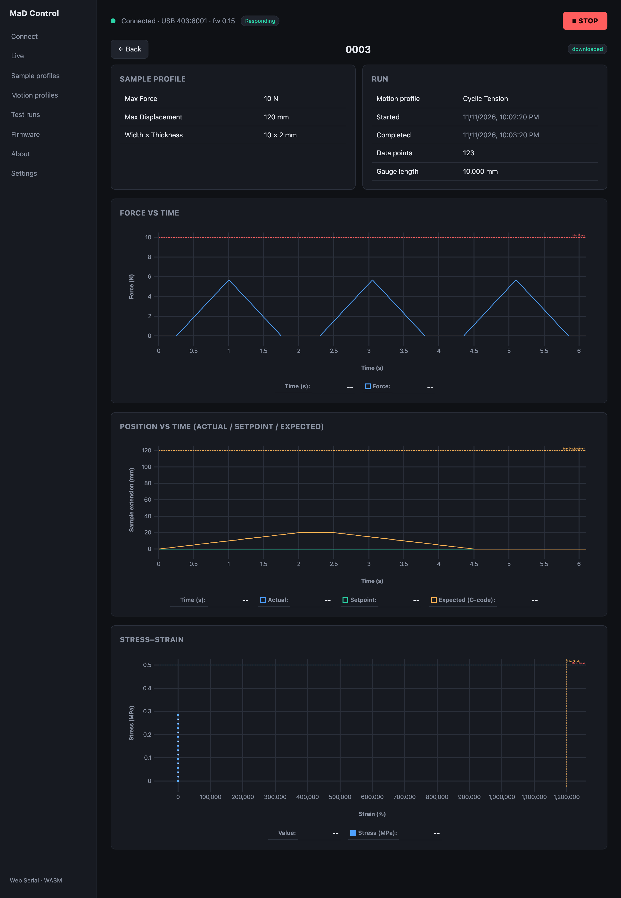

# Run your first test

This assumes the machine is [connected](connect.md), on the
[recommended firmware](flashing-firmware.md), and
[calibrated](machine-setup.md).

## 1. Position the carriage

Open **Control**. This is where you watch the machine, move it by hand and
start tests.

The coloured banner under **State** says what the machine is doing and what to
do next.

1. Click **Enable motion**. The banner turns green (**Ready**) and the
   **Motion** badge changes to *enabled*. Jog and Home stay locked until
   motion is on.
2. Pick a jog distance (type it, or use the **0.1 / 1 / 5 / 10 mm** presets),
   set **Speed (mm/s)**, and use **+ Jog up** / **− Jog down** to bring the
   grips to your sample's length.
3. Mount the sample.

If the buttons are greyed out or a jog is refused, see
[The machine won't move](../troubleshooting/machine-wont-move.md).

## 2. Zero

With the sample mounted and just slack:

- **Zero force** makes the current load the origin of **Sample Force**.
- **Zero length** makes the current position the origin of **Sample
  Position**. This is the gauge length the test's strain is measured from.

**Machine Force** and **Machine Position** are unaffected: those are always
absolute.

## 3. Create a sample profile

Open **Sample profiles**. A sample profile holds the specimen's dimensions and
the limits the machine enforces during the test.

Enter the width and thickness (used for stress), and **Max force** / **Max
displacement**. If the sample reaches either limit the machine stops the test.
Save it.

[:octicons-arrow-right-24: Sample profiles](../user-guide/sample-profiles.md)

## 4. Create a motion profile

Open **Motion profiles**. A motion profile is what the machine does: moves
(linear pulls, dwells, waveforms) grouped into sets that can repeat.

**Preview G-code** shows the exact program and its position-against-time plot
before anything runs:

[:octicons-arrow-right-24: Motion profiles](../user-guide/motion-profiles.md)

## 5. Run

Back on **Control**, in **New test**, pick the sample profile and the motion
profile, then click **Run test**. If the test goes beyond the machine's or the
sample's limits, the app lists each problem first: **Cancel** to fix the
profiles, or **Run anyway**.

The app sends the limits, uploads the program to the machine's SD card and
starts it. From then on the machine runs the test by itself. The banner reads
**Test running**, the **Test** badge reads *running*, the manual controls lock,
and the charts follow the test:

!!! warning "Stopping a test"
    The red **STOP** button disables motion, which ends the test. Closing the
    tab or unplugging USB does **not** stop it: the machine keeps running from
    its SD card and the app reconnects to watch. STOP is a software stop, not
    the hardware emergency stop.

## 6. Get the results

When the machine finishes, the run's status changes to *completed*, whichever
screen you are on. Open **Test runs**, and in **History** click **Download
data** to copy the recording off the machine, then **View**:

**Export CSV** saves the data for a spreadsheet or your own analysis.

[:octicons-arrow-right-24: Test history & analysis](../user-guide/test-history-and-analysis.md)

## Where next

- The [User Guide](../user-guide/index.md) covers every screen.
- [Troubleshooting](../troubleshooting/index.md) is organised by what you see
  on screen.
- [Theory of operation](../how-it-works/the-machine.md) explains what the
  machine is doing and why.
