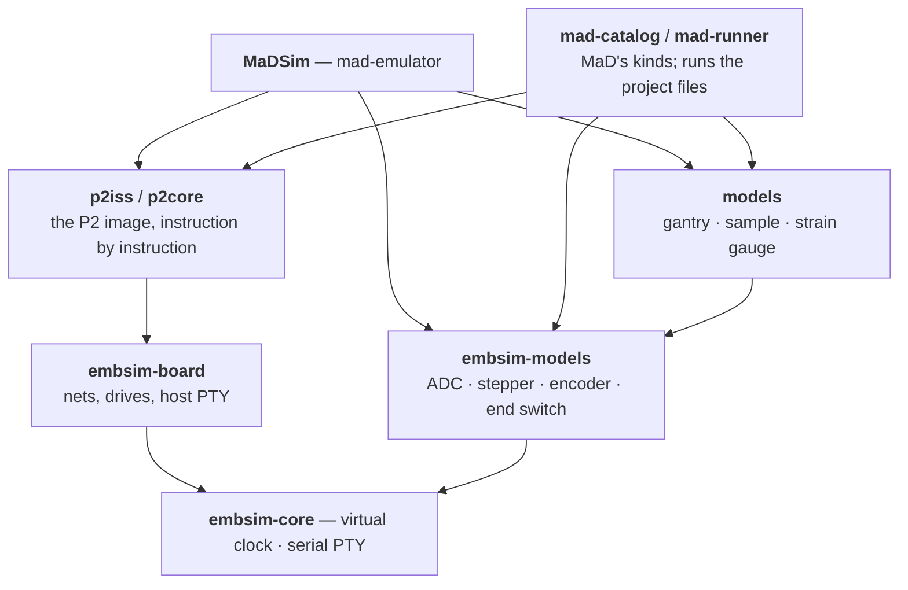
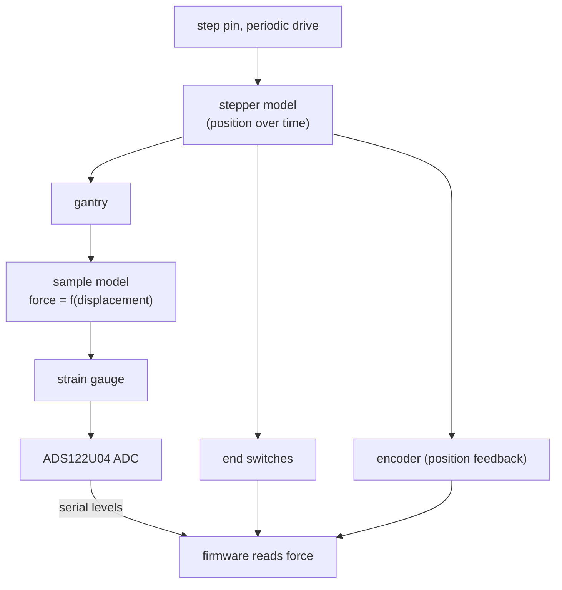

# SIL emulator

The **software-in-the-loop (SIL)** system tests the *complete* firmware ↔ UI
integration with **no physical hardware**. It executes the **Propeller 2
image** on an instruction-set simulator. The machine's pins are nets, and the
physics models sit on those nets. The host on the protocol link is the host's
Chrome, every page and worker held to the board's clock by embsim's
`chrome-cdp` node; or a PTY, for a serial console. The control app connects to
the virtual serial port exactly as it would to a real board.

Two systems run it:

- **The machine's project files** (`SIL/mad.toml` and its twins, under
  `embsim run`): the Edge carrier and the P2-EC32MB module from their
  netlists, the ISS as the module's processor booting the production image
  (`pio run -e propeller2`) off the module's flash, the DS2 add-on and the
  machine on the carrier's connectors, the host on the carrier's debug header
  `J1`. The e2e suite runs here (`make e2e`, on `mad-cosim.toml`); so do the
  scenarios that move the carriage, on `mad-ic14-fixed-cosim.toml`, the
  board with MaD #285 fixed (`make e2e-motion`; as drawn, the isolator
  `IC14` passes nothing to the drive), SERVO-stall, on that board with a
  hard stop on its carriage, `mad-hard-stop-cosim.toml` (`make e2e-stall`,
  MaD #298), FW-ISS, the app's flasher against the mask ROM, on
  `mad-serial-boot-cosim.toml` (`make e2e-rom`), the playgrounds, on headed
  copies (`make playground`, `playground-rom`), and `mad-catalog`'s tests.
- **`mad-emulator`** (`SIL/MaDSim`): the debug image (`propeller2_debug`) on
  the bare chip, the bench wired by hand, the host on `P30`/`P32`. No make
  target or CI job runs it since SERVO-stall moved onto a project, and it
  retires (MaD #298; embsim `MIGRATING-MAD.md` step 11).

!!! info "This is not a mock"
    The firmware under test is the image you flash. The ISS executes its
    instructions, including `WRPIN` / `DIR` / `OUT`, so a wrong smart-pin mode
    or a wrong `clkfreq` shows up on the wire. The screenshots in this
    documentation were produced by driving the app against this emulator.

## embsim — a reusable framework

The board is **embsim**. A part is a node: it publishes a drive and receives a
sense. MaD supplies the core (the ISS) and the bench around it. The generic
crates carry no MaD protocol and no gantry geometry.

The dependency graph is acyclic — **no generic crate depends on a project crate**.
MaD-specific code lives in `MaDSim/`, `mad-catalog/`, `mad-runner/`,
`p2iss/`, `p2core/`, `models/`, and the `protocol` crate (`Protocol/rust/`). See the
[embsim README](https://github.com/RileyMcCarthy/embsim/blob/main/README.md).

## The simulation chain

When the firmware commands the motor, a chain of callbacks turns pulses into
forces and feeds them back as sensor readings:

The ADC, stepper, encoder, and end switch are **generic** (`embsim-models`).
The gantry, sample, and strain gauge are **MaD-specific** (`SIL/models/`).
Pin numbers are the firmware's, named in `iss_description::pins` from
`HW_pins.h`.

## The virtual serial port

The host end sits on the protocol nets at 2,000,000 baud 8N1: on the project,
the carrier's debug header `J1` (`P63`/`P62`), where the machine's Prop Plug
sits; on `mad-emulator`, the bare chip's `P30`/`P32`. It is one of two
components:

- **Chrome on the board's clock** (`chrome-cdp`: `mad-cosim.toml`'s `HOST`,
  `make e2e`; `mad-playground.toml`'s, headed, `make playground`;
  `mad-emulator --chrome`). Every page's
  `navigator.serial` is the node's shim, whose one port is this line (USB
  `0403:6015` on the project, `0403:6001` on `mad-emulator`), by Chrome's own
  rules; every page and dedicated worker lives the board's time, a 1 ms
  quantum at a time over DevTools, so the app's 2 s response timeout is 2 s
  of the board's time. Its rail pins are wired to a 3.3 V rail and the
  board's ground.
- **A PTY** (`host-serial`: `mad.toml`'s `HOST`, `embsim run mad.toml --pty
  PATH`; `make playground-pty`, `embsim run mad.toml --pty /tmp/tty.iss`),
  for a serial console or a program. A browser behind it (the WS↔PTY
  bridge) runs at host speed while the ISS runs at a few percent of real
  time, so it measures the host, not the machine.

On real hardware the app uses Web Serial directly. See
[SIL testing](../dev/sil-testing.md).

## One emulator per process

The virtual clock and the host PTY are process-global, so there is **one
emulator per OS process**. To run several, run several processes — which is
why the E2E suite uses `workers: 1`.
