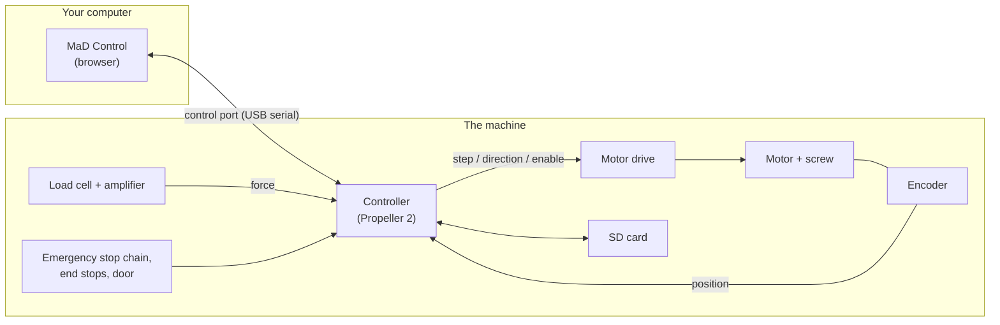
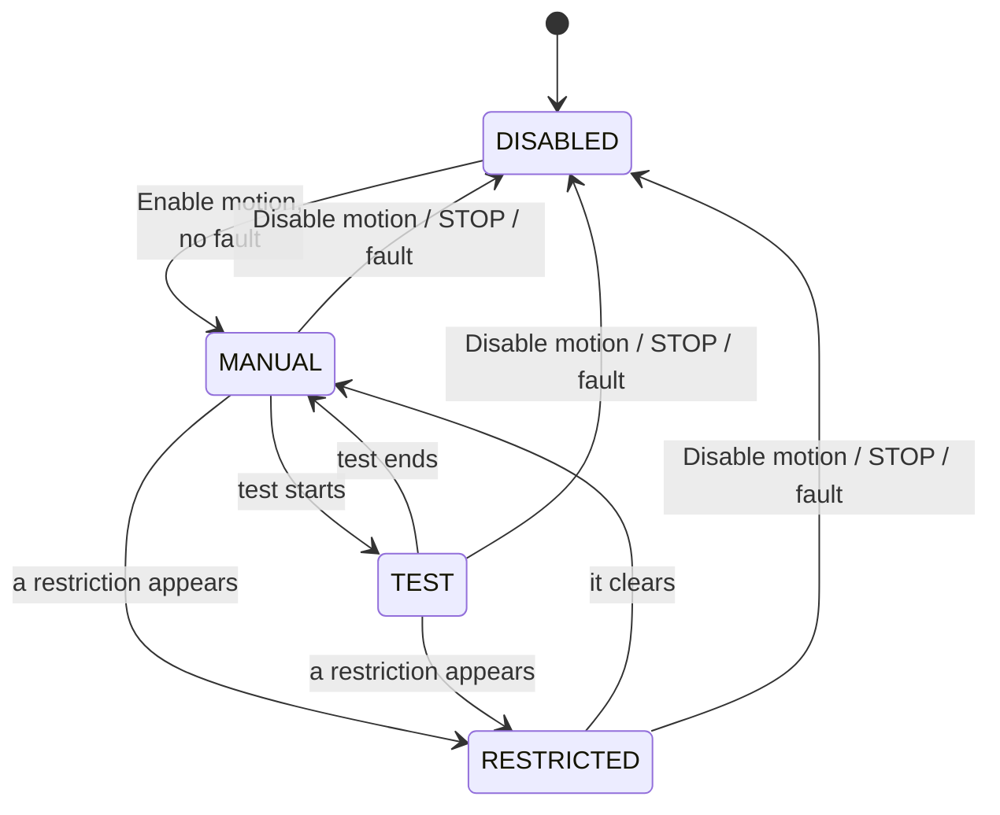
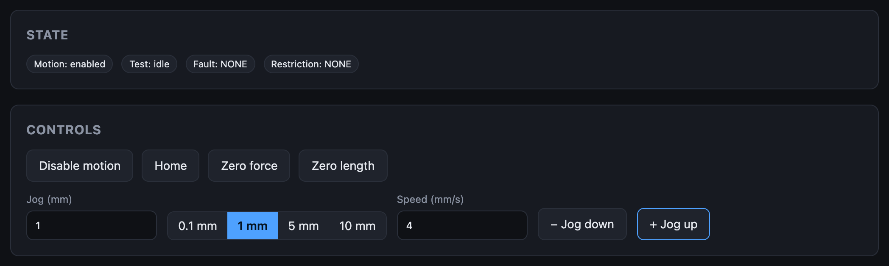
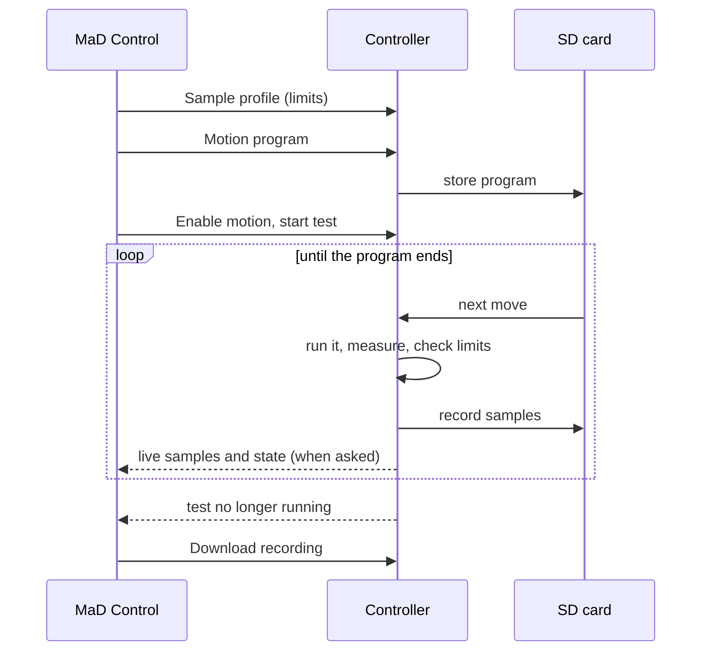

# Theory of operation

What the machine is doing, and why the app behaves the way it does. This page
is for operators: it explains the model behind the badges, banners and
buttons. The pages after it go into the firmware, protocol and app internals.

## What the machine is

MaD pulls a sample apart along one axis while measuring two things: how far
the jaws have moved and how hard the sample is pulling back.

| Part | Job |
|---|---|
| **Controller** | A Propeller 2 microcontroller on the Edge board. It runs the firmware: motion, measurement, safety checks, test execution and the link to the app. |
| **Motor drive and motor** | The controller sends step and direction pulses; the drive turns the motor, and the screw moves the carriage. |
| **Encoder** | Reports where the carriage actually is. The controller treats the encoder, not the pulses it sent, as the truth. |
| **Load cell** | A strain-gauge bridge read by a 24-bit converter on the force gauge board. |
| **SD card** | Holds the test program while it runs, the recorded data, and the machine configuration. |
| **Safety inputs** | The emergency stop chain, an end stop at each end of travel, and the door interlock. |
| **MaD Control** | The browser app. It configures, commands and displays. It is not in the control loop. |

## How position is controlled

A move, whether a jog or a step of a test, becomes a **trajectory**: a
position that changes over time, accelerating at **Acceleration Max** up to the
move's speed and back down to a stop.

A thousand times a second the controller:

1. works out where the trajectory says the carriage should be now;
2. reads the encoder to see where it is;
3. sends the drive step pulses for the trajectory's speed plus a correction
   proportional to the error (**Servo Kp**, with **Servo Ki** for a steady
   error).

Two configuration values convert between the controller's world and
millimetres: **Servo (step/mm)** for pulses out and **Encoder (step/mm)** for
counts in. If their ratio is wrong, the correction fights the motion, which is
why the [drive and encoder check](../user-guide/motor-calibration.md) exists.

The gap between where the trajectory is and where the encoder is, the
*following error*, is also how the machine notices a jam. Too large, or too
little encoder travel for the pulses sent, and it raises
[`SERVO_STALL`](../troubleshooting/faults.md#servo_stall).

The Control screen shows these quantities: **Machine Position** (the
encoder), **Machine Setpoint** (the trajectory, where the gantry should be
right now), **Machine Target** (where the current move ends), and on the chart
the **Expected** path, a straight line at the commanded speed.

## How force is measured

The load cell's bridge puts out a voltage proportional to both the force on it
and the voltage exciting it. The converter measures the output *relative to the
excitation*, in mV/V, so supply drift cancels out. Force is then:

> force = (signal − **Zero Balance**) × **Capacity** ÷ **Sensitivity**

Those three are in the
[machine configuration](../user-guide/machine-configuration.md). Capacity and
Sensitivity come from the load cell's datasheet; the
[load cell calibration](../user-guide/load-cell-calibration.md) measures Zero
Balance and refines Sensitivity against known weights.

## Machine and sample coordinates

Every measurement exists in two frames:

| | Machine | Sample |
|---|---|---|
| **Position** | Jaw separation | Extension since **Zero length** |
| **Force** | Absolute force on the load cell | Force since **Zero force** |
| **Used for** | The machine's own limits | The test's limits, strain and stress |

Zeroing changes only the sample frame. That is why you zero with the sample
mounted and just slack: the sample frame then starts at the gauge length with
no load.

## The state machine

The controller is always in one of four states, and all motion is gated on
them.

| State | Motion | Speed |
|---|---|---|
| **DISABLED** | Off. The drive is disabled and queued moves are discarded. | — |
| **MANUAL** | On, driven by jogs from the app | Up to Velocity Max |
| **TEST** | On, driven by the test program on the SD card | Up to Velocity Max |
| **RESTRICTED** | On, so the carriage can be backed off | Capped at **Restricted Velocity** |

The controller decides the state afresh on every pass, in this order:

1. Any **fault** → DISABLED.
2. Motion **not requested** → DISABLED.
3. Any **restriction** → RESTRICTED.
4. A test running → TEST, otherwise MANUAL.

The app doesn't show the state by name. It shows the four inputs to it, as the
badges on the Control screen:

| Badges | State |
|---|---|
| `Fault:` anything but `NONE` | DISABLED |
| `Motion: disabled` | DISABLED |
| `Motion: enabled`, `Restriction:` anything but `NONE` | RESTRICTED |
| `Motion: enabled`, `Test: idle`, both `NONE` | MANUAL |
| `Motion: enabled`, `Test: running`, both `NONE` | TEST |

### Faults and restrictions

A **fault** means the machine can't be trusted to move: a safety input is
open, or part of the controller or its sensors has stopped. It forces DISABLED.

A **restriction** means the machine is somewhere it shouldn't stay: on an end
stop, door open, over a force or length limit. It slows the machine and leaves
it movable, because refusing to move would strand a sample under load. An end
stop also stops travel toward it: a move heading into an active end stop is
stopped and refused, and a move away from it runs.

Both are re-evaluated continuously from the live inputs, so they clear when
their cause does. Six faults are different: the four emergency-stop faults, a
load cell overload and a servo stall **latch**. One that stops a machine with
motion enabled stays until you disable motion, so the machine never comes back
by itself after an emergency stop, and a stall or an overload does not clear
the moment switching the drive off relieves it.

One consequence is worth knowing. **Enable motion** is a standing request.
A fault overrides it but doesn't cancel it, so when a fault that does not
latch clears by itself, motion returns. Clicking **Disable motion** while
faulted cancels the request.

[Faults](../troubleshooting/faults.md) and
[Restrictions](../troubleshooting/restrictions.md) list every one.

## How a test runs

1. The app turns the [motion profile](../user-guide/motion-profiles.md) into a
   program of moves (G-code) and uploads it to the SD card, along with the
   [sample profile](../user-guide/sample-profiles.md)'s limits.
2. The controller plays the program from the card, one move after another, and
   records force and position to the card as it goes.
3. It ends the test when the program ends, when the sample passes **Max
   force** or **Max displacement**, or when motion is disabled for any reason.
4. The app notices the test is no longer running and marks the run
   *completed*. **Download data** copies the recording off the card.

The app's part ends at step 1. Everything after is the controller working from
its own SD card, which is why closing the tab or pulling the USB cable does not
stop a test.

## What the app does

The app only ever asks; the controller answers.

- **Live data** is polled about a hundred times a second, and the machine's
  state about once a second. **Responding** means answers are arriving.
- **Commands** (enable, jog, home, zero, start a test, write configuration)
  are requests the controller can refuse. A refused jog shows as a toast.
- **On connect**, the app asks which protocol version the firmware speaks, and
  sends no motion command until it matches its own. This is the
  [firmware banner](../troubleshooting/firmware.md).

Two serial ports keep these roles apart. The **control port** carries all of
the above and never resets the controller. The **programming port** resets the
controller into its boot loader and is used only to
[flash firmware](../getting-started/flashing-firmware.md).

## Power-up sequence

Power is applied in stages so the electronics and the safety chain come up in
a known order:

1. Turn on the **mains inlet** switch. This powers the controller.
2. Press the momentary **ON** button. This applies DC power to the status
   switches and the emergency stop chain.
3. Release the **emergency stop**. This applies AC power to the motor drive.
4. When no fault is showing, **Enable motion** from the app.

To power down, reverse the order.

The controller reads its configuration at power-up, so a changed
[machine configuration](../user-guide/machine-configuration.md) takes effect
after a restart: the app's **Reboot now**, or a power cycle.

## Safety model

!!! danger "The machine is the safety authority"
    The app is never a safety device. The machine has:

    - a **hardware emergency stop** that removes power from the drive;
    - **faults** that switch motion off whenever a safety input opens or part
      of the controller stops;
    - **end stops** that stop travel toward them;
    - an **overload fault** at 120% of the load cell's rated capacity;
    - **restrictions** that slow it at the end stops, with the door open, or
      over a force or length limit;
    - **sample limits** that end a test.

    The red **STOP** button in the app sends a disable-motion request. It is a
    convenience, and it depends on the computer, the browser and the cable all
    working. Use the hardware emergency stop when it matters.

    Because a test runs from the SD card, losing the app is a non-event by
    design: the test carries on, and the app reconnects to watch it.
