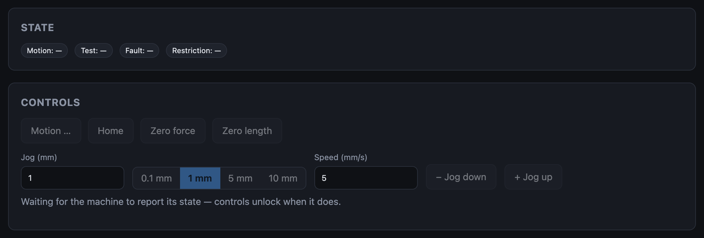

# Connection problems

## The app shows an "unsupported browser" screen

You're not in a Chromium browser. Use Chrome or Edge on a desktop computer.
See [What you need](../getting-started/requirements.md#browser-support).

## No port appears in the browser's chooser

- The adapter isn't plugged in, or its cable is charge-only.
- On Windows, the adapter's USB-serial driver isn't installed.
- Another program has the port open (a serial terminal, an IDE, another tab of
  the app). Close it.

## Connected but not responding

The port opened and nothing is answering.

| Check | Why |
|---|---|
| **You're on the control port** | The firmware answers only on the control port (P30/P32, J4 on the Edge carrier). On J1 the app gets nothing, and the machine restarts each time the port opens. |
| **The board has firmware** | A new board never answers. [Flash it](../getting-started/flashing-firmware.md): flashing doesn't need the firmware to respond. |
| **Baud rate is 2,000,000** | Any other value on the Connect screen reads garbage. |
| **The machine is powered** | Follow the [power-up sequence](../how-it-works/the-machine.md#power-up-sequence). |
| **TX and RX aren't swapped** (bench wiring) | Adapter TX → P30, adapter RX ← P32, grounds joined. |

On the Control screen this state leaves the badges at **—** and the controls
locked:

## The link drops

A loose cable, a hub that powers down, or the machine losing power. Click
**Reconnect**; the app also reconnects by itself when the adapter reappears.

A dropped link does not stop the machine. A running test carries on, and the
app picks it up again on reconnect.

## The machine restarts whenever the app connects

The app is connecting through the programming port (J1). Its adapter resets
the controller when the port opens. Connect through the control port; the
Connect screen labels the Firmware screen's programming port.

## The app doesn't reconnect by itself

Two remembered ports have the same USB id (the Prop Plug and the control
adapter can be identical parts). One of them would restart the machine, so the
app won't guess: click **Connect** beside the control port.

To stop being asked, use adapters with different USB ids, or click **Forget**
beside the programming port on the Connect screen (the Firmware screen asks
for it again when you next flash).

## An error line appears under the Connect button

The browser refused to open the port. The message is the browser's own. Most
often the port is already open elsewhere, or the adapter was unplugged between
choosing and opening.
