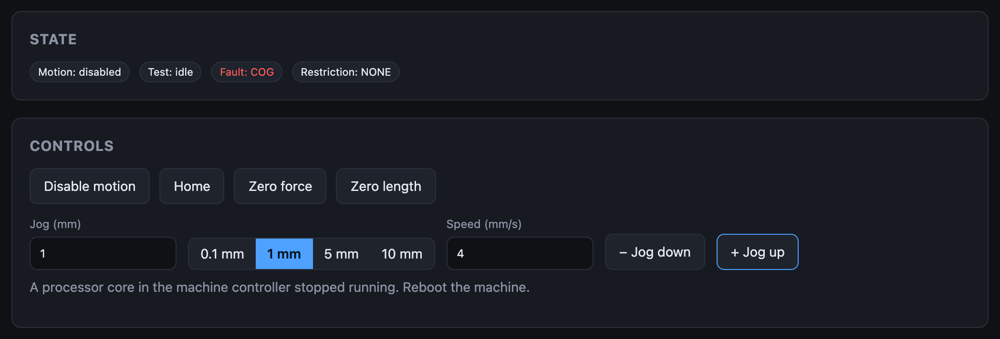
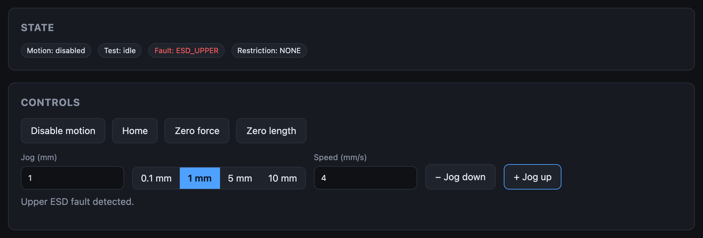
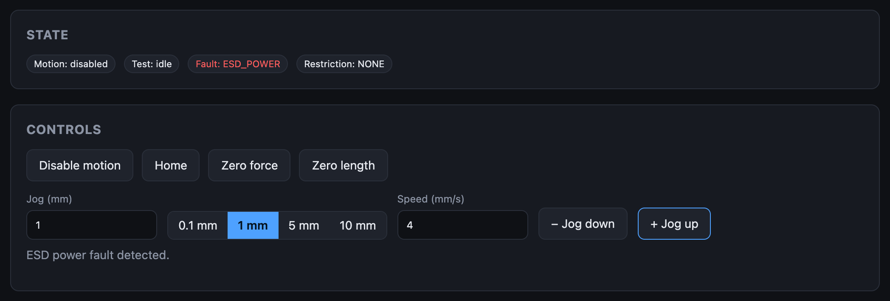
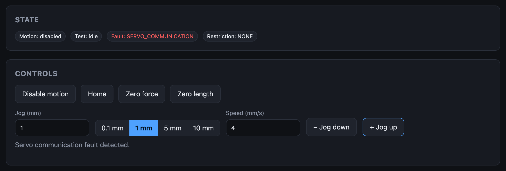
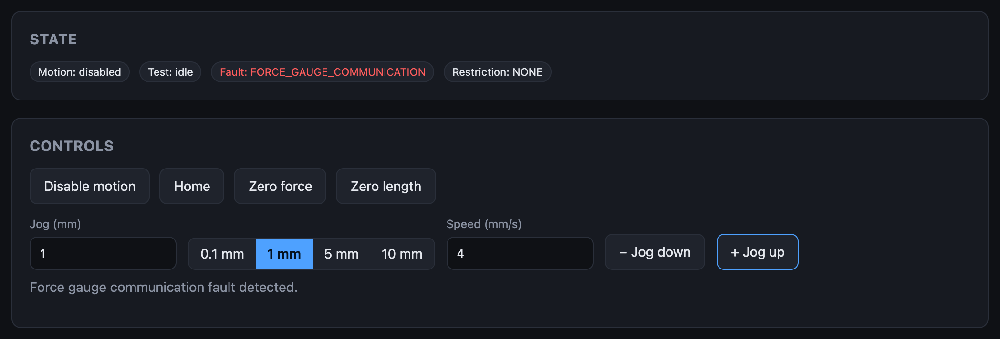
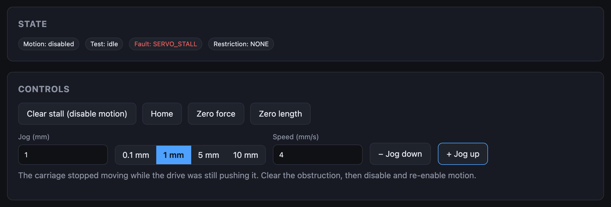

# Faults

A **fault** switches motion off. The **Fault** badge on the Live screen turns
red, the machine refuses to enable motion, and a running test is ended.

The machine re-checks every fault condition continuously:

- Six faults **latch**: the four emergency-stop faults
  ([`ESD_SWITCH`](#esd_switch), [`ESD_UPPER`](#esd_upper),
  [`ESD_LOWER`](#esd_lower), [`ESD_POWER`](#esd_power)),
  [`FORCE_OVERLOAD`](#force_overload) and [`SERVO_STALL`](#servo_stall). When
  one of them stops a machine that had motion enabled, it stays showing after
  its cause has gone, and motion stays off, until you click **Disable motion**
  to acknowledge it. Then click **Enable motion**. If the cause is still there
  when you acknowledge (the emergency stop still pressed), the fault stays
  until it is gone.
- With motion already off, the emergency-stop faults follow their inputs: the
  emergency stop circuit has no power until **ON** is pressed, and that needs
  no acknowledgement.
- `FORCE_GAUGE_COMMUNICATION` **clears by itself** when readings resume.
- A stopped core (`COG`, `WATCHDOG`, `SERVO_COMMUNICATION`) doesn't come back
  by itself: power-cycle the machine.

!!! warning "Click Disable motion while a fault is showing"
    The machine remembers that you asked for motion. A fault that latches
    keeps the machine off until you acknowledge it, but if a fault that does
    not latch clears by itself, **motion comes back on without another
    click**. Clicking **Disable motion** while faulted withdraws the request,
    so the machine stays off until you enable it again. This is why the button
    offers a disable whenever a fault is showing.

Only one fault is shown at a time: the first in the order below, which puts a
cause ahead of what it causes. A pressed emergency stop shows as `ESD_SWITCH`
even though the circuit's lost power (`ESD_POWER`) is active too. Fix it and
the next one, if any, appears.

Reconnecting the app never clears a fault and never restarts the machine.

## COG

**A processor core in the controller stopped running.**

The controller runs each job (motion, force reading, communication, logging) on its own core. One of them is no longer running.

**What to do:** **Power-cycle the machine.** If it comes back, note what the machine was doing and [report it](../user-guide/firmware-and-diagnostics.md#reporting-a-bug).

## WATCHDOG

**A task in the controller stopped checking in.**

Each core has to report in regularly. One missed its deadline, so the machine no longer trusts it.

**What to do:** **Power-cycle the machine.** If it repeats, report it with the session log.

## ESD_SWITCH

**The emergency stop is pressed.**

The emergency stop switch is open, which also removes power from the drive.

**What to do:** Make sure the machine is safe, then release the emergency stop and press **ON**. If it was pressed while motion was enabled, the fault stays after you release it: click **Disable motion** to acknowledge it, then **Enable motion**. The machine never switches the drive back on by itself.

## ESD_UPPER

**The upper emergency-stop limit tripped.**

The upper limit input of the emergency stop chain is active: the carriage ran past the top of its travel. This is the hard limit, separate from the upper end stop that raises a restriction.

**What to do:** Motion stays off while this is tripped, so the carriage can't be jogged off it: move it back by hand, press **ON**, then click **Disable motion** to acknowledge the fault and **Enable motion**. Then find out why it over-travelled: the end stop before it should have stopped the move.

## ESD_LOWER

**The lower emergency-stop limit tripped.**

As `ESD_UPPER`, at the bottom of travel.

**What to do:** As `ESD_UPPER`.

## ESD_POWER

**The emergency stop circuit has no power.**

The DC supply for the emergency stop chain is off, and none of the three inputs above explains it: the **ON** button hasn't been pressed, or the supply has dropped.

**What to do:** Press **ON** ([power-up sequence](../how-it-works/the-machine.md#power-up-sequence)). If it stays, check the supply and wiring of the emergency stop chain. If it stopped a machine that had motion enabled, click **Disable motion** to acknowledge it, then **Enable motion**.

## SERVO_COMMUNICATION

**The motor control loop is not running.**

Despite the name, this is not a cable to the drive: it means the core that generates step pulses and closes the position loop has stopped ticking.

**What to do:** **Power-cycle the machine.** If it repeats, report it.

## FORCE_GAUGE_COMMUNICATION

**The load cell amplifier stopped answering.**

The controller reads the load cell through an ADC on the force gauge board. It retried and got no reply.

**What to do:** Check the cable between the controller and the force gauge board and that the board has power. The fault clears by itself when readings resume. If it doesn't, power-cycle.

## FORCE_OVERLOAD

**The force passed 120% of the load cell's rated capacity.**

**Machine Force** went past 120% of the **Load Cell Capacity** in the machine configuration, in tension or compression. It is checked all the time, in a jog as in a test, and it is separate from the sample's and the machine's force limits, which only restrict.

**What to do:** Relieve the load by hand. Click **Disable motion** to acknowledge the fault, then **Enable motion**. If it shows with nothing loaded, the load cell values are wrong: check the capacity and run the [load cell calibration](../user-guide/load-cell-calibration.md).

The fault latches for the reason a stall does: switching the drive off lets the load relax, so a fault that followed the reading would clear itself and switch the drive back on against the same load.

## SERVO_STALL

**The carriage stopped following the drive.**

The machine compares where it is driving the carriage with where the encoder
says it is. It declares a stall when any of these happens:

- the position error passes 2 mm;
- the position error stays above 1 mm;
- about 1 mm of step pulses go out and the encoder covers too little of it.

Typical causes: the carriage hit something or reached the end of its travel,
the sample is stiffer than the motor can pull, **Acceleration Max** or
**Velocity Max** is more than the motor can deliver, the drive is off, or the
encoder isn't counting.

**What to do:**

1. Clear whatever is blocking the carriage.
2. Click **Clear stall (disable motion)**. The Fault badge returns to `NONE`.
3. Click **Enable motion**.

A stall latches on purpose. Disabling motion is what makes the stall condition
go away, so a stall that cleared itself would re-enable and drive into the same
obstruction again.

If it stalls with nothing in the way, run the
[motor calibration](../user-guide/motor-calibration.md): the drive and encoder
check finds wiring and steps/mm problems, and the motion calibration tells you
whether **Acceleration Max** is too high.
