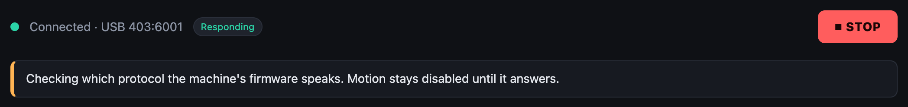
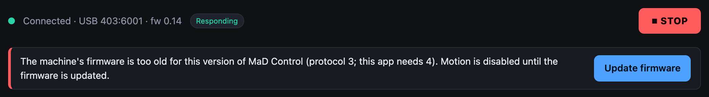
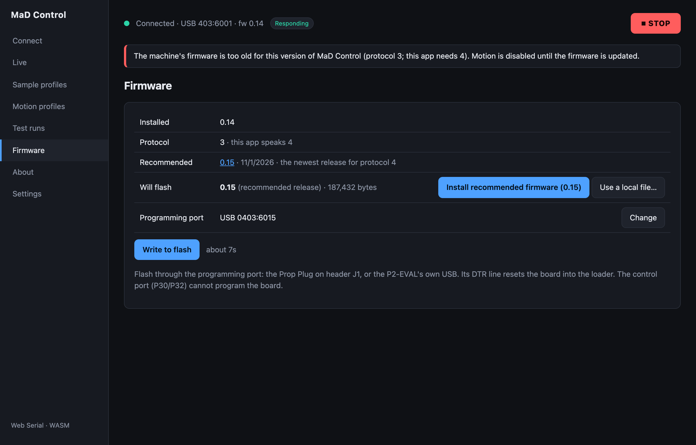
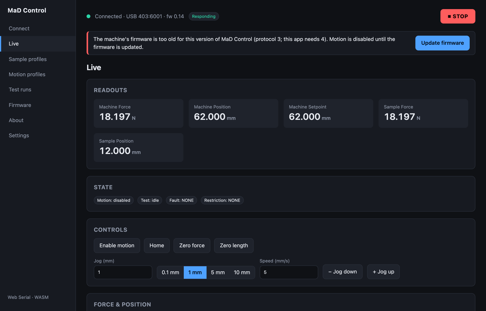
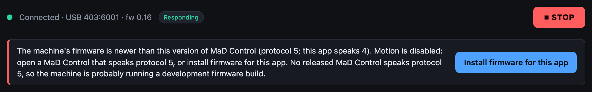
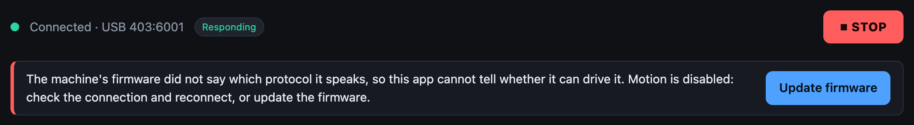
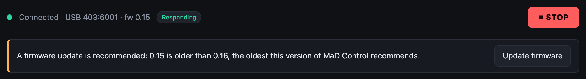
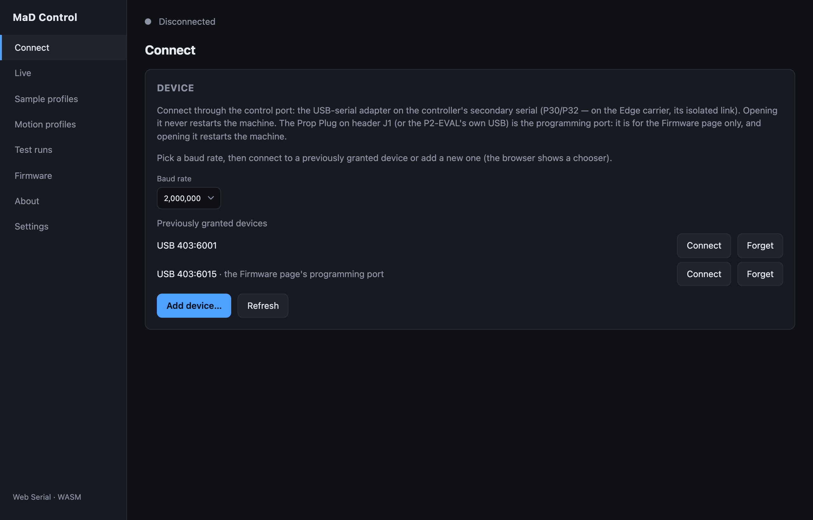

# Firmware problems

Every time the app connects it asks the firmware which protocol version it
speaks. Until the answer matches the app's own, the app will not move the
machine, and a banner under the status bar says why on every screen. **STOP**
and **Disable motion** always work.

Find your banner below.

## Checking which protocol the machine's firmware speaks

**Normal for a moment after connecting.** Motion unlocks when the firmware
answers.

If it stays, the firmware isn't answering: the banner changes to *did not say
which protocol it speaks* after a few tries. See that section.

## The machine's firmware is too old

The firmware speaks an older protocol than this app. The app can't safely read
its replies, so it blocks motion and does not read the machine configuration.

**Fix:** click **Update firmware**, then **Install recommended firmware**.
[Flash the firmware](../getting-started/flashing-firmware.md) walks through it.

On the Firmware screen the **Protocol** row shows the two numbers that
disagree, and the install button is highlighted:

While this banner is up, the Live screen still shows data it can read, but
enabling motion and jogging are refused:

{ width=640 }

## The machine's firmware is newer than this version of MaD Control

The firmware is ahead of the app. The banner's second sentence says which way
out applies, and its buttons follow:

| The banner adds | Meaning | Fix |
|---|---|---|
| *MaD Control X.Y.Z speaks protocol n.* | A released app matches this firmware | Click **Open MaD Control X.Y.Z**. It opens that release on the same screen. |
| *No released MaD Control speaks protocol n, so the machine is probably running a development firmware build.* | Nothing released matches (the case in the screenshot) | Click **Install firmware for this app**, then **Install recommended firmware** on the Firmware screen. |
| *The list of MaD Control releases could not be loaded…* | The app is offline or the list didn't load | Click **Open the latest MaD Control**, or reload with a network connection. |

**Install firmware for this app** is always offered as the alternative: it
puts the firmware this app recommends back on the machine.

## The machine's firmware did not say which protocol it speaks

The port opened, but the firmware never answered the question. The app can't
tell whether it is safe to drive, so motion stays blocked.

Work through these:

1. **Are you on the control port?** The firmware does not answer on J1 (the
   Prop Plug). Disconnect and connect to the adapter on P30/P32.
2. **Is the machine powered** and past its
   [power-up sequence](../how-it-works/the-machine.md#power-up-sequence)?
3. **Is the baud rate 2,000,000** on the Connect screen?
4. **Disconnect and connect again.** A cable knocked during the check is
   enough to miss the answer.
5. **Flash the recommended firmware.** A blank board, or one running something
   else, never answers. Flashing goes through the programming port and does not
   need the firmware to respond.

## A firmware update is recommended

The protocols match and **the machine still moves**. This app version knows of
a fix in a newer firmware release.

**Fix:** update when convenient: **Update firmware**, then **Install
recommended firmware**.

## Flashing fails

| Symptom | Cause and fix |
|---|---|
| **Programming port** says *No serial device yet* | The browser hasn't been given the Prop Plug. Click **Choose port** and pick it. |
| **Programming port** says *Several serial devices* | The app can't tell the Prop Plug from the control adapter by USB id. Click **Choose port** and pick the Prop Plug; the choice is remembered. |
| **Install recommended firmware** is greyed out | No programming port is chosen (see above), or a flash is already running. |
| **Recommended** says *No firmware release is bundled with this copy of the app* or *Could not reach the app server* | The app couldn't load the release list. Reload the app with a network connection, or download the image from the [releases page](https://github.com/RileyMcCarthy/MaD/releases) and use **Use a local file…**. |
| It fails at *Resetting the board…* | The chosen port isn't the Prop Plug on J1 (or the P2-EVAL USB), the Prop Plug isn't seated, or the machine has no power. The control port has no reset line and can't program the board. |
| It fails during *Uploading…* | Try again. If it keeps failing, power-cycle the machine and reseat the Prop Plug. |
| It finished, but **Installed** still shows the old version | The write was interrupted, or the app reconnected before the board finished booting. Disconnect, power-cycle the machine, connect on the control port and check again. If it is still old, flash again and leave the machine alone until the status line says it is done. |
| After flashing: **Connected** but never **Responding** | The app is connected to the programming port. Connect to the control port instead. |
| A file is refused when picked | It is too large to be a firmware image (the limit is 512 KB). Pick the `.bin` from the release. |

## The machine restarts whenever the app connects

The app is connecting through the programming port (J1), whose adapter resets
the controller when the port opens. Connect through the control port. The
Connect screen labels the port the Firmware screen uses:

