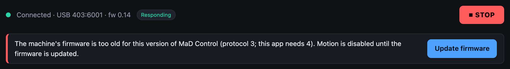
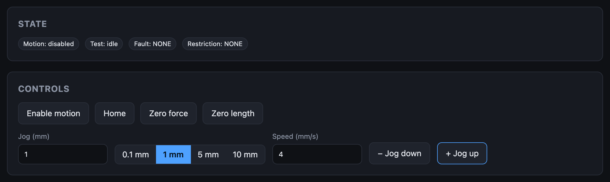

# Troubleshooting

Find what you see on screen, and follow the link.

## Start at the status bar

| You see | Go to |
|---|---|
| { width=360 } **Disconnected**, or no port to pick | [Connection problems](connection.md) |
| { width=360 } **Connected** but **Not responding** | [Connected but not responding](connection.md#connected-but-not-responding) |
| { width=360 } A banner under the status bar | [Firmware problems](firmware.md) |
| { width=360 } Green, **Responding**, no banner, but something else is wrong | Keep going |

## Then the Live screen

| You see | Go to |
|---|---|
| Badges showing **—**, controls greyed out | [The machine won't move](machine-wont-move.md#the-state-badges-show) |
| **Fault:** anything but `NONE` (the badge is red) | [Faults](faults.md) |
| **Restriction:** anything but `NONE` | [Restrictions](restrictions.md) |
| Everything reads `NONE` but a jog does nothing | [The machine won't move](machine-wont-move.md) |

## Or by task

| Problem | Go to |
|---|---|
| Flashing fails or the version doesn't change | [Firmware problems → Flashing fails](firmware.md#flashing-fails) |
| A calibration run stops or reports an error | [Motor calibration → What the findings mean](../user-guide/motor-calibration.md#what-the-findings-mean) |
| Force reads wrong | [Load cell calibration](../user-guide/load-cell-calibration.md) |
| A test stops early, hangs in *running*, or can't be viewed | [Tests and data](tests-and-data.md) |
| The app asks for the data folder again, or saves fail | [Tests and data → Data folder](tests-and-data.md#data-folder) |

## What "normal" looks like

Connected, **Responding**, no banner, `Fault: NONE`, `Restriction: NONE`, and
**Enable motion** available. [Theory of operation](../how-it-works/the-machine.md)
explains what each of those means inside the machine.

## Still stuck?

File a report from **About → Report a bug**: it attaches the app's session log,
which is what a problem gets traced from. See
[Reporting a bug](../user-guide/firmware-and-diagnostics.md#reporting-a-bug).
