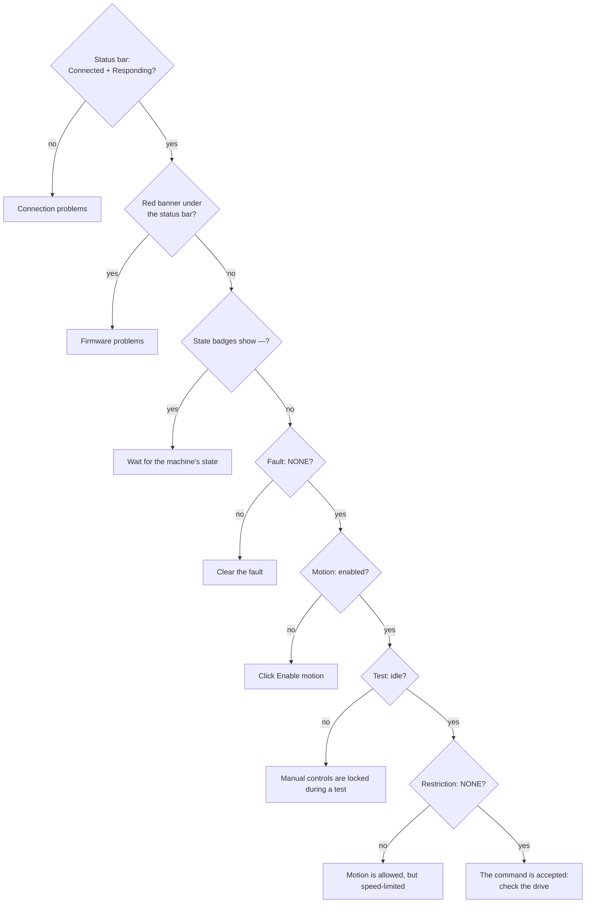
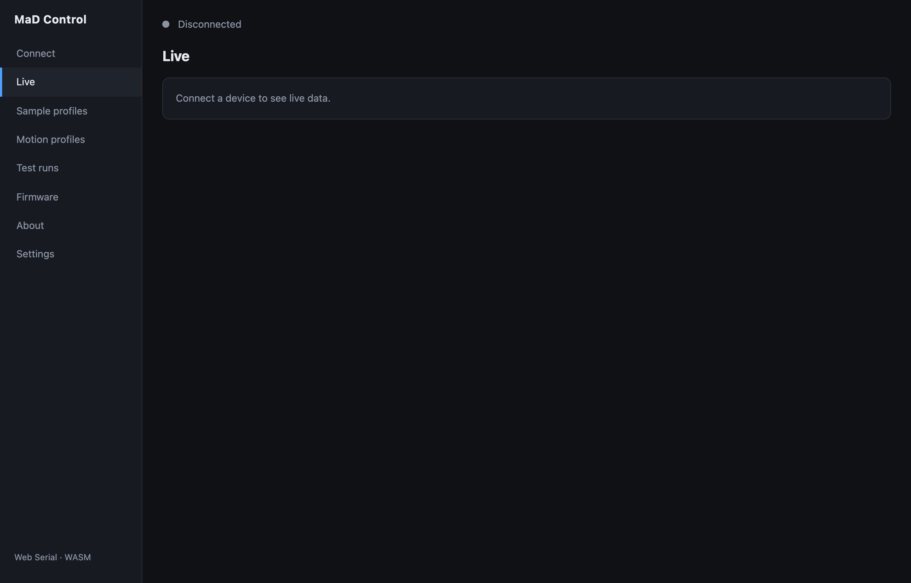
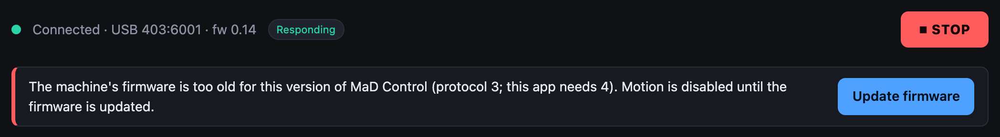
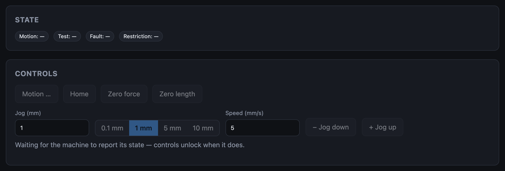
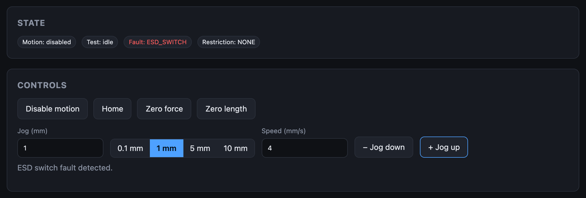
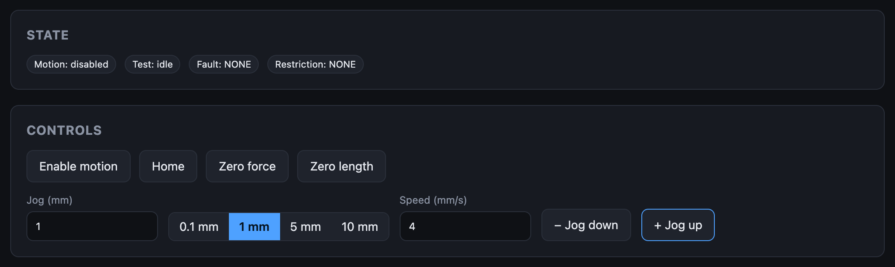
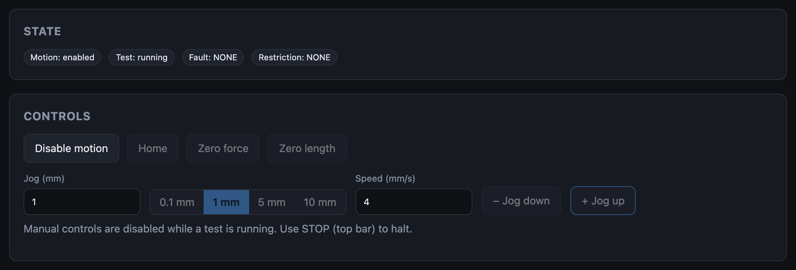
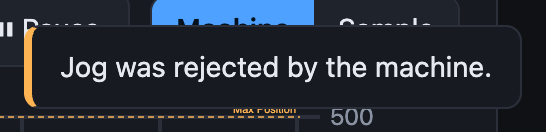

# The machine won't move

Motion needs every one of these to be true. Check them from the top; the first
one that fails is your answer.

## Not connected, or not responding

The Live screen says *Connect a device to see live data*, or the status bar
says **Not responding**. See [Connection problems](connection.md).

{ width=640 }

## A red banner is showing

The app refuses to move a machine whose firmware it can't talk to safely.
**Enable motion** and jogs are refused in the app, before anything is sent.
See [Firmware problems](firmware.md).

## The state badges show —

The machine hasn't reported its state yet, so the app doesn't know whether it
is safe to offer controls. It unlocks when the first state report arrives,
normally within a second or two of connecting.

If it stays like this, the firmware isn't answering state requests: treat it
as [Connected but not responding](connection.md#connected-but-not-responding).

## A fault is showing

The **Fault** badge is red and the button offers **Disable motion**, because
the machine refuses to enable motion while faulted. The line under the controls
says what the fault is. Find it in [Faults](faults.md).

## Motion is disabled

`Fault: NONE`, **Motion: disabled**. This is how the machine starts, and where
**STOP** leaves it. Click **Enable motion**.

If clicking it changes nothing, the machine turned the request down: a fault
appeared at that moment (watch the Fault badge).

## A test is running

Jog, home and zero are locked while the machine runs a test. Wait for it to
finish, or stop it with **Disable motion** or **STOP**.

If no test should be running, the last one may not have ended: disable motion
to end it.

## A restriction is showing

A restriction does **not** stop manual motion. It caps the speed at
**Restricted Velocity** from the
[machine configuration](../user-guide/machine-configuration.md), so the
carriage can still be backed away slowly. If it seems not to move, your jog
may simply be running at that low speed. See [Restrictions](restrictions.md).

## Everything looks right, but the carriage doesn't move

Motion is enabled, no fault, no restriction, and the jog is accepted (no
toast), yet nothing moves. The command reached the drive's step and direction
inputs; the drive isn't acting on it.

| Check | Why |
|---|---|
| **Drive enable** in [Machine configuration](../user-guide/machine-configuration.md) | With the wrong polarity the drive is held off whenever motion is enabled. Flip it, **Write to device**, power-cycle. |
| The drive has power | The emergency stop circuit switches the drive's supply. Follow the [power-up sequence](../how-it-works/the-machine.md#power-up-sequence). |
| Step, direction and enable wiring | Run the [drive and encoder check](../user-guide/motor-calibration.md): *The encoder did not count in either direction* points here. |
| Wait a moment | If the drive really isn't moving the carriage, the machine raises [`SERVO_STALL`](faults.md#servo_stall) once it has sent about 1 mm of pulses with no matching encoder travel. |

## "Jog was rejected by the machine"

The app sent the jog and the machine refused it. Usually motion isn't enabled
(a fault just appeared, or STOP was pressed), or the machine is busy with a
test. Check the State badges.

## "Enter a valid jog distance and a speed greater than 0"

The **Jog (mm)** or **Speed (mm/s)** field is blank or zero.
