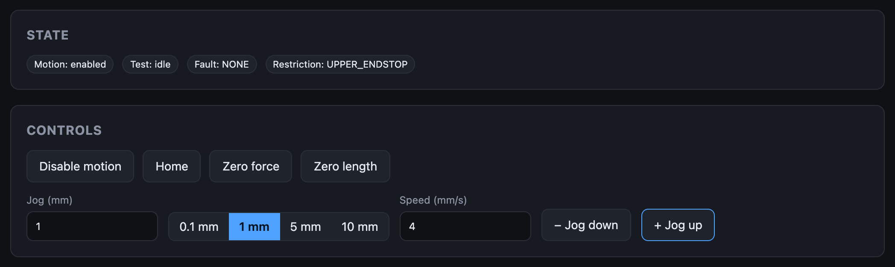
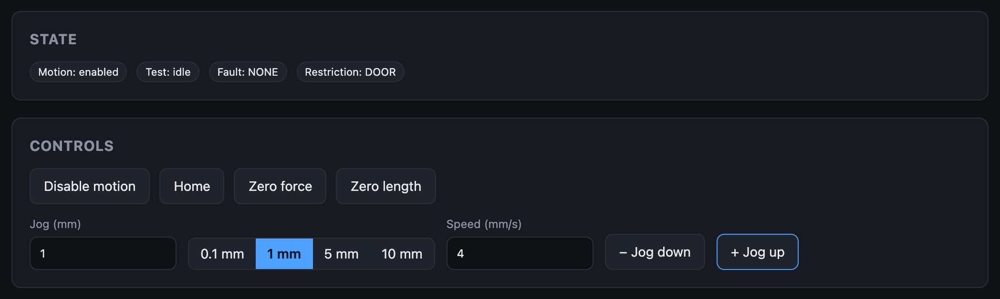

# Restrictions

A **restriction** is a condition the machine wants you to get out of: an end
stop, an open door, a force or length limit. It shows in the **Restriction**
badge on the Live screen.

What a restriction does:

- **It does not switch motion off.** The carriage can still be moved, so a
  sample is never left stranded under load.
- **It caps the speed** of every move at **Restricted Velocity** from the
  [machine configuration](../user-guide/machine-configuration.md), including
  one already under way.
- **An end stop also stops travel toward it.** A move heading into an active
  end stop is stopped, and further moves that way are refused, in a jog and in
  a test. A move away from it runs. A waveform does not start on an end stop.
- **It clears by itself** as soon as the condition ends.

!!! warning "Set Restricted Velocity"
    A **Restricted Velocity** of **0 means no cap**: the badge shows, and
    nothing slows down. Set it to a speed you're comfortable backing off an
    end stop at.

The two sample limits and the two end stops also **stop a running test**.

Only one restriction is shown at a time: the first in the order below.

## SAMPLE_LENGTH

**The sample reached its maximum displacement.**

Only checked while a test is running. Extension passed **Max displacement** in the sample profile.

**What to do:** The machine has stopped the test. Jog back, then raise the limit in the [sample profile](../user-guide/sample-profiles.md) if it was too tight.

## SAMPLE_TENSION

**The sample reached its maximum force.**

Only checked while a test is running. Sample force passed **Max force** in the sample profile.

**What to do:** The machine has stopped the test. Jog back to unload the sample, then raise the limit in the sample profile if it was too tight.

## MACHINE_TENSION

**Force is above the machine's own limit.**

**Machine Force** is above **Tensile Force Max** in the machine configuration. Checked all the time, test or not.

**What to do:** Jog down to relieve the load. If it shows with nothing loaded, the load cell values are wrong: run the [load cell calibration](../user-guide/load-cell-calibration.md).

## UPPER_ENDSTOP

**The carriage is on the upper end stop.**

The upper end stop switch is active: the jaws are as close together as the machine allows. A move that would bring them closer is stopped and refused.

**What to do:** Jog away from the switch. While it is active the machine accepts only a move that increases **Machine Position** (**+ Jog up**).

## LOWER_ENDSTOP

**The carriage is on the lower end stop.**

The lower end stop switch is active: the jaws are as far apart as the machine allows. A move that would take them further apart is stopped and refused.

**What to do:** Jog away from the switch. While it is active the machine accepts only a move that decreases **Machine Position** (**− Jog down**).

## DOOR

**The door is open.**

The door interlock switch is active.

**What to do:** Close the door.

## End stops and emergency-stop limits

Each end of travel is watched twice. The **end stop** raises a restriction and
stops travel toward it. The **emergency-stop limit** beyond it is part of the
emergency stop chain and raises an
[`ESD_UPPER` / `ESD_LOWER`](faults.md#esd_upper) fault, which switches motion
off.
