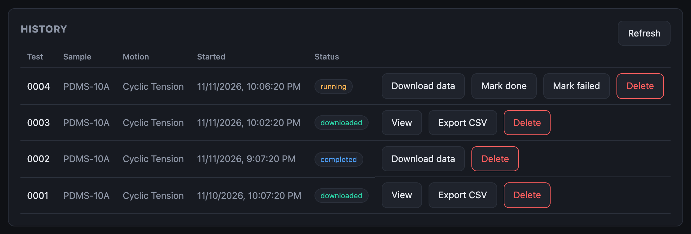
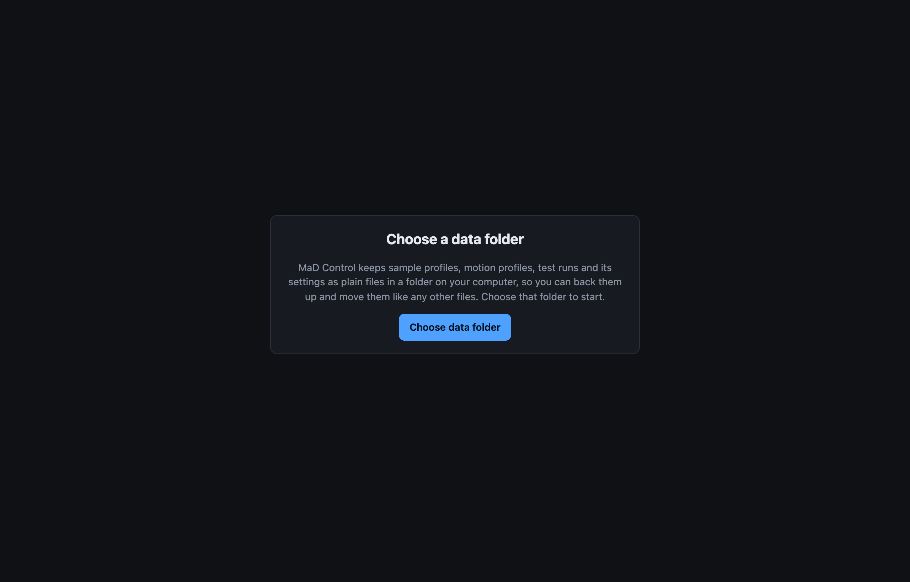

# Tests and data

## Run test is refused

| Message or symptom | Cause and fix |
|---|---|
| A red firmware banner is showing | The app won't start a test on firmware it can't talk to. See [Firmware problems](firmware.md). |
| Nothing to select in **New test** (on **Control**) | No profiles saved yet. Create a [sample profile](../user-guide/sample-profiles.md) and a [motion profile](../user-guide/motion-profiles.md), or use **Import .sp / .mp**. |
| The test starts and ends at once | A [fault](faults.md) is showing, so motion can't be enabled. Check the status banner on the Control screen. |
| *Run past the limits?* | The test goes beyond the machine configuration or the sample profile (speed, acceleration, travel or force); each problem is listed. **Cancel** and change the profiles, or **Run anyway**. |
| *This motion profile can't be run* | The profile is in the old format. The message names the move; rebuild the profile in [Motion profiles](../user-guide/motion-profiles.md). |
| A sine or chirp is refused | The machine won't run a sine or chirp it can't deliver at the amplitude asked (too fast for the machine's velocity or acceleration limit). Lower the frequency or amplitude; the motion profile editor shows the peak velocity. Straight and sigmoid moves aren't refused: they run at the machine's limits, slower than written. |

## A test stops early

| Toast | Cause |
|---|---|
| *Test stopped: sample limit exceeded* | The sample reached **Max force** or **Max displacement** from its sample profile. This is the limit doing its job; raise it if it was too tight. |
| *Test aborted: motion disabled* | Motion was switched off: **STOP**, **Disable motion**, or a [fault](faults.md). The Fault badge on Control shows which, if it is still present. |
| *Test aborted: waveform refused* | The machine could not deliver a waveform in the program. |

## A run is stuck in *running*

The app marks a run *completed* when the machine reports it finished, and on
connecting it completes any run left *running* once the machine reports it is
idle. A run that stays *running* means the machine still reports a test in
progress, or the app has not connected since.

Connect, and check **Control** shows `Test: idle`. If the row is still
*running*, use **Mark done** (or **Mark failed**) on it. **Download data**
still works.

## A run can't be viewed

**View** appears once the run is *downloaded*. Click **Download data** first.

If the download finds the machine recorded nothing, the run is marked *error*
with the reason under its badge: the test most likely failed to start or
stopped straight away.

## Download data fails

- The machine must be connected and responding.
- The recording is on the machine's SD card. If the card was removed or
  replaced, the data is gone from the machine.

## Runs or profiles are missing

The History table is built from an index file in the data folder. If you
switched folders or changed files outside the app, click **Settings → Rescan
folder** to rebuild it from the files that are there.

## Data folder

| Symptom | Cause and fix |
|---|---|
| The app asks for the folder when it opens | First run, or the browser forgot the folder. Click **Choose data folder** and pick the same one: your files are still in it. |
| *The browser needs your permission again* | Chrome re-asks after a restart. Click the **Allow** button. |
| Saves fail with an error toast | The disk is full, the folder was moved or deleted, or permission was withdrawn. Choose the folder again in **Settings**. |

{ width=520 }

## Numbers in the CSV look too large

The raw CSV on disk uses the machine's units (µs, mN, nm). **Export CSV** and
the run viewer use s, N and mm. See
[File formats](../user-guide/file-formats.md).
