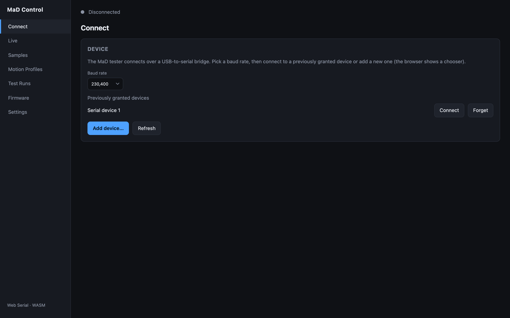
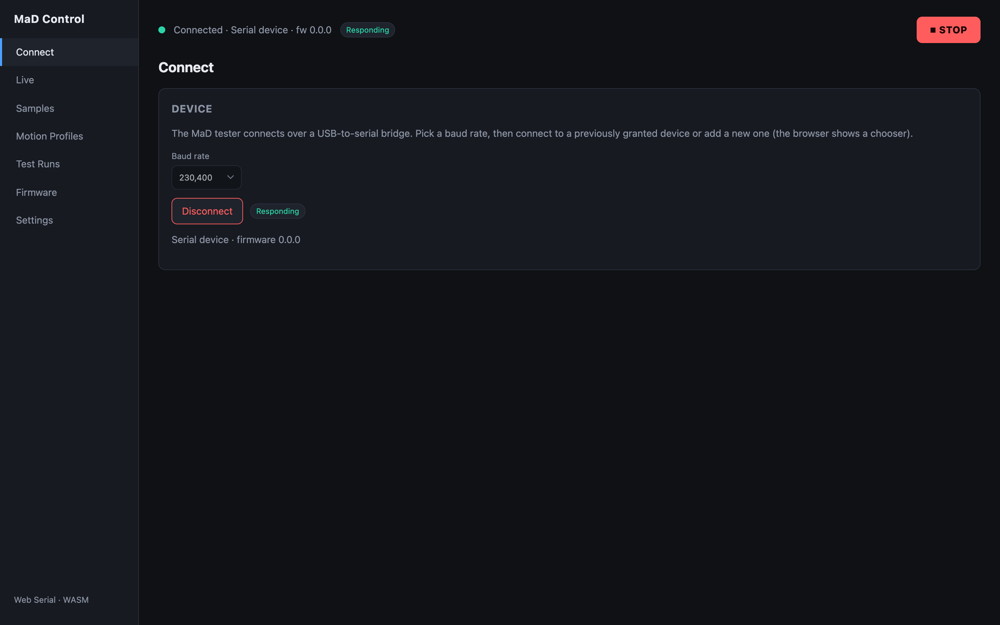

# Connecting

The **Connect** screen establishes the serial link between your browser and the
machine. The MaD tester presents itself as a USB-to-serial device.

Connect through the machine's **control port**: the USB-serial adapter on the
controller's secondary serial (P30/P32). On the Edge carrier v0.3 that is
header **J4**, through the isolator; on a P2-EVAL bench, an FTDI adapter with
its TX on P30 and its RX on P32. Opening the control port never restarts the
machine, so connecting, refreshing the page and auto-reconnect are safe even
mid-test. The Prop Plug on header **J1** (or the P2-EVAL's own USB) is the
**programming port**, used only by the [Firmware](firmware-and-diagnostics.md)
page: opening it restarts the machine, and the firmware doesn't talk the
protocol there. Machines still on firmware 0.14 or earlier are the exception:
they connect over J1.

## Connect to a machine

1. Power the machine on and plug its control-port adapter into your computer
   over USB.
2. Choose a **baud rate**. The default is **2,000,000**, which matches the firmware
   out of the box — only change this if your firmware is configured differently.
3. Connect:
    - If you've connected this device before, it appears in the **granted
      devices** list — click it to reconnect instantly.
    - Otherwise click **Connect device** (or **Add device…**). Your browser shows
      a native serial-port chooser; pick the control port and confirm. A port
      the Firmware page programs through is marked as its programming port in
      the granted list.

When the link is up, the status bar turns green and shows **Connected**, the port
label, and the firmware version. A **Responding** badge appears once the firmware
starts streaming sample data:

## Granted devices & permissions

The browser remembers devices you've granted access to. The list comes from the
browser's own `navigator.serial.getPorts()`, so permissions persist across
reloads and survive in your browser profile. Use **Refresh** to re-scan and
**Add device…** to authorise a new one.

## Disconnecting & reconnecting

- **Disconnect** cleanly closes the port.
- If the link drops unexpectedly (USB unplugged, machine power-cycled), the
  status bar shows **Disconnected** with a **Reconnect** button that retries the
  last port and baud rate. When you replug the device, the app auto-reconnects.
  If two granted ports share the adapter's USB id (the Prop Plug and the
  control adapter can be identical FTDI parts), it doesn't guess: pick the
  control port yourself.
- Reconnecting does not restart the machine. To restart it, power-cycle it
  ([Rebooting the machine](firmware-and-diagnostics.md#rebooting-the-machine)).

!!! note "Responding vs. Connected"
    **Connected** means the serial port is open. **Responding** means the
    firmware is actually answering — sample data is flowing. If you see
    *Connected* but *Not responding*, the port opened but the firmware isn't
    talking; check power and baud rate, and see
    [Troubleshooting](troubleshooting.md).
