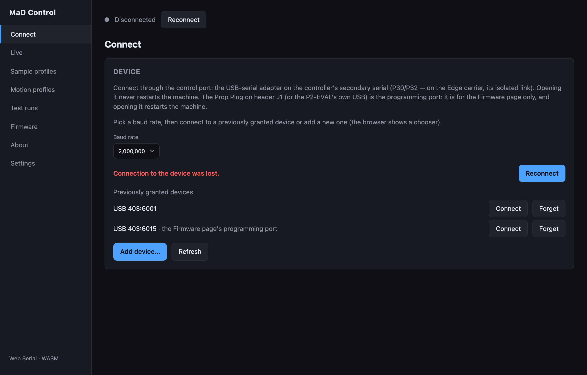

# Connecting

The **Connect** screen opens the serial link between your browser and the
machine.

## Which port

Connect through the machine's **control port**: the USB-serial adapter on the
controller's secondary serial (P30/P32). On the Edge carrier that is header
**J4**, through the isolator; on a P2-EVAL bench, an FTDI adapter with its TX
on P30 and its RX on P32.

Opening the control port never restarts the machine, so connecting, refreshing
the page and auto-reconnect are safe even mid-test.

The Prop Plug on header **J1** (or the P2-EVAL's own USB) is the **programming
port**. It belongs to the [Firmware](firmware-and-diagnostics.md) screen:
opening it restarts the machine, and the firmware does not answer the app
there. [The two ports](../getting-started/connect.md#the-two-ports) compares
them.

## Connect to a machine

1. Power the machine on and plug in the control-port adapter.
2. Leave **Baud rate** at **2,000,000**. It matches the firmware; any other
   value shows a reminder that the hardware expects 2,000,000.
3. Connect:
    - A port you have used before is listed under **Previously granted
      devices**: click **Connect** beside it.
    - Otherwise click **Connect device** (**Add device…** when the list is not
      empty) and pick the control port in the browser's chooser.

The port the Firmware screen programs through is labelled *the Firmware page's
programming port* in the list.

When the link is up, the status bar turns green and shows the port and the
firmware version. **Responding** appears once the firmware is answering:

## Granted devices

The browser remembers the ports you have allowed, per browser profile.
**Refresh** re-reads the list, **Add device…** allows a new one, and
**Forget** removes one.

Ports are named by their USB vendor and product id (for example `USB
403:6001`), which is all the browser exposes. Two adapters of the same model
look identical.

## Disconnecting and reconnecting

- **Disconnect** closes the port. The machine is not affected.
- If the link drops (cable pulled, machine power-cycled), the screen shows
  **Connection to the device was lost** with a **Reconnect** button, which
  retries the same port and baud rate. The app also reconnects by itself when
  the adapter is plugged back in.

    

- If two granted ports have the remembered adapter's USB id, the app does not
  guess between them: pick the control port yourself.
- Reconnecting does not restart the machine. To restart it, power-cycle it.

!!! note "Connected vs. Responding"
    **Connected** means the serial port is open. **Responding** means the
    firmware is answering. *Connected* with *Not responding* is covered in
    [Connection problems](../troubleshooting/connection.md#connected-but-not-responding).
