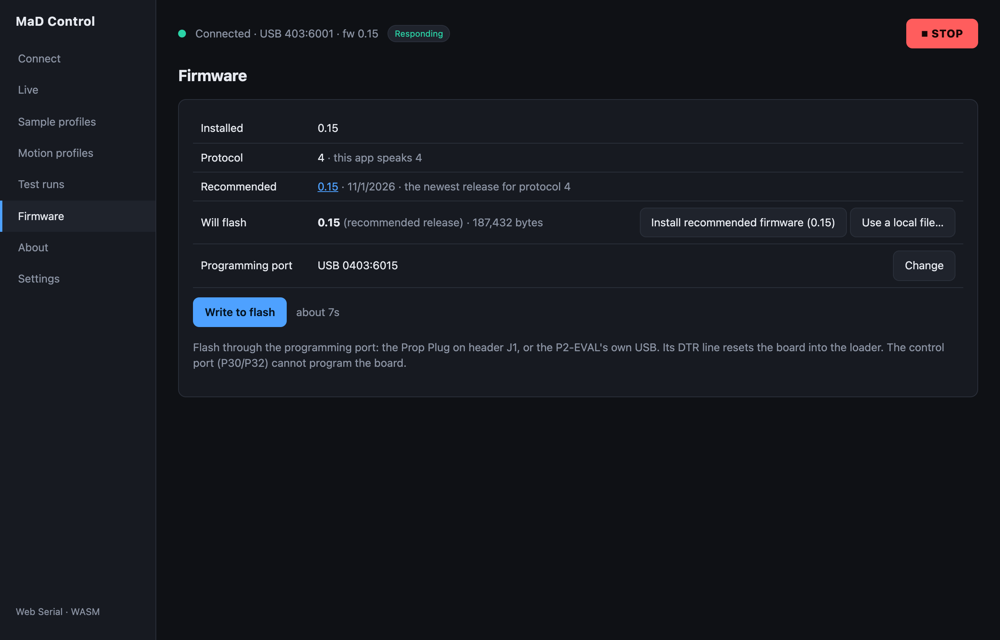
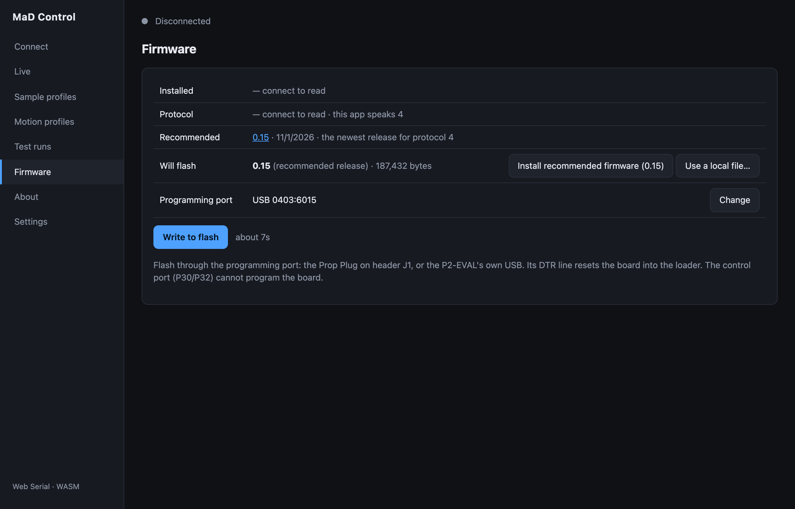
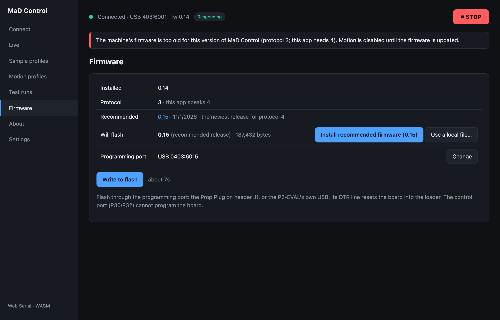
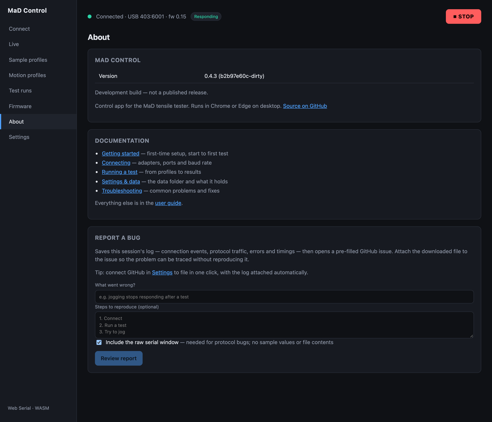

# Firmware

The **Firmware** screen shows the firmware the machine is running, the release
this app recommends, and flashes it. For the first-time walkthrough see
[Flash the firmware](../getting-started/flashing-firmware.md).

## What the screen shows

| Row | Meaning |
|---|---|
| **Installed** | The version the connected firmware reports. *— connect to read* when nothing is connected. |
| **Protocol** | The protocol version the firmware speaks, and the one this app speaks |
| **Recommended** | The newest published firmware release that speaks this app's protocol, with a link to its release notes |
| **Will flash** | What a flash would write: the recommended release, or a local file |
| **Programming port** | The port the flash goes through; **Change** picks another |

Without a machine connected the screen still shows the recommended release and
can flash it, which is how a blank board gets its first firmware:

## How the app decides the firmware is compatible

Every build of the firmware and of the app is generated from one protocol
definition, which carries a **protocol version**. That number changes whenever
the messages change in a way the other side could misread.

Each time the app connects it asks the firmware for its protocol version, and
until the answer matches its own it **refuses to move the machine**: enable
motion, jog, home, calibration and running a test are all blocked, and a banner
on every screen says why. **STOP** and **Disable motion** always work.

| Verdict | Banner | Motion |
|---|---|---|
| Still asking | *Checking which protocol the machine's firmware speaks…* | Blocked until it answers |
| Same protocol | none | Allowed |
| Firmware older | *The machine's firmware is too old for this version of MaD Control…* | Blocked: update the firmware |
| Firmware newer | *The machine's firmware is newer than this version of MaD Control…* | Blocked: open the app release the banner names, or install this app's firmware |
| No answer | *The machine's firmware did not say which protocol it speaks…* | Blocked: reconnect, or update the firmware |
| Same protocol, older than a fix this app knows about | *A firmware update is recommended…* | Allowed |

[Firmware problems](../troubleshooting/firmware.md) shows each banner and what
to do.

## Updating

1. Plug the Prop Plug into **J1** (or the P2-EVAL USB) alongside the control
   port.
2. Check **Programming port** names it. The app never offers the control port
   it is connected through.
3. Click **Install recommended firmware**, check the file and port named in the
   prompt, and confirm.

The app stops the control session, resets the controller into its boot loader
through the Prop Plug, uploads the image, and waits while the controller writes
it to its SPI flash. The controller then boots the new firmware, and the app
reconnects on the control port and checks the protocol again.

The update is permanent: the controller boots from that flash on every
power-up.

### A local file

**Use a local file…** picks any image (a development build, for example).
**Write to flash** then writes that file. **Install recommended firmware**
always writes the recommended release, whatever file is picked.

### Choosing the programming port

The browser identifies a port only by its USB vendor and product id, and the
Prop Plug and the control adapter can be the same part. If more than one port
could be the programming port, the app asks instead of guessing. **Change**
sets it, and the choice is remembered; the Connect screen then labels that port
so you don't connect to it by mistake.

## Restarting the machine

After you write the machine configuration, the app offers **Reboot now**,
which tells the machine to restart and reconnects once it has booted. Otherwise,
to restart it, power-cycle it.

## Updating the app

The app updates separately from the firmware. When a new version has been
downloaded the status bar shows **Update ready**. It is applied only when you
click it while disconnected, so the app never reloads during a test.

**About** shows the version you are running and lets you open another
published version.

## Reporting a bug

**About → Report a bug** packages what the app has been doing into a file for
a GitHub issue.

1. Describe what went wrong (and, if you can, the steps).
2. Click **Review report**. The app shows exactly what will be sent.
3. Click **Download and open issue**: the session log is saved to your
   computer and a pre-filled GitHub issue opens. Attach the file to it.

The log holds connection events, protocol traffic, errors and timings. It has
no sample values, no file contents and no folder paths. Tick **Include the raw
serial window** for protocol problems.

If you connect a GitHub token under **Settings → GitHub (optional)**, the
button becomes **File issue on GitHub** and attaches the log for you.
