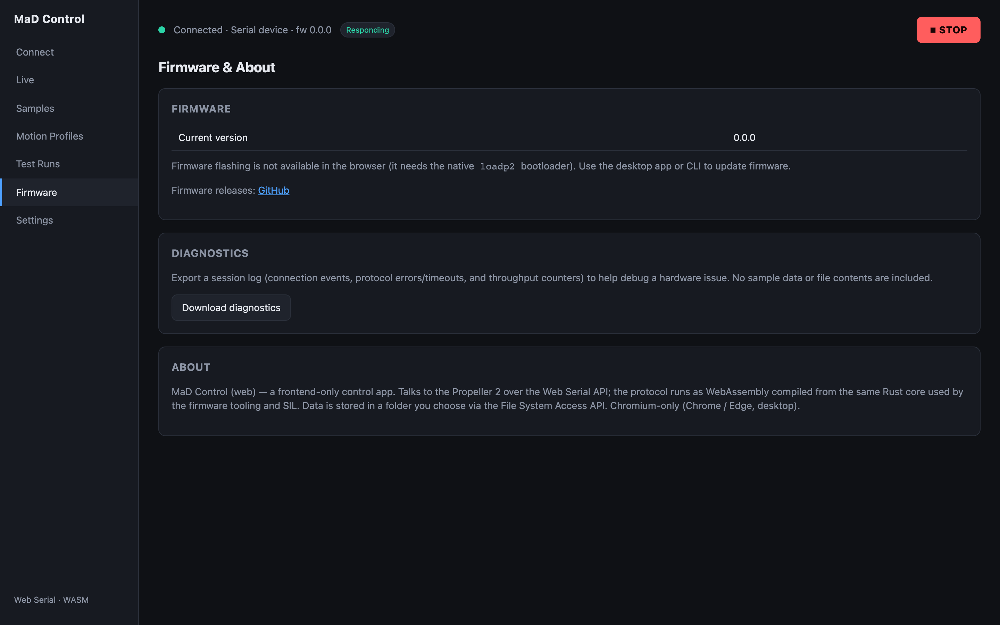

# Firmware & diagnostics

The **Firmware** screen shows the firmware version reported by the connected
machine and lets you update it. Diagnostics for troubleshooting live on the
**About** screen.

## Firmware version

When the machine is connected and responding, its **firmware version** is shown
here (and in the status bar). If it shows nothing, the firmware isn't responding —
see [Troubleshooting](troubleshooting.md).

## Updating the firmware

The app programs the Propeller 2 straight from the browser. There is nothing
to install.

### Two ports: control and programming

The machine has two serial ports with separate jobs, and the app uses each for
one thing only:

| Port | What plugs in | Used for |
|---|---|---|
| **Control port** | A USB-serial adapter on the controller's secondary serial, P30/P32. On the Edge carrier v0.3 that is header **J4**, through the isolator; on a P2-EVAL bench, an FTDI adapter with its TX on P30 and its RX on P32. | The **Connect** page: live data, jogging, tests. Opening it never resets the machine, so connecting, refreshing the page and auto-reconnect are all safe mid-test. |
| **Programming port** | A Prop Plug on the **Debug/Programming header (J1)**, wired pin 1→4 as `P62 / P63 / RESn / GND`, or the P2-EVAL's own USB. | The **Firmware** page only. Its adapter drives RESn from DTR, so **opening it resets the machine**. It also carries the firmware's debug log. |

Both are usually plugged in at once. The firmware never talks the protocol on
J1, so connecting the app there finds no machine (and restarts it). The
control port has no reset line, so it cannot program the board.

### What flashing does

The Propeller 2 boots from its SPI flash, so an update writes there and takes
effect immediately: the board reboots into the new firmware and stays on it
through power cycles.

This is the only mode the app offers. The chip can also run firmware straight
from RAM without writing it, which is useful when bringing up a board, but that
copy disappears at the next reset — as an update it would look like it worked
and then silently revert. That path lives in the `hw:flash` developer CLI
instead.

### When the app asks you to update

Each version of MaD Control speaks one version of the serial protocol, and
on connect it asks the firmware which one it speaks. Until the firmware
answers with this app's protocol, the app refuses to move the machine
(enable motion, jog, home, run a test), and a banner under the status bar
says why on every screen.
**STOP** and disabling motion always work.

- **Firmware too old**: the firmware speaks an older protocol, or is from
  before the app could ask. Click **Update firmware**, then **Install
  recommended firmware** on the Firmware screen.
- **Firmware newer than this app**: click **Open the latest MaD Control**.
- **Firmware update recommended**: the protocols match, but this app version
  recommends a newer firmware release for a fix. The machine still moves;
  update when convenient.
- **Checking which protocol the firmware speaks**: shown for a moment after
  connecting. Motion stays disabled until the firmware answers.
- **Firmware did not say which protocol it speaks**: the firmware never
  answered, so the app can't tell whether it is safe to drive. Motion stays
  disabled: check the cable and reconnect, or update the firmware.

### Doing the update

1. **Connect to the machine** on the control port as usual. The **Firmware**
   screen shows the **Installed** version, the **Protocol** it speaks next to
   the one this app speaks, and the **Recommended** release: the newest
   firmware release that speaks this app's protocol.
2. **Will flash** shows the recommended release. Each release has one image,
   `MaD-Firmware-<version>.bin`, fetched by the app — there is nothing to
   download. To flash any other image, or a local build, click **Use a local
   file…** and pick it.
3. Check the **Programming port** shown is the Prop Plug on J1 (or the
   P2-EVAL USB) of the machine you mean to program. The app never offers the
   control port it is connected through. Then click **Install recommended
   firmware** (or **Write to flash** for a local file; with none picked it
   writes the recommended release too). The prompt names the file it will
   write: check it is `MaD-Firmware-<version>.bin` (or the local file you
   picked), then confirm.
4. The app stops the control session, then the status line walks through
   *Resetting the board…*, *Uploading… n%*, then *Finishing…*.
5. When it completes, the app reconnects on the **control port** (never the
   programming port) and asks the protocol again, and the banner clears.
   Confirm **Installed** shows the version you just flashed.

!!! tip "Choosing the programming port"
    The browser only sees USB vendor and product IDs, and the Prop Plug and a
    control adapter can be identical FTDI parts. If more than one port could
    be the programming port, the app refuses to guess and asks you to choose.
    **Change** sets it explicitly, and the choice is remembered; the Connect
    page then marks that port as the Firmware page's programming port so you
    don't connect to it by mistake.

!!! note "Machines still on firmware 0.14 or earlier"
    Releases up to 0.14 talk the protocol on J1 itself, so a machine on one of
    those connects over J1. The app never recommends those releases, and any
    newer one moves the protocol to P30/P32: don't install it on a machine
    with nothing wired there, or the app can no longer talk to it (flashing
    0.14 back over J1 as a local file recovers it). The real machine stays on
    0.14 until its Edge carrier v0.3 (the one with the isolated J4 link) is
    built. A P2-EVAL bench moves over by rewiring its FTDI adapter from
    P53/P55 to P30 (adapter TX) and P32 (adapter RX).

### Rebooting the machine

Reconnecting on the control port does not restart the machine. When a restart
is needed (to clear a latched fault, say), power-cycle it, or have the app send
the protocol's **reboot** command: the firmware acknowledges, disables motion
and restarts about 100 ms later, and the app reopens the control port to pick
up the new boot. The firmware refuses to reboot while a test runs.

### If it doesn't work

- **Nothing happens, or it fails while resetting** — the programming port
  isn't the Prop Plug on J1 (or the P2-EVAL USB), or the adapter isn't driving
  RESn from DTR. Check **Programming port** and use **Change**.
- **It fails partway through the upload** — retry. The board holds the previous
  firmware until a write completes, so a failed attempt leaves it as it was.
  If it keeps failing, power-cycle the machine and try again.
- **The version doesn't change after a flash** — the machine may have rebooted
  into the previous image. Power-cycle it, reconnect, and check again.
- **Connected, but never Responding** — the app is probably on the wrong
  port. On firmware newer than 0.14 the protocol is only on the control port
  (P30/P32): connect there, not to J1. Programming doesn't need the firmware
  to answer, so the machine can still be flashed from the Firmware page.

## Diagnostics export

Click **Download diagnostics** to save a file recording what the app has been
doing — connections, errors, timeouts, and rejected commands — plus some
performance counters. It contains **no test data**, so it's safe to attach when
reporting a problem.

!!! info "Updating the app"
    The app and the firmware update separately. When a new version of the **app**
    is published, the status bar shows an **Update ready** button. It is applied
    only when you click it **and** are idle and disconnected — the app will never
    reload itself mid-test.
