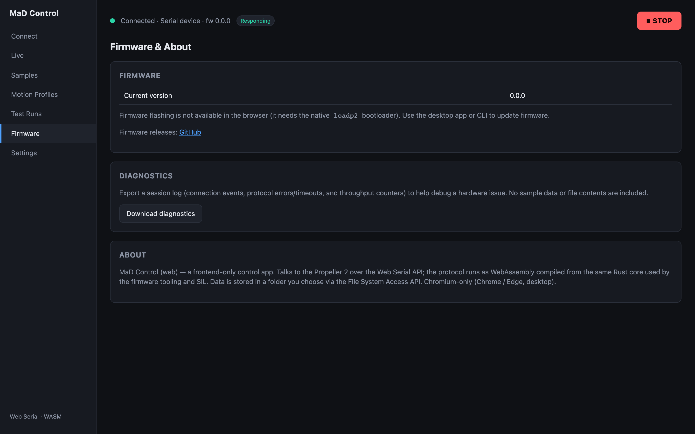

# Firmware & diagnostics

The **Firmware** screen shows the firmware version reported by the connected
machine and lets you update it. Diagnostics for troubleshooting live on the
**About** screen.

## Firmware version

When the machine is connected and responding, its **firmware version** is shown
here (and in the status bar). If it shows nothing, the firmware isn't responding —
see [Troubleshooting](troubleshooting.md).

## Updating the firmware

The app programs the Propeller 2 over the same USB connection it uses for
control. There is nothing to install.

### What you need

- A cable to the board's **Debug/Programming header (J1)** — the 4-pin header
  fitted to every EdgeBoard, wired pin 1→4 as `P62 / P63 / RESn / GND`.
- A USB-serial adapter that **drives RESn from DTR**, such as a Parallax Prop
  Plug. The app resets the chip that way to reach its boot ROM.

On production hardware the control link and the programming link are the same
connection, so if you can already talk to the machine, you can already program it.

!!! danger "The isolated Raspberry Pi link cannot program the board"
    On the machine's P2-EC32MB module, that link isn't connected to the chip:
    its pins (P52–P55) go to the module's own memory. Where a bench brings
    P53/P55 out, the link still has **no reset line**. Either way, flashing over
    it won't work. Use the J1 header.

### What flashing does

The Propeller 2 boots from its SPI flash, so an update writes there and takes
effect immediately: the board reboots into the new firmware and stays on it
through power cycles.

This is the only mode the app offers. The chip can also run firmware straight
from RAM without writing it, which is useful when bringing up a board, but that
copy disappears at the next reset — as an update it would look like it worked
and then silently revert. That path lives in the `hw:flash` developer CLI
instead.

### Doing the update

1. **Connect to the machine** as usual. The **Firmware** screen shows the
   **Installed** version next to the **Latest release**.
2. **Will flash** shows the latest release. The app writes that release's
   production build (`MaD-Firmware-<version>-release.bin`), fetched by the app —
   there is nothing to download. It puts the protocol on J1, so the app reaches
   the new firmware on the port it just programmed. MaD Control 0.4.2 and
   earlier label this row "MadEdge" whatever the image is; the prompt in step 3
   names the real file. Releases from 0.13 on also carry a `-madEdge.bin` build
   for a bench with a second adapter: it moves the protocol to P53/P55 and puts
   a debug log on J1. Don't flash it to the machine — its P2-EC32MB module uses
   P40–P57 for its own memory and doesn't bring them out, so the app could no
   longer reach the firmware. To flash that build, or a local one, click
   **Use a local file…** and pick it.
3. Check the **Port** shown is the machine you mean to program, then click
   **Write to flash**. The prompt names the file it will write: check it is
   `MaD-Firmware-<version>-release.bin` (or the local file you picked), then
   confirm.
4. The status line walks through *Resetting the board…*, then *Uploading… n%*,
   then *Finishing…*.
5. When it completes, confirm **Installed** shows the version you just
   flashed.

!!! tip "Bench setups with two adapters"
    The **Port** line names the port that will be programmed. On production
    hardware there is only one and the app picks it. If several serial devices
    are attached it will refuse to guess and ask you to choose, because the
    browser only sees USB vendor and product IDs — two identical adapters are
    indistinguishable to it. **Change** lets you set it explicitly,
    and the choice is remembered.

### If it doesn't work

- **Nothing happens, or it fails while resetting** — the adapter probably isn't
  driving RESn from DTR, or it isn't on J1. Check you're on J1 with a Prop Plug
  or equivalent.
- **It fails partway through the upload** — retry. The board holds the previous
  firmware until a write completes, so a failed attempt leaves it as it was.
  If it keeps failing, power-cycle the machine and try again.
- **The version doesn't change after a flash** — the machine may have rebooted
  into the previous image. Power-cycle it, reconnect, and check again.
- **Connected, but never Responding, after flashing a `-madEdge.bin`** — that
  build talks on P53/P55, which don't reach the machine's chip. Programming
  doesn't need the firmware, so the machine can still be flashed: on the
  **Firmware** screen pick the J1 port, click **Write to flash**, and check the
  prompt names `MaD-Firmware-<version>-release.bin` before you confirm. If the
  app was connected on J1, it reconnects there afterwards and the machine
  answers; otherwise connect to J1.

## Diagnostics export

Click **Download diagnostics** to save a file recording what the app has been
doing — connections, errors, timeouts, and rejected commands — plus some
performance counters. It contains **no test data**, so it's safe to attach when
reporting a problem.

!!! info "Updating the app"
    The app and the firmware update separately. When a new version of the **app**
    is published, the status bar shows an **Update ready** button. It is applied
    only when you click it **and** are idle and disconnected — the app will never
    reload itself mid-test.
