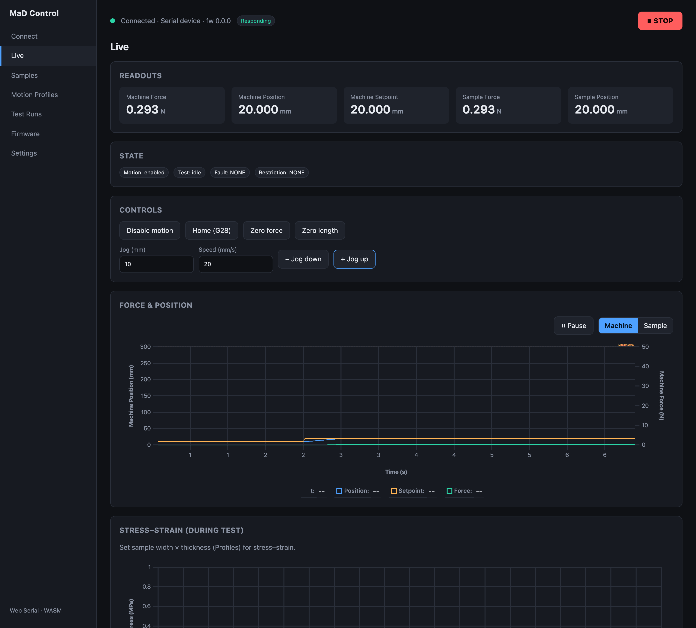

# Control

The **Control** screen is the hub: real-time readouts, machine state, manual
controls, and live charts, all updating continuously while you're connected.

## Readouts

The top row shows live numeric values. Each has a tooltip explaining it (hover to
read):

| Readout | Meaning |
|---|---|
| **Machine Force** | Force measured at the gauge, in machine coordinates |
| **Machine Position** | Gantry position from the encoder |
| **Machine Setpoint** | Where the motion trajectory says the gantry should be right now, with acceleration included. Machine Position follows it, and a test run records it as *setpoint*. |
| **Machine Target** | Where the current move ends. It changes in one step when a move starts. |
| **Sample Force** | Force in sample coordinates (zeroed at the gauge) |
| **Sample Position** | Extension of the sample relative to its gauge length |

Forces are shown in **N**, positions in **mm**.

## Machine state

A coloured **status banner** at the top says what the machine is doing and what
to do next: green when it's ready, amber when motion is off or the machine is
restricted (with the step that fixes it, such as **Enable motion**), red for a
fault with its remedy, and the accent colour while a test runs (press **STOP** to end it).
**Jog** and **Home** are locked while motion is off, faulted or a test is
running; hover them for the reason.

Beneath it, the **State** badges summarise the details:

- **Motion** — whether motion is enabled.
- **Test** — whether a test is running.
- **Fault** — something needs attention. A fault stops motion and usually needs a
  machine reboot to clear. A servo stall is the exception: it clears when you
  disable motion (see [Clear a servo stall](manual-control.md#clear-a-servo-stall)).
- **Restriction** — something is currently *limiting* motion, such as an endstop
  or an open door. Restrictions clear on their own once the cause is resolved.

Hover any fault or restriction badge for a plain-language explanation of that
specific code. While a fault is showing, its explanation also appears under the
controls. [States, faults & restrictions](machine-states.md) lists them all.

## Live charts

### Force & Position

A dual-axis, 60-second rolling chart plots **position** (left axis) and **force**
(right axis) together. You can:

- Toggle between **Machine** and **Sample** coordinates.
- See **limit reference lines** (max force / max position) drawn from the machine
  configuration and the loaded sample profile.
- **Pause** the sweep to inspect a moment without losing the connection.
- Compare the **Setpoint** (the machine's trajectory) with **Expected**, the
  ideal path a jog or test asks for: a straight line at exactly the commanded
  speed, with no acceleration. The gap between them is the machine's
  acceleration; the gap between Setpoint and Position is how well it follows.
- Hover to read every series at that moment, with a vertical line marking it.

When you connect, the chart is pre-filled with the machine's most recent
readings, so you see recent history straight away rather than an empty plot.

### Stress–strain

A live stress–strain scatter accumulates **only while a test is running** and
clears at the start of each test, with max-stress / max-strain limit lines from
the sample profile.

## Controls

The manual **controls** (Enable motion, Home, Zero, Jog) also live on this
screen — see [Manual control](manual-control.md).
