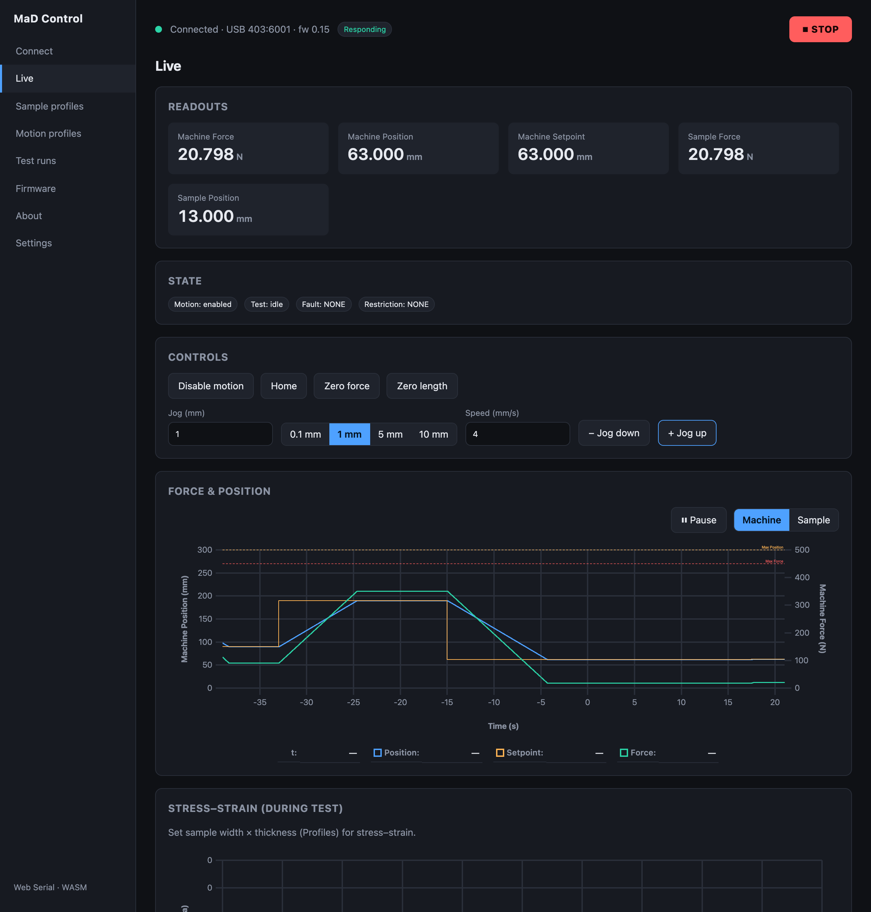
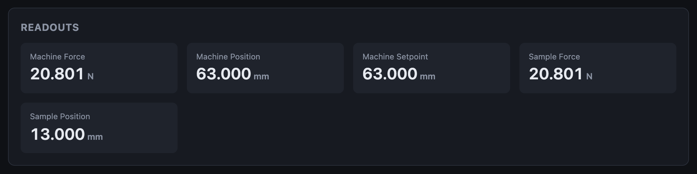
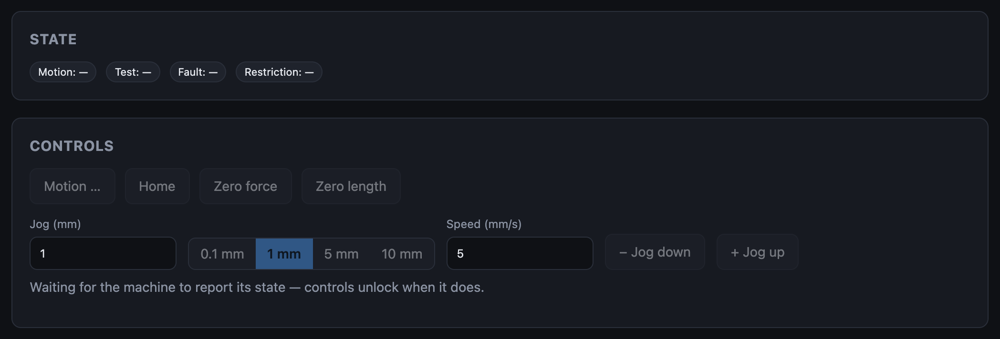
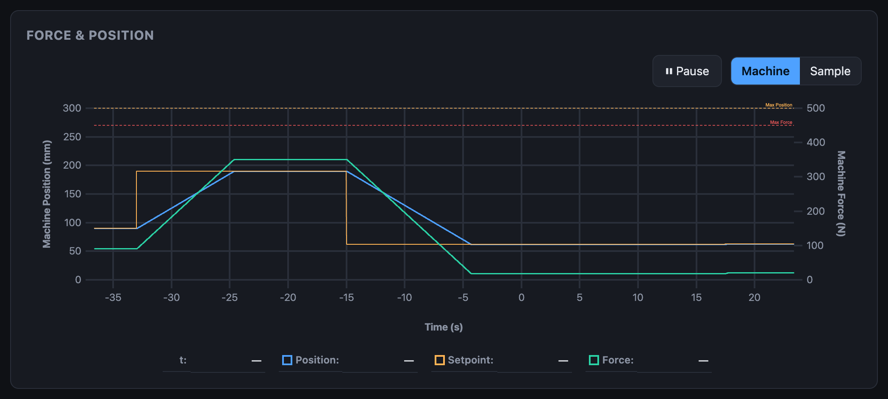

# Live monitoring

The **Live** screen is the hub: readouts, machine state, manual controls and
live charts, all updating while you're connected.

## Readouts

| Readout | Meaning |
|---|---|
| **Machine Force** | The absolute force at the load cell |
| **Machine Position** | Jaw separation, from the encoder |
| **Machine Setpoint** | Where the current move ends |
| **Sample Force** | Force since **Zero force** |
| **Sample Position** | Extension since **Zero length** |

Forces are in **N**, positions in **mm**. The numbers refresh four times a
second so they stay readable; the charts draw every sample. Hover a readout for
its description.

## State

Four badges say what the machine is doing:

| Badge | Values |
|---|---|
| **Motion** | *enabled* or *disabled*: whether the machine will act on a move |
| **Test** | *running* or *idle* |
| **Fault** | `NONE`, or the reason motion is switched off. Turns red. See [Faults](../troubleshooting/faults.md). |
| **Restriction** | `NONE`, or a condition limiting motion. See [Restrictions](../troubleshooting/restrictions.md). |

Hover a fault or restriction badge for a one-line explanation. While a fault
is showing, the same explanation appears under the controls.

A badge showing **—** means the machine has not reported its state yet. The
controls stay locked until it does:

How these badges relate to the machine's internal state (DISABLED, RESTRICTED,
MANUAL, TEST) is in the
[theory of operation](../how-it-works/the-machine.md#the-state-machine).

## Force & Position chart

A 60-second rolling chart of **position** and **setpoint** (left axis) and
**force** (right axis).

- **Machine / Sample** switches between absolute values and values since
  zeroing.
- The dashed lines are the limits: **Max Position** and **Max Force** from the
  machine configuration, and the sample profile's limits once one is selected
  for a run.
- **Pause** freezes the sweep so you can inspect a moment. The connection and
  recording are unaffected.
- Hover the chart to read values off the legend.

When you connect, the chart is filled with the machine's most recent readings
rather than starting empty.

## Stress–strain chart

Plots stress against strain **only while a test is running**, and clears at
the start of each test. It needs the sample's width and thickness from the
[sample profile](sample-profiles.md).

## Controls

Enable motion, home, zero and jog are covered in
[Manual control](manual-control.md).
