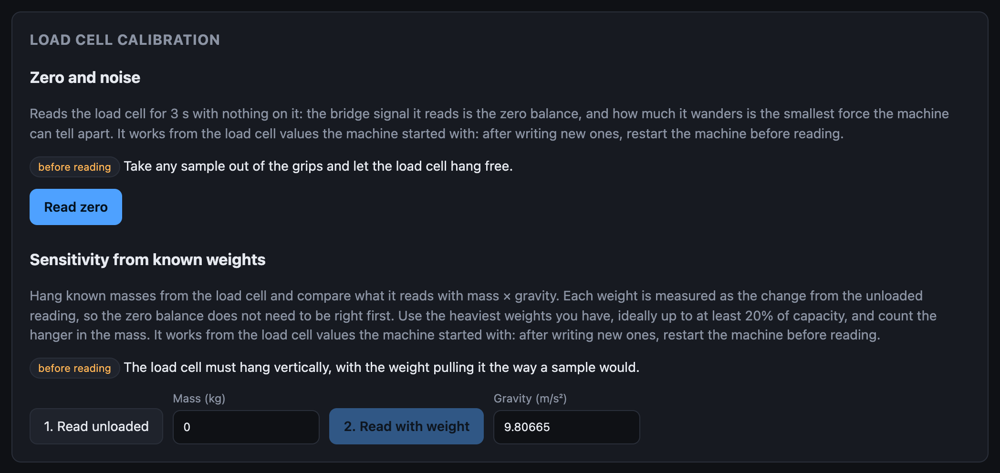
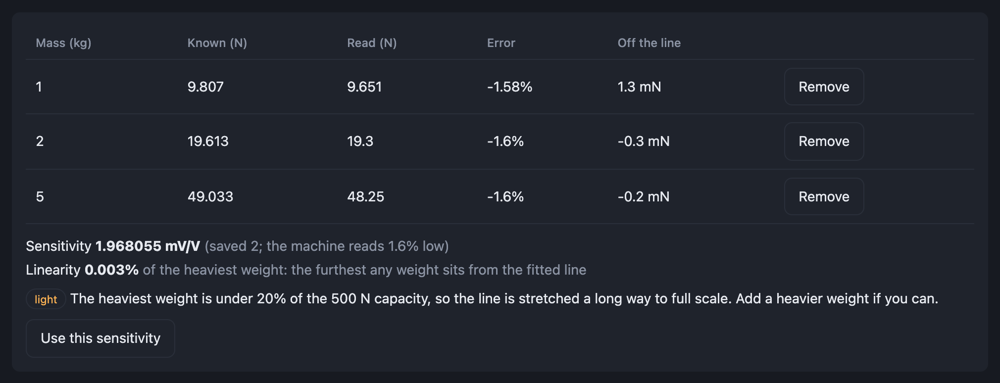

# Load cell calibration

The **Load cell calibration** box on **Settings**, below
[Motor calibration](motor-calibration.md), measures the two load cell values a
datasheet can only give you nominally. Neither step moves the carriage.

Force is worked out from the bridge signal as
(signal − **Zero Balance**) × **Capacity** ÷ **Sensitivity**, all in **mV/V**:
millivolts of bridge output per volt of excitation. A load cell rated 2 mV/V
puts out 2 mV per volt of excitation at its capacity, so 10 mV at 5 V. The
machine measures the signal against the excitation itself, so supply drift
cancels out.

!!! warning "Restart after writing load cell values"
    The machine loads the load cell values when it starts. Both steps work
    from the values it **started with**, so after **Write to device**, restart
    the machine before reading again.

## Zero and noise

Take any sample out of the grips, let the load cell hang free, and press
**Read zero**. It reads for 3 s and reports:

- **Zero balance**: the bridge signal with nothing on the load cell, next to
  the saved value and the force the saved one was leaving in the readings.
  **Use this zero** puts it into **Load Cell Zero Balance (mV/V)** in Machine
  configuration; then **Write to device** and restart.
- **Noise**: one standard deviation of the readings, in force, in nV/V and as a
  share of capacity, and the spread from lowest to highest. This is the
  smallest force the machine can tell apart.
- **still settling**: the reading moved more than its noise explains while it
  was read. Wait (a cold load cell can take minutes) and read again. The noise
  figure includes the drift while it does.

## Sensitivity from known weights

The load cell must hang vertically, with the weight pulling it the way a sample
would.

1. Press **1. Read unloaded**.
2. Enter the mass in **Mass (kg)**, counting the hanger, hang it, and press
   **2. Read with weight**.
3. Repeat step 2 with more weights, the heaviest you have, ideally up to at
   least 20% of capacity. Press **Read unloaded again** whenever you like: each
   weight is measured from the most recent unloaded reading, and the panel
   shows how far that has moved from the first one.

Each weight is the change from the unloaded reading, so the **zero balance does
not have to be right first**. The new sensitivity is the saved one × the force
read ÷ (mass × gravity); with several weights it comes from a least-squares
line through zero. **Gravity (m/s²)** defaults to standard gravity, 9.80665;
local gravity differs by up to about 0.3%.

Each weight's row shows its known force, the force read, the **error** against
the saved sensitivity, and how far it sits **off the line**. **Linearity** is
the furthest any weight sits from the line, as a share of the heaviest weight.
**Use this sensitivity** puts the value into **Load Cell Sensitivity (mV/V)**;
then **Write to device** and restart. **Remove** drops a weight.

## Flags

| Flag | What it means | What to do |
|---|---|---|
| polarity | The weights read as pushing | If they hang the way a sample pulls, the load cell is wired the other way round; the new sensitivity flips its sign to match |
| light | The heaviest weight is under 20% of capacity, so the line is stretched a long way to full scale | Add a heavier weight |
| swinging | A weight was still moving while it was read | Remove it, let it settle, read it again |
| moved the reading by under 50 mN | That weight barely registered | Check it hangs from the load cell, and that Capacity and Sensitivity are entered |
