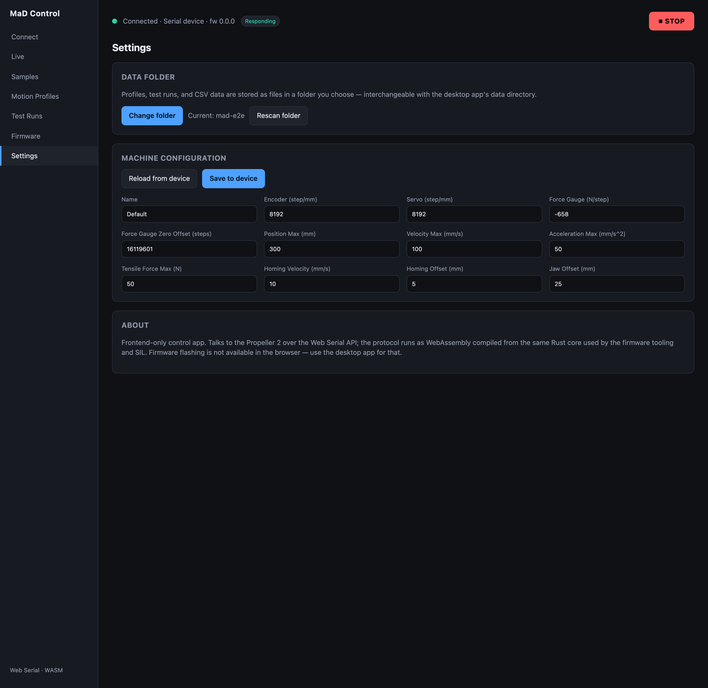

# Machine configuration

The **machine configuration** is the calibration and limits stored on the machine
itself. It describes *this* machine — its mechanics and sensors — and rarely
changes. You read and edit it on the **Settings** screen.

## Reading & writing

- The configuration loads from the device when you open **Settings** while
  connected.
- Edit a field, then **Write to device** to write it back to the machine, where it
  persists across power cycles.
- **Read from device** re-reads the configuration, discarding unsaved edits.

!!! warning "These values calibrate the machine"
    Getting the steps-per-mm or force calibration wrong will make every
    measurement wrong (and could drive the gantry past safe limits). Change these
    only if you know the machine's mechanics.

## Fields

These are the fields as they appear on the Settings screen, in order.

| Field | What it sets |
|---|---|
| **Name** | A label for this machine |
| **Encoder (step/mm)** | Encoder counts per millimetre of travel |
| **Servo (step/mm)** | Motor pulses per millimetre of travel |
| **Load Cell Capacity (N)** | The load cell's rated force, from its datasheet |
| **Load Cell Sensitivity (mV/V)** | The load cell's output at capacity, per volt of excitation (its datasheet's rated output; the [load cell calibration](#load-cell-calibration) measures it) |
| **Load Cell Zero Balance (mV/V)** | What the load cell reads with nothing on it (the [load cell calibration](#load-cell-calibration) measures it) |
| **Position Max (mm)** | How far the jaw is allowed to travel |
| **Velocity Max (mm/s)** | Fastest the machine will move |
| **Acceleration Max (mm/s²)** | How hard the machine is allowed to accelerate |
| **Tensile Force Max (N)** | Force at which the machine protects itself |
| **Homing Velocity (mm/s)** | Speed used when homing |
| **Homing Offset (mm)** | Offset applied after homing |
| **Jaw Offset (mm)** | Distance from the home reference to the jaw |
| **Servo Kp (1/s)** | How hard the servo corrects a position error (8 by default; the motor calibration suggests a value) |
| **Servo Ki (1/s^2)** | Removes a steady position error under load (0 = off) |
| **Drive enable** | Which level of the drive's enable input turns the drive on. Servo drives such as the DMM DYN4 are on while the input is energized (**High enables**, the default); most stepper drivers are off while it is energized (**Low enables**). If this is wrong, the drive never turns on and the carriage doesn't move. Takes effect after a reboot. |

These are *machine* limits — distinct from the per-test limits you set in a
[sample profile](sample-profiles.md). Both are enforced, and whichever is more
conservative wins.

## Motor calibration

The **Motor calibration** box on **Settings**, below **Machine configuration**,
has two routines. Run them in order:

1. **Drive and encoder check.** Checks that **Encoder (step/mm)** and
   **Servo (step/mm)** match the hardware and that the encoder counts the way
   the carriage moves. It drives the carriage 5 mm forward and back at 1 mm/s
   **open loop**: the servo runs its usual motion profile but ignores the
   encoder, so the drive gets exactly the pulses the move calls for, and the
   encoder is only watched. These moves are sent as `G124`, a linear move with
   the servo feedback off.
2. **Motion calibration.** Runs a short test program **closed loop**. It checks
   the machine can deliver **Acceleration Max**, measures how closely the servo
   follows its encoder, and **suggests servo gains** (Kp and Ki). It unlocks
   only once the check has passed in this session on the steps/mm **saved** on
   the machine, because it moves on those, and it uses the drive lag the check
   measured.

Both are **report only**. Nothing is written to the machine: you change the
fields (and **Write to device**) yourself.

!!! warning "The saved profile's motion limits must be right first"
    The motion calibration is built from the profile **saved on the machine**:
    **Velocity Max**, **Acceleration Max** and **Position Max**. Its longest
    move is a tenth of Position Max, swung half either side of where the
    carriage starts, at up to Velocity Max. The panel shows the distance and
    speeds before you run it. Leave that much room each way.

### Before you run it

- Enable motion and clear any fault.
- Leave the carriage clear of both end stops, with the room the panel asks for.
- Don't start a test or jog while it runs.

Before each measured leg of the check, a 0.5 mm move in the same direction
takes up any slack, so slack doesn't count against the ratio. The panel
disables motion if the encoder moves more than three times the distance the
profile expects.

The check judges the steps/mm you have **typed**. If those differ from the ones
saved on the machine, **Run motion calibration** stays locked and the panel
asks you to write them, restart the machine, and run the check again.

### Reading the result

The **drive and encoder check** shows a **pass**, **warning** or **error**,
then what the run measured:

> Sent 32000 pulses each way → encoder moved **11993** counts (expected 12000)

The pulses are what the machine sent, and the counts are what the encoder saw
come back (averaged over both directions). If the encoder counted only one way,
or counted the same way in both directions, an average would point at the wrong
fault, so the line shows each direction's counts instead (for example
"forward 2400 · back 2400"). *Expected* is what your two steps/mm values
predict. When they don't match, a **Fix** line gives the value to
change. One run only measures the ratio of the two values, so it gives both
options. Trust the one you can work out from datasheets (usually the encoder:
counts per revolution ÷ mm per revolution).

It also reports:

- **Lost motion on reversal**: how far the carriage falls short on the move
  straight after a change of direction. This is slack, backlash or the motor
  settling against friction. Harsh reversals (a high Acceleration Max) make it
  larger.
- **Drive lag**: how far behind the pulses the encoder runs at a steady speed.

The **motion calibration** program ramps at Acceleration Max up to a quarter,
half, three quarters and all of Velocity Max, each speed out, back and out again
so both directions are covered. Every move the firmware runs accelerates at
Acceleration Max, so ramping to rising speeds is how it tests that one value:
a motor has less torque the faster it turns. Then come 1 mm, 0.1 mm and 0.01 mm
moves in both directions.

**Acceleration** says whether the carriage kept up:

- **pass**: it delivered Acceleration Max at every speed up to the one shown.
  If a tenth of Position Max is too short to reach Velocity Max at that
  acceleration, the report shows the speed it did reach, and ramps to higher
  speeds are untested.
- **too high**: on at least one ramp the carriage delivered under 80% of
  Acceleration Max. A carriage that can't accelerate as fast as its trajectory
  falls behind it through the ramp, so the following error beyond what the
  drive lag explains, divided by the ramp's length, is the share it fell short
  by. Lower **Acceleration Max** (or **Velocity Max**), write, restart and run
  it again.
- **not judged**: the run stopped before every speed had been measured.

The table gives each speed's peak following error and the share of
Acceleration Max delivered. The servo's corrections during a ramp hide part of
a shortfall, so treat a marginal pass with care; a carriage that stalls fails
clearly.

**Tracking** sums up the program: the largest stop error, the peak following
error (the gap between where the trajectory is and where the encoder is), the
largest overshoot, and the longest settle time. **Each move** expands to the
per-move numbers. These are measured against the machine's **own encoder**:
they show how well the servo follows it, not the carriage's true position, which
needs an external reference.

**Suggested servo gains** gives a starting Kp and Ki, with the reasons:

- **Kp** is the largest that is still safe: at most 0.5 ÷ the drive lag (above
  that, corrections arrive too late and the carriage rings), and at most
  Acceleration Max ÷ Velocity Max (above that, an ordinary error asks for more
  than the acceleration limit).
- **Ki** is only suggested when moves end consistently short (or past) in their
  direction of travel, at Kp² ÷ 8. Otherwise it stays 0, because an integral
  with nothing to correct only adds overshoot.

To try them, enter **Servo Kp (1/s)** and **Servo Ki (1/s^2)**, **Write to
device**, restart the machine, and run the motion calibration again to compare.

### What the findings mean

| Finding | What it means | What to do |
|---|---|---|
| Calibration passed | The encoder follows the motor in the right direction, and the two steps/mm values match the hardware (within 2%) | Nothing |
| The encoder did not count in either direction | No encoder counts at all | Check that the encoder is coupled to the motor, that A and B reach the board, that it shares a ground with the board, and that its outputs have pull-ups |
| The encoder counted only one way | One channel is missing, or the carriage did not move one way | Check the encoder wiring and that the carriage moves both ways |
| The encoder counts the opposite way to the motion | The encoder is reversed relative to the drive. The servo loop would run away as wired | Swap encoder A and B, or reverse the drive's direction setting |
| The encoder counted the same way whichever way the carriage was driven | The carriage did not reverse, or the direction signal is wrong | Check the drive direction wiring |
| The steps/mm entered don't match the hardware | The counts that came back differ from the expected counts by more than 2%, so one of the two steps/mm values is wrong | Use the **Fix** line: change the value you trust less |
| Forward and back differ by *n*% | The two directions disagree by more than 2% | Look for slip, backlash or lost pulses |

### Runs that don't finish

These are for the drive and encoder check. The motion calibration stops with
"the carriage went further than a move asked for", "motion was disabled",
"a move never finished" or "the machine turned a move down".

| Message | Why | What to do |
|---|---|---|
| Not run: enable motion (and clear any fault) first | Motion was off or the machine was faulted | Enable motion, clear the fault |
| Not run: the machine is busy with a move or a test | A test was running, or the machine turned the move down | Wait for it to finish |
| Not run: no live position from the machine | No samples are arriving | Check the connection |
| Stopped: motion was disabled | Motion was turned off mid-run, or a fault disabled it | Clear the cause, run it again |
| Stopped: the carriage was still moving long after the pulses should have finished | It hadn't settled after twice the move's time plus 3 seconds | Check the drive and the mechanics |
| Stopped: the encoder moved over three times further than the profile expects | The drive is set much finer than servo steps/mm says, or encoder steps/mm is far too low | Check both values |

## Load cell calibration

The **Load cell calibration** box on **Settings**, below **Motor calibration**,
measures the two load cell values a datasheet can only give you nominally.
Neither moves the carriage.

Force is worked out from the bridge signal as
(signal − **Zero Balance**) × **Capacity** ÷ **Sensitivity**, all in **mV/V**:
millivolts of bridge output per volt of excitation. A load cell rated 2 mV/V
puts out 2 mV per volt of excitation at its capacity, so 10 mV at 5 V. The
machine measures the signal against the excitation itself, so supply drift
cancels out.

!!! warning "Restart after writing load cell values"
    The machine loads the load cell values when it starts. Both steps work
    from the values it **started with**, so after **Write to device**, restart
    the machine before reading again.

### Zero and noise

Take any sample out of the grips, let the load cell hang free, and press
**Read zero**. It reads for 3 s and reports:

- **Zero balance**: the bridge signal with nothing on the load cell, next to
  the saved value and the force the saved one was leaving in the readings.
  **Use this zero** puts it into **Load Cell Zero Balance (mV/V)** in Machine
  configuration; then **Write to device** and restart.
- **Noise**: one standard deviation of the readings, in force, in nV/V and as a
  share of capacity, and the spread from lowest to highest. This is the
  smallest force the machine can tell apart.
- **still settling**: the reading moved more than its noise explains while it
  was read. Wait (a cold load cell can take minutes) and read again. The noise
  figure includes the drift while it does.

### Sensitivity from known weights

The load cell must hang vertically, with the weight pulling it the way a sample
would.

1. Press **1. Read unloaded**.
2. Enter the mass in **Mass (kg)**, counting the hanger, hang it, and press
   **2. Read with weight**.
3. Repeat step 2 with more weights, the heaviest you have, ideally up to at
   least 20% of capacity. Press **Read unloaded again** whenever you like: each
   weight is measured from the most recent unloaded reading, and the panel
   shows how far that has moved from the first one.

Each weight is the change from the unloaded reading, so the **zero balance does
not have to be right first**. The new sensitivity is the saved one × the force
read ÷ (mass × gravity); with several weights it comes from a least-squares
line through zero. **Gravity (m/s²)** defaults to standard gravity, 9.80665;
local gravity differs by up to about 0.3%.

Each weight's row shows its known force, the force read, the **error** against
the saved sensitivity, and how far it sits **off the line**. **Linearity** is
the furthest any weight sits from the line, as a share of the heaviest weight.
**Use this sensitivity** puts the value into **Load Cell Sensitivity (mV/V)**;
then **Write to device** and restart. **Remove** drops a weight.

| Flag | What it means | What to do |
|---|---|---|
| polarity | The weights read as pushing | If they hang the way a sample pulls, the load cell is wired the other way round; the new sensitivity flips its sign to match |
| light | The heaviest weight is under 20% of capacity, so the line is stretched a long way to full scale | Add a heavier weight |
| swinging | A weight was still moving while it was read | Remove it, let it settle, read it again |
| moved the reading by under 50 mN | That weight barely registered | Check it hangs from the load cell, and that Capacity and Sensitivity are entered |
