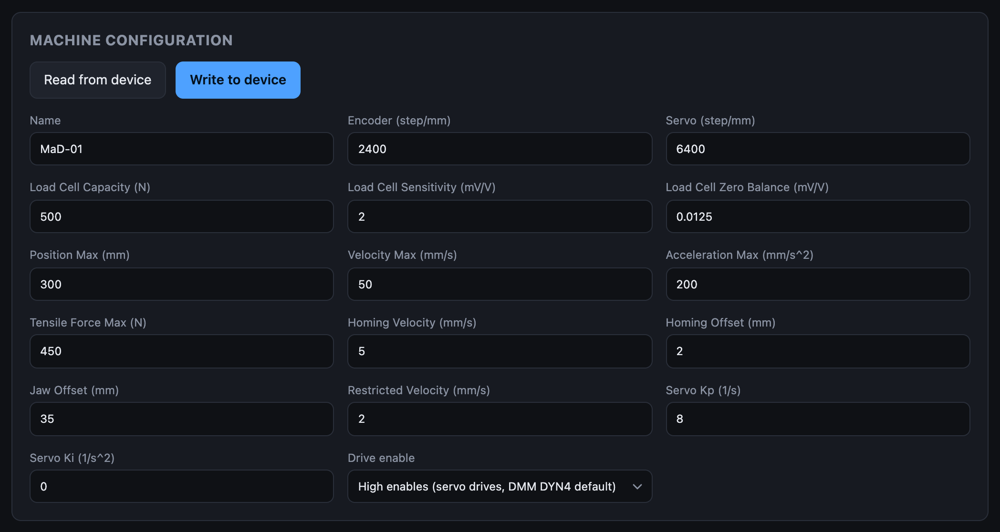

# Machine configuration

The **machine configuration** is the calibration and limits stored on the
machine itself. It describes *this* machine (its mechanics, drive and load
cell) and rarely changes. It is on the **Settings** screen, under the data
folder.

## Reading and writing

- The configuration is read from the machine when you connect.
- Edit a field, then **Write to device**. The machine stores it and keeps it
  through power cycles.
- **Read from device** re-reads it, discarding unsaved edits.

!!! info "Power-cycle after writing"
    The machine loads its configuration when it starts, so a written value
    takes effect at the next power-up. Reconnecting the app does not restart
    the machine.

!!! warning "These values calibrate the machine"
    Wrong steps/mm or load cell values make every measurement wrong, and wrong
    limits can drive the carriage past safe travel. The
    [motor calibration](motor-calibration.md) and
    [load cell calibration](load-cell-calibration.md) check them against the
    hardware.

## Fields

In the order they appear.

| Field | What it sets |
|---|---|
| **Name** | A label for this machine |
| **Encoder (step/mm)** | Encoder counts per millimetre of travel |
| **Servo (step/mm)** | Drive pulses per millimetre of travel |
| **Load Cell Capacity (N)** | The load cell's rated force, from its datasheet |
| **Load Cell Sensitivity (mV/V)** | The load cell's output at capacity, per volt of excitation. Start from the datasheet's rated output; the [load cell calibration](load-cell-calibration.md#sensitivity-from-known-weights) measures it. |
| **Load Cell Zero Balance (mV/V)** | What the load cell reads with nothing on it. The [load cell calibration](load-cell-calibration.md#zero-and-noise) measures it. |
| **Position Max (mm)** | How far the carriage is allowed to travel |
| **Velocity Max (mm/s)** | The fastest the machine will move |
| **Acceleration Max (mm/s²)** | The acceleration every move uses |
| **Tensile Force Max (N)** | The force above which the machine reports a `MACHINE_TENSION` [restriction](../troubleshooting/restrictions.md) |
| **Homing Velocity (mm/s)** | Speed used when homing |
| **Homing Offset (mm)** | Offset applied after homing |
| **Jaw Offset (mm)** | Distance from the home reference to the jaw |
| **Restricted Velocity (mm/s)** | The speed cap while a [restriction](../troubleshooting/restrictions.md) is active (an end stop, the door, a force or length limit). **0 means no cap.** |
| **Servo Kp (1/s)** | How hard the servo corrects a position error. The [motion calibration](motor-calibration.md) suggests a value. |
| **Servo Ki (1/s²)** | Removes a steady position error under load. 0 switches it off. |
| **Drive enable** | Which level of the drive's enable input turns the drive on. Servo drives such as the DMM DYN4 are on while the input is energized (**High enables**); most stepper drivers are off while it is energized (**Low enables**). If this is wrong, the drive never turns on and the carriage doesn't move. |

These are *machine* limits. The per-test limits are in the
[sample profile](sample-profiles.md), and both apply.
