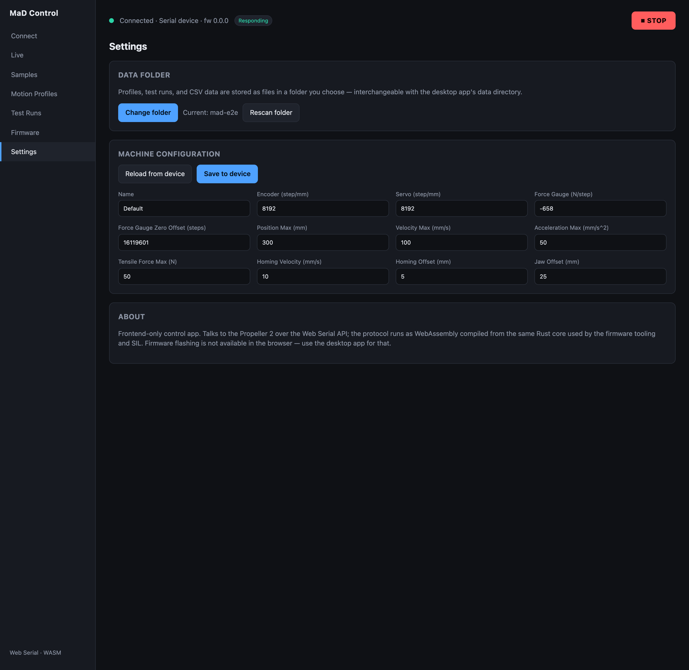

# Machine configuration

The **machine configuration** is the calibration and limits stored on the machine
itself. It describes *this* machine — its mechanics and sensors — and rarely
changes. You read and edit it on the **Settings** screen.

## Reading & writing

- The configuration loads from the device when you open **Settings** while
  connected.
- Edit a field, then **Write to device** to write it back to the machine, where it
  persists across power cycles.
- **Read from device** re-reads the configuration, discarding unsaved edits.

!!! warning "These values calibrate the machine"
    Getting the steps-per-mm or force calibration wrong will make every
    measurement wrong (and could drive the gantry past safe limits). Change these
    only if you know the machine's mechanics.

## Fields

These are the fields as they appear on the Settings screen, in order.

| Field | What it sets |
|---|---|
| **Name** | A label for this machine |
| **Encoder (step/mm)** | Encoder counts per millimetre of travel |
| **Servo (step/mm)** | Motor pulses per millimetre of travel |
| **Force Gauge (N/step)** | How much force one gauge reading step represents |
| **Force Gauge Zero Offset (steps)** | The gauge's zero point |
| **Position Max (mm)** | How far the jaw is allowed to travel |
| **Velocity Max (mm/s)** | Fastest the machine will move |
| **Acceleration Max (mm/s²)** | How hard the machine is allowed to accelerate |
| **Tensile Force Max (N)** | Force at which the machine protects itself |
| **Homing Velocity (mm/s)** | Speed used when homing |
| **Homing Offset (mm)** | Offset applied after homing |
| **Jaw Offset (mm)** | Distance from the home reference to the jaw |
| **Servo Kp (1/s)** | How hard the servo corrects a position error (8 by default; the motor calibration suggests a value) |
| **Servo Ki (1/s^2)** | Removes a steady position error under load (0 = off) |
| **Drive enable** | Which level of the drive's enable input turns the drive on. Servo drives such as the DMM DYN4 are on while the input is energized (**High enables**, the default); most stepper drivers are off while it is energized (**Low enables**). If this is wrong, the drive never turns on and the carriage doesn't move. Takes effect after a reboot. |

These are *machine* limits — distinct from the per-test limits you set in a
[sample profile](sample-profiles.md). Both are enforced, and whichever is more
conservative wins.

## Motor calibration

The **Motor calibration** panel on **Settings**, below the fields, does two
things in one run, then gives you one report:

1. **Drive and encoder.** It checks that **Encoder (step/mm)** and
   **Servo (step/mm)** match the hardware and that the encoder counts the way
   the carriage moves. It drives the carriage a short distance forward and back
   **open loop**: the servo runs its usual motion profile but ignores the
   encoder, so the drive gets exactly the pulses the move calls for, and the
   encoder is only watched. These moves are sent as `G124`, a linear move with
   the servo feedback off.
2. **Tracking.** If the first part passes, it runs a short test program
   **closed loop** and measures how closely the servo follows its encoder:
   large moves at mid and full speed, then 1 mm, 0.1 mm and 0.01 mm moves in
   both directions. From that it **suggests servo gains** (Kp and Ki).

It is **report only**. Nothing is written to the machine: you change the
fields (and **Write to device**) yourself.

!!! warning "The saved profile's motion limits must be right first"
    The tracking program is built from the profile **saved on the machine**:
    **Velocity Max**, **Acceleration Max** and **Position Max**. It swings up to
    a quarter of Position Max (at most 25 mm) in total, half either side of
    where the carriage starts, at up to Velocity Max. The panel shows the
    distances and speeds before you run it. Leave that much room each way.

### Before you run it

- Enable motion and clear any fault.
- Leave the carriage clear of both end stops, with the room the panel asks for.
- Don't start a test or jog while it runs.

**Check distance** defaults to 5 mm and **Check speed** to 1 mm/s. A shorter
distance still gives a pass or fail, but each leg loses a few encoder counts at
its ends, which matters more on a short one. Before each measured leg, a
0.5 mm move in the same direction takes up any slack, so slack doesn't count
against the ratio. The panel disables motion if the encoder moves more than
three times the distance the profile expects.

The drive-and-encoder check judges the steps/mm you have **typed**. The
tracking run moves with the steps/mm **saved** on the machine, so it only runs
when the two are the same. Otherwise the report asks you to write them and
restart first.

### Reading the result

**Drive and encoder** shows a **pass**, **warning** or **error**, then what the
run measured:

> Sent 32000 pulses each way → encoder moved **11993** counts (expected 12000)

The pulses are what the machine sent, and the counts are what the encoder saw
come back (averaged over both directions). If the encoder counted only one way,
or counted the same way in both directions, an average would point at the wrong
fault, so the line shows each direction's counts instead (for example
"forward 2400 · back 2400"). *Expected* is what your two steps/mm values
predict. When they don't match, a **Fix** line gives the value to
change. One run only measures the ratio of the two values, so it gives both
options. Trust the one you can work out from datasheets (usually the encoder:
counts per revolution ÷ mm per revolution).

It also reports:

- **Lost motion on reversal**: how far the carriage falls short on the move
  straight after a change of direction. This is slack, backlash or the motor
  settling against friction. Harsh reversals (a high Acceleration Max) make it
  larger.
- **Drive lag**: how far behind the pulses the encoder runs at a steady speed.

**Tracking** sums up the program: the largest stop error, the peak following
error (the gap between where the trajectory is and where the encoder is), the
largest overshoot, and the longest settle time. **Each move** expands to the
per-move numbers. These are measured against the machine's **own encoder**:
they show how well the servo follows it, not the carriage's true position, which
needs an external reference.

**Suggested servo gains** gives a starting Kp and Ki, with the reasons:

- **Kp** is the largest that is still safe: at most 0.5 ÷ the drive lag (above
  that, corrections arrive too late and the carriage rings), and at most
  Acceleration Max ÷ Velocity Max (above that, an ordinary error asks for more
  than the acceleration limit).
- **Ki** is only suggested when moves end consistently short (or past) in their
  direction of travel, at Kp² ÷ 8. Otherwise it stays 0, because an integral
  with nothing to correct only adds overshoot.

To try them, enter **Servo Kp (1/s)** and **Servo Ki (1/s^2)**, **Write to
device**, restart the machine, and run the calibration again to compare.

### What the findings mean

| Finding | What it means | What to do |
|---|---|---|
| Calibration passed | The encoder follows the motor in the right direction, and the two steps/mm values match the hardware (within 2%) | Nothing |
| The encoder did not count in either direction | No encoder counts at all | Check that the encoder is coupled to the motor, that A and B reach the board, that it shares a ground with the board, and that its outputs have pull-ups |
| The encoder counted only one way | One channel is missing, or the carriage did not move one way | Check the encoder wiring and that the carriage moves both ways |
| The encoder counts the opposite way to the motion | The encoder is reversed relative to the drive. The servo loop would run away as wired | Swap encoder A and B, or reverse the drive's direction setting |
| The encoder counted the same way whichever way the carriage was driven | The carriage did not reverse, or the direction signal is wrong | Check the drive direction wiring |
| The steps/mm entered don't match the hardware | The counts that came back differ from the expected counts by more than 2%, so one of the two steps/mm values is wrong | Use the **Fix** line: change the value you trust less |
| Forward and back differ by *n*% | The two directions disagree by more than 2% | Look for slip, backlash or lost pulses |

### Runs that don't finish

| Message | Why | What to do |
|---|---|---|
| Not run: enable motion (and clear any fault) first | Motion was off or the machine was faulted | Enable motion, clear the fault |
| Not run: the machine is busy with a move or a test | A test was running, or the machine turned the move down | Wait for it to finish |
| Not run: no live position from the machine | No samples are arriving | Check the connection |
| Stopped: motion was disabled | Motion was turned off mid-run, or a fault disabled it | Clear the cause, run it again |
| Stopped: the carriage was still moving long after the pulses should have finished | It hadn't settled after twice the move's time plus 3 seconds | Check the drive and the mechanics |
| Stopped: the encoder moved over three times further than the profile expects | The drive is set much finer than servo steps/mm says, or encoder steps/mm is far too low | Check both values |
