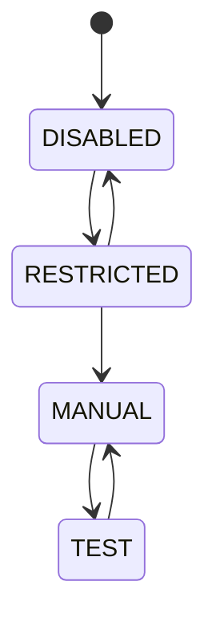

# States, faults & restrictions

The machine reports a state, and — when something is wrong — a fault or a
restriction. These appear as badges on the [Live](live-monitoring.md) screen.
This page explains what each one means.

The short version: a **fault** stops everything until its cause is fixed (some
also need acknowledging, a few need a reboot); a **restriction** just limits
motion and clears itself once you fix the cause.

## States

| State | Meaning |
|---|---|
| **DISABLED** | Motion not enabled — the safe default |
| **RESTRICTED** | Motion enabled but limited by an active restriction |
| **MANUAL** | Free motion control from the app |
| **TEST** | Automated test execution from a motion profile |

## Faults

No motion is permitted while a fault is showing. The badge shows the code in
the first column below.

Six faults **latch**: the four emergency-stop faults (`ESD_POWER`,
`ESD_SWITCH`, `ESD_UPPER`, `ESD_LOWER`), `SERVO_STALL` and `FORCE_OVERLOAD`.
When one of them stops a machine that had motion enabled, it stays showing
after its cause has gone, and motion stays off, until you click **Disable
motion** to acknowledge it. The machine never switches the drive back on by
itself. Then click **Enable motion**. No reboot is needed (see
[Clear a servo stall](manual-control.md#clear-a-servo-stall) for the stall).
If the cause is still there when you acknowledge — the emergency stop still
pressed — the fault stays until it is released. With motion already off, the
emergency-stop faults simply follow their inputs.

When several faults are active at once, the badge names the cause first: a
pressed emergency stop is shown as `ESD_SWITCH` even though the circuit's lost
power (`ESD_POWER`) is active too.

Reconnecting the app does not restart the machine: power-cycle it
([Rebooting the machine](firmware-and-diagnostics.md#rebooting-the-machine)).

| Badge | What it means | What to do |
|---|---|---|
| `NONE` | No fault — normal | — |
| `COG` | One of the controller's processor cores stopped running | Reboot the machine. If it repeats, note what you were doing and open an issue |
| `WATCHDOG` | Part of the controller stopped responding and the machine shut itself down | Reboot the machine |
| `ESD_POWER` | The emergency-stop circuit has no power, and none of the inputs below explains it | Check the circuit's wiring and power and reset it, then click **Disable motion** and **Enable motion** |
| `ESD_SWITCH` | The emergency stop was pressed | Release it and reset the circuit, then click **Disable motion** and **Enable motion** |
| `ESD_UPPER` | The upper end-of-travel emergency switch tripped | Move the gantry off the switch by hand, reset the circuit, then click **Disable motion** and **Enable motion** |
| `ESD_LOWER` | The lower end-of-travel emergency switch tripped | Move the gantry off the switch by hand, reset the circuit, then click **Disable motion** and **Enable motion** |
| `SERVO_COMMUNICATION` | Lost contact with the motor controller | Check the motor wiring, then reboot |
| `FORCE_GAUGE_COMMUNICATION` | Lost contact with the force gauge | Check the force-gauge cable, then reboot |
| `SERVO_STALL` | The carriage stopped moving while the drive was still pushing it | Clear the obstruction, click **Clear stall (disable motion)**, then **Enable motion**. No reboot needed |
| `FORCE_OVERLOAD` | The force passed 120% of the load cell's rated capacity, in tension or compression, in a jog or a test | Relieve the load by hand, click **Disable motion**, then **Enable motion**. Check the load cell capacity in the [machine configuration](machine-configuration.md) |

## Restrictions

A restriction **limits motion while a condition holds**, and **clears by itself**
as soon as the cause goes away. No reboot needed — just resolve the cause.

| Badge | What it means | What to do |
|---|---|---|
| `NONE` | No restriction — normal | — |
| `SAMPLE_LENGTH` | The sample reached the maximum extension set in its profile | Jog back, or raise the limit in the [sample profile](sample-profiles.md) |
| `SAMPLE_TENSION` | The sample reached the maximum force set in its profile | Jog back, or raise the limit in the sample profile |
| `MACHINE_TENSION` | Force reached the machine's own protection limit | Jog back to relieve the load |
| `UPPER_ENDSTOP` | The gantry reached the upper travel limit (jaws closest together). Motion toward it stops and further moves that way are refused, in a jog and in a test; a test stops there | Jog away from the limit |
| `LOWER_ENDSTOP` | The gantry reached the lower travel limit (jaws furthest apart). Motion toward it stops and further moves that way are refused; a test stops there | Jog away from the limit |
| `DOOR` | The door is open | Close the door |

## Where you'll see them

These show up as **State badges** on the [Live](live-monitoring.md) screen —
hover any badge for a short explanation without leaving the screen. There's also
a separate **Motion** badge that simply reports whether the machine is disabled,
waiting, or moving.

For the safety reasoning behind all this, see
[the machine](../how-it-works/the-machine.md#safety-model).
