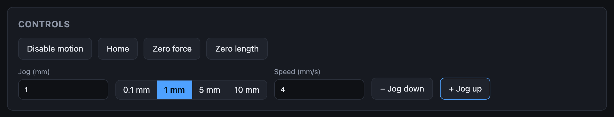
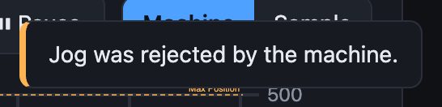
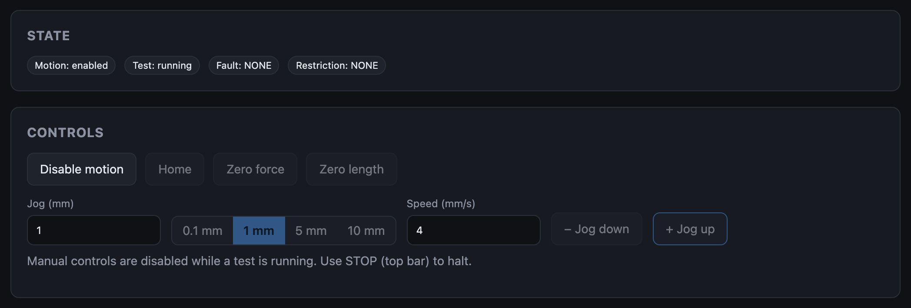

# Manual control

The **Controls** panel on the [Control](live-monitoring.md) screen positions the
carriage, homes the axis, and zeroes force and length before a test.

## Enable motion

The machine starts with motion disabled. Click **Enable motion**; the
**Motion** badge changes to *enabled* and the button becomes **Disable
motion**.

Enabling motion permits movement. It does not move anything.

The button changes with the machine's state:

| Button | When |
|---|---|
| **Enable motion** | Motion is off and nothing is wrong |
| **Disable motion** | Motion is on, **or** a fault is showing (the machine refuses to enable while faulted, so the button offers the disable) |
| **Clear stall (disable motion)** | A `SERVO_STALL` fault is showing |
| **Motion …** (greyed out) | The machine has not reported its state yet |

If the button does nothing or a banner is showing, see
[The machine won't move](../troubleshooting/machine-wont-move.md).

## When the controls are locked

**Jog** and **Home** are greyed out while motion is off, while the machine has
not reported its state, while it is faulted, and while a test is running.
Hover a locked button for the reason. **Zero force** and **Zero length** don't
move the carriage, so they work with motion off; they lock only while the
state is unknown or a test is running.

## Jog

1. Set **Jog (mm)**: type a distance or pick **0.1 / 1 / 5 / 10 mm**.
2. Set **Speed (mm/s)**.
3. Click **+ Jog up** or **− Jog down**.

A blank or zero distance or speed is refused with a message. If the machine
turns a jog down, a toast says so:

## Home, Zero force, Zero length

| Button | Action |
|---|---|
| **Home** | Homes the axis to its reference |
| **Zero force** | Makes the current load the origin of **Sample Force** |
| **Zero length** | Makes the current position the origin of **Sample Position** (the gauge length) |

Zeroing defines the **sample** coordinates a test records. **Machine Force**
and **Machine Position** stay absolute.

## During a test

Jog, home and zero are locked while a test is running. **Disable motion**
and the status bar's **STOP** stay available: either one disables motion,
which ends the test.

## Clearing a servo stall

A stall means the carriage stopped following the drive. It stays set until you
acknowledge it:

1. Clear whatever is blocking the carriage.
2. Click **Clear stall (disable motion)**.
3. Click **Enable motion**.

[Faults → SERVO_STALL](../troubleshooting/faults.md#servo_stall) has the
details.
