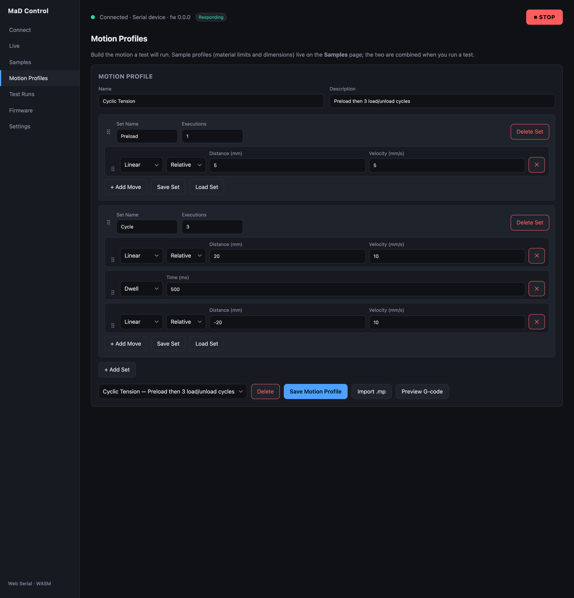
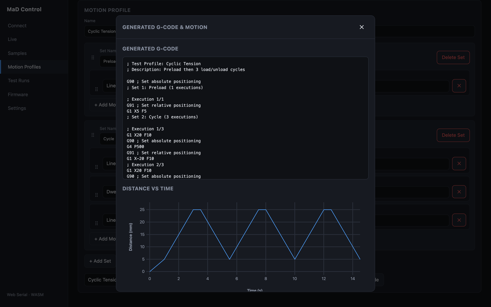

# Motion profiles

A **motion profile** defines what the machine *does* during a test — a sequence
of moves, grouped into repeatable **sets**. You build it on the **Motion
Profiles** screen.

## Structure

A motion profile has a **name** and **description**, and contains one or more
**sets**. Each set has:

- a **name**,
- an **executions** count (how many times the set repeats),
- and an ordered list of **moves**.

Both **sets** and **moves** are **drag-reorderable** (grab the handle on the
left). You can add and delete sets and moves freely.

## Move types

| Type | Parameters | What it does |
|---|---|---|
| **Linear** | position + velocity | A controlled pull or return to a position. |
| **Dwell** | time (ms) | Hold position for a fixed time. |
| **Waveform** | a waveform type, then that type's parameters | **Sine:** amplitude, frequency — one cycle that starts and ends at rest where the gantry is, swinging out to twice the amplitude: up first for a positive amplitude, down first for a negative one. **Sigmoid:** position, velocity, acceleration — an S-curve move: like a linear move, but its acceleration rises and falls smoothly instead of switching on and off. **Chirp:** amplitude, start and end frequency, duration — a sine whose frequency sweeps steadily from start to end, for seeing how a material responds across loading rates in one run. The duration is rounded to whole cycles so it ends at rest where it started. |

Every position is **absolute**: sample extension in mm, measured from zero length.

**Repeating a sine.** One sine move is one cycle. Put it in a set on its own and
use the set's **executions** for the number of cycles; back-to-back cycles run
as one continuous wave. The gantry's position when it starts is the bottom (or,
for a negative amplitude, the top) of the stroke, so to oscillate around a
position, first move one amplitude below (or above) it. A back-and-forth at constant speed (a triangle
wave) is a set of two linear moves, out and back, repeated the same way.

For the **Waveform** move, the app shows the live **peak velocity**, **peak
acceleration** and **duration**, and warns you if they exceed the machine's
limits.

A **sine** runs as the machine's own canned cycle, so long cyclic runs continue
unattended. It is a cosine from rest: starting and ending at a peak, where the
wave's own speed is zero, means the gantry follows it exactly from the first
moment, with no extra moves before or after.

A **sigmoid** is sent as a chain of short straight moves whose speeds follow the
S-curve; the machine carries its speed from one into the next, so it runs as one
smooth motion. It takes a little longer than a linear move at the same velocity
and acceleration, because its acceleration builds up gradually.

A waveform the machine cannot physically deliver — too fast for its amplitude,
say — is **refused** by the machine rather than run at a reduced amplitude, so a
specimen never sees a gentler loading than the report claims. The app warns
before the run when a waveform, or any other move, goes beyond the machine's
limits (see [Running a test](running-a-test.md#start-a-run)). Straight and
sigmoid moves faster than the machine allows are not refused: they run at its
speed and acceleration limits, so they take longer than written. Hand-written G-code can also hold
at either peak and load faster than it unloads; see
[Waveform motion control](../how-it-works/waveform-motion-control.md).

## Preview the motion

Click **Preview G-code** to see a distance-vs-time chart of exactly what the
machine will do, along with the instructions that will be sent:

This is a good habit before running an unfamiliar profile — the chart makes an
accidental over-long pull or an inverted direction obvious at a glance.

## Saving, loading, importing

- **Save motion profile** stores it in your [data folder](settings-and-data.md);
  it then appears in the **Load saved profile…** dropdown.
- You can also **Save / Load individual Sets**, so a reusable set (e.g. a cyclic
  block) can be shared across profiles.
- **Import** loads a profile from a `.mp` file — see [file formats](file-formats.md).
- The save button shows **Saved ✓** when it worked, and leaving with unsaved
  changes asks first.

!!! warning "Old motion profiles must be rebuilt"
    Profiles saved before this format (relative moves; waveforms with a cycle
    count, centre, holds, skew, phase or a triangle shape) are **refused** on
    load, import and run, with a message naming the move. They are not
    converted: read as the current format they would mean something else (a
    relative +10 mm move would drive to 0 mm), so rebuild them.
