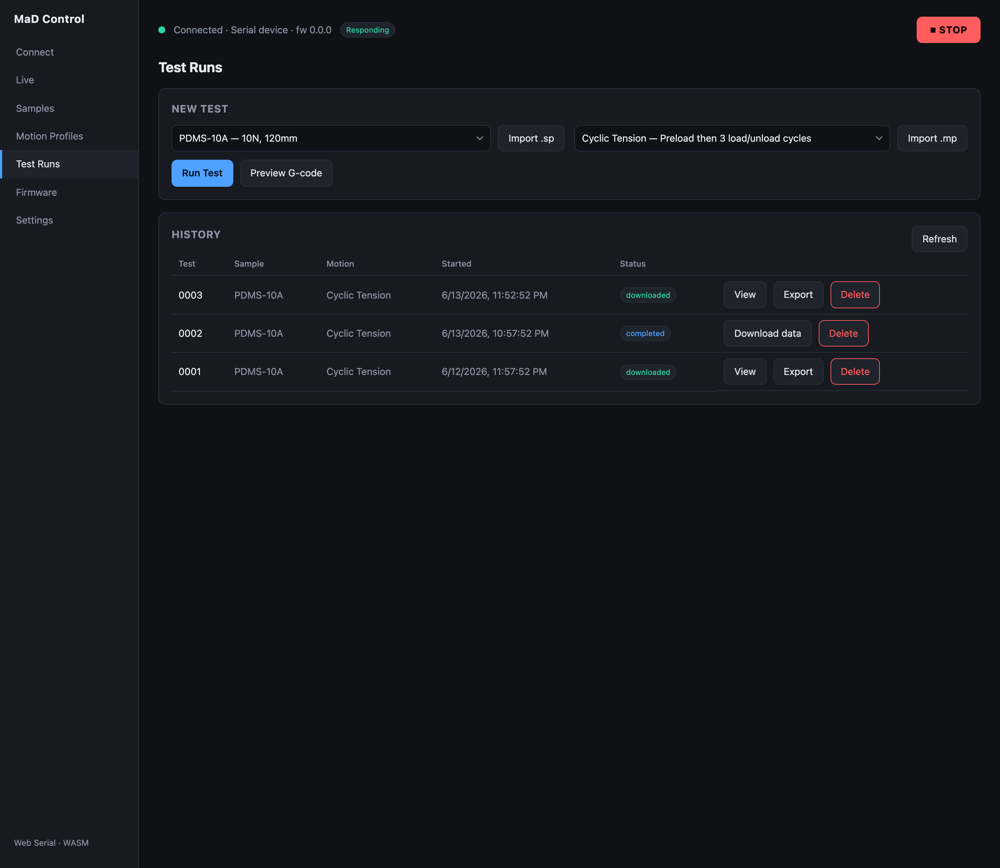

# Running a test

You run tests from the **Control** screen, so the live readouts and charts are
in view while the test runs. The **New test** card combines a sample profile
with a motion profile and starts the run, and says when the machine finishes.
Every run is recorded in the **History** table on the **Test runs** screen.

## Before you run

You'll want:

1. A **connected, responding** machine ([Connect](connecting.md)).
2. A **data folder** chosen ([Settings](settings-and-data.md)) so results can be
   saved.
3. A **sample profile** ([Samples](sample-profiles.md)) and a **motion profile**
   ([Motion profiles](motion-profiles.md)).

## Start a run

1. In **New test**, select a saved **sample** profile and a saved **motion**
   profile (or **Import** a `.sp` / `.mp` on the spot).
2. Optionally click **Preview G-code** to review the exact motion.
3. Click **Run test**.

When you run, the app:

- pushes the selected **sample profile** to the firmware (so its limits are
  enforced),
- reserves a test name and creates a **run record**,
- captures the **gauge length** and **initial machine position** from the latest
  sample,
- generates the G-code and **uploads** it to the machine's SD card,
- enables motion and **starts** the test.

The run appears in **History** on **Test runs** with a *running* badge.

## While it runs

The machine executes the motion **autonomously from its SD card**, and the
readouts and charts on **Control** follow it live. The **Run** button reflects
the firmware's `testRunning` state. When the firmware reports it has finished,
the card says so and the run is marked **completed**. Stay on **Control** until
then; if you leave, use **Mark done** in History afterwards.

!!! warning "Losing the UI doesn't stop the test"
    The test keeps running even if you close the tab or unplug USB — the app just
    reconnects to keep monitoring. If the link is lost mid-test the run is marked
    **error** (its data may still be downloadable after reconnecting). For runs
    that get stuck in *running*, the history row offers **Mark done / Mark
    failed** actions, and a watchdog warns if the firmware never reports
    completion.

If the sample hits its **Max force** or **Max displacement**, the firmware stops
the test and raises a warning notification (you'll see a toast).

## After it finishes

Once a run shows **completed**, click **Download data** to pull the recorded CSV
off the machine, then **View** to analyse it — see
[Test history & analysis](test-history-and-analysis.md).
