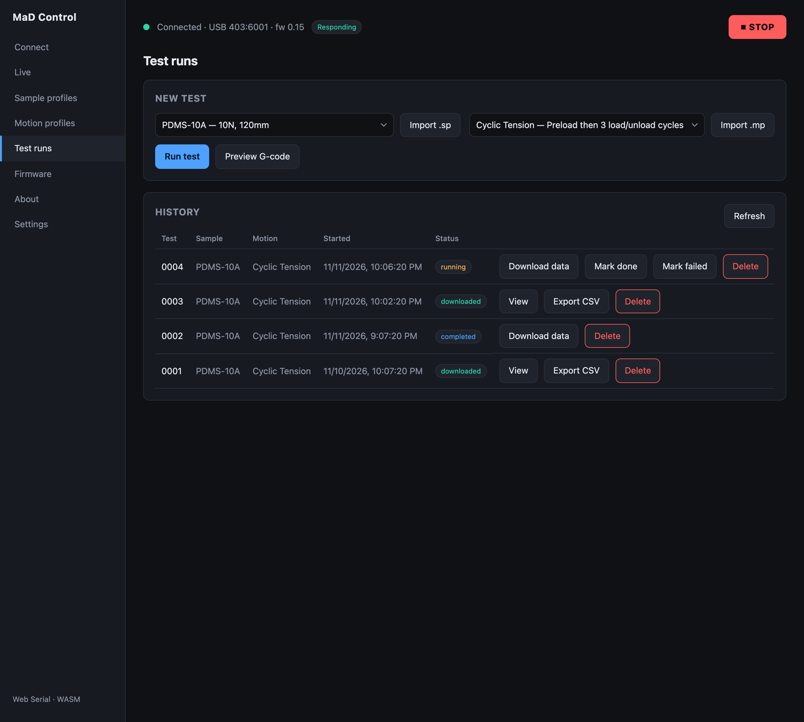

# Running a test

You run tests from the **New test** panel on the **Control** screen. It
combines a sample profile with a motion profile and starts the run. The
**History** table on the **Test runs** screen tracks every run.

## Before you run

You'll want:

1. A **connected, responding** machine ([Connect](connecting.md)).
2. A **data folder** chosen ([Settings](settings-and-data.md)) so results can be
   saved.
3. A **sample profile** ([Samples](sample-profiles.md)) and a **motion profile**
   ([Motion profiles](motion-profiles.md)).

## Start a run

1. In **New test**, select a saved **sample** profile and a saved **motion**
   profile (or **Import** a `.sp` / `.mp` on the spot).
2. Optionally click **Preview G-code** to review the exact motion.
3. Click **Run test**.

Before it runs, the app checks the test against the
[machine configuration](machine-configuration.md) and the sample profile:
speed, acceleration (including short moves too short to reach their speed),
travel and force. Each problem is listed under the profiles, for example
*Motion profile speed of 60 mm/s exceeds machine limit of 50 mm/s*. With any
listed, **Run test** asks again: **Cancel** to change the profiles, or **Run
anyway**.

A motion profile in the old format can't be run; the panel names the move to
rebuild (see [Motion profiles](motion-profiles.md)).

When you run, the app:

- pushes the selected **sample profile** to the firmware (so its limits are
  enforced),
- reserves a test name and creates a **run record**,
- captures the **gauge length** and **initial machine position** from the latest
  sample,
- generates the G-code and **uploads** it to the machine's SD card,
- enables motion and **starts** the test.

The run appears in **History** with a *running* badge.

## While it runs

The machine executes the motion **autonomously from its SD card**. The **Run**
button reflects the firmware's `testRunning` state, and the run is marked
**completed** when the machine reports it has finished, whichever screen you
are on.

!!! warning "Losing the UI doesn't stop the test"
    The test keeps running even if you close the tab or unplug USB — the app just
    reconnects to keep monitoring. A run still marked *running* when the app
    reconnects to an idle machine is marked **completed**, so its data can be
    downloaded. If the machine runs well past the profile's expected time, the
    panel warns that the firmware may be stuck; the history row's **Mark done /
    Mark failed** resolve it.

If the sample reaches its **Max force** or **Max displacement**, the machine
stops the test and the app shows a warning toast (*Test stopped: sample limit
exceeded*). Disabling motion, with **STOP** or **Disable motion**, also ends
the test (*Test aborted: motion disabled*), and so does any
[fault](../troubleshooting/faults.md).

## After it finishes

Once a run shows **completed**, click **Download data** to pull the recorded CSV
off the machine, then **View** to analyse it — see
[Test history & analysis](test-history-and-analysis.md).
